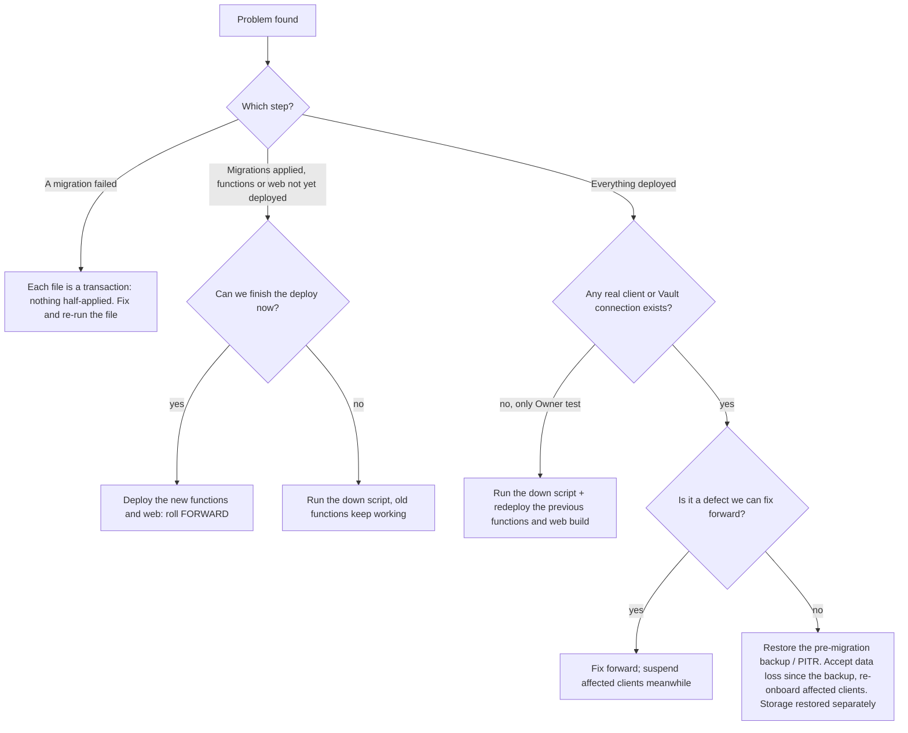

# Production backup and rollback plan for the multi-tenant migrations

> **A plan and a tested local rollback script. Nothing here was executed against the hosted project**, and applying the migrations to hosted Supabase still needs your explicit approval.
> Supabase facts come from its documentation read on 2026-11-16 (`.../platform/backups`, `.../platform/migrating-within-supabase/dashboard-restore`, `.../backup-restore`, `.../database/vault`).
> Status labels: see [README.md](README.md#status-labels-used-in-all-documents). Related: [MULTI_TENANT_MIGRATIONS.md](MULTI_TENANT_MIGRATIONS.md) · [VAULT_BOUNDARY_AND_RECOVERY.md](VAULT_BOUNDARY_AND_RECOVERY.md) · [MIGRATION_AND_POLICY_REVIEW.md](MIGRATION_AND_POLICY_REVIEW.md)

## 1. The gap that was found and what closes it

The four migrations were additive but had **no down-migration**. It now exists and has been **tested locally**:

| Item | File | State |
| --- | --- | --- |
| Rollback script | `supabase/rollbacks/20261118_multi_tenant_down.sql` (outside `supabase/migrations/`, so no tool applies it by accident) | Tested locally |
| Schema signature (columns, constraints, indexes, function bodies, privileges, policies, 260 lines) | `supabase/rollbacks/schema_signature.sql` | Used as the proof |
| Safety guard | The script **refuses** to run when a second tenant, a Vault connection, a second connection, or data outside Owner (test) exists | Tested (refusal changed nothing) |
| Snapshot | Before changing anything it copies the new tables (without the Vault reference) and the tenant mapping of every row into `rollback_snapshot` | Tested |

### Local proof (one continuous run)
| Step | Result |
| --- | --- |
| Restore the **pre-migration backup** into a scratch database and take its schema signature | 260 signature lines |
| Add a second tenant, run the rollback | **Refused** with a clear message; schema unchanged |
| Remove it, run the rollback on the real local data (5,890 messages, 717 conversations) | Completed in one transaction |
| Compare the rolled-back schema with the pre-migration signature | **Identical** (no differing line) |
| Compare data (md5 of every pre-existing table and file list) before and after | **Identical** |
| Run the **original** delete-for-me SQL suite from git `HEAD` on the rolled-back schema | 25 / 25 |
| Call the old single-tenant `ingest_incoming` and `apply_message_status(3 args)` | Work; tenant tables are gone |
| Roll forward (apply the four migrations again) | Schema identical to the forward schema; data identical; new suites pass |
| Snapshot contents | 1 tenant, 1 connection (no token reference), 119 audit rows, 717 + 5,890 tenant mappings |

**Limits of this proof:** it is a local database, not hosted. The old *Edge Function code* was not run end to end against the rolled-back database (only its SQL functions and the original SQL tests). After a roll-forward the legacy connection's phone number id is learned again from the next webhook and the audit rows stay in `rollback_snapshot` (restoring them is a manual copy).

## 2. What Supabase's documentation says that shapes the plan

| Fact | Plan consequence |
| --- | --- |
| Daily backups exist for **Pro, Team and Enterprise** projects (7, 14, 30 days); free-tier projects should export with the CLI `db dump` and keep off-site copies | The plan must first learn which plan the hosted project is on (**not verified**) |
| **PITR** is an add-on (Pro+); WAL is archived about every two minutes (worst-case RPO about two minutes); with PITR enabled daily backups stop | If available, enable it **before** the migration window and note the restore point |
| A restore makes the project **inaccessible** while it runs; duration grows with database size | Plan a maintenance window and tell clients |
| Database backups **do not include Storage objects** (only their metadata); an old backup does not restore objects deleted since | Back up Storage separately (the hosted bucket currently has about 2 objects, but verify) |
| Daily backups do not contain custom role passwords | Not used by this project; note if custom roles are added |
| Same-project restores and PITR keep the project's Vault key; "Restore to a new project" copies it; a **manual** dump/restore to a new project does not | See the Vault document |
| `supabase db dump` can produce `roles.sql`, `schema.sql` and `data.sql` (with `--use-copy --data-only`); extensions must be enabled in a new project | Use these for the independent logical copy |
| Edge Function secrets and Auth settings are not part of a database backup (inferred from the documentation: they are project settings, not database content; **Unverified**) | Record them separately (names only) |

## 3. Before the maintenance window (owner or approved session; read-only except the backup itself)

| # | Step | Why |
| --- | --- | --- |
| 1 | Confirm the **plan** and whether daily backups or PITR are on; if PITR is available, enable it now | Defines the recovery point |
| 2 | Take a **manual logical backup** with the CLI (`roles`, `schema`, `data` with `--use-copy`), keep it off the project (encrypted storage) | Independent of the dashboard backups |
| 3 | **Copy all Storage objects** of bucket `files` and record names, sizes, SHA-256 | Backups exclude them |
| 4 | Record the **fingerprint**: run `supabase/tests/tenant_migration_fingerprint.sql` on hosted (read-only SELECTs) and save the output; record row counts | Before/after proof |
| 5 | Record **secret names** (`supabase secrets list`), Auth settings, `config.toml`, the deployed function list, and the **git commit** of the functions and web app currently live | Needed to restore the old behaviour |
| 6 | Verify the hosted prerequisites: `supabase_vault` extension available; `WA_PHONE_ID`, `WA_TOKEN`, `WA_APP_SECRET`, `WA_VERIFY_TOKEN` present (finding F8) | The legacy test number must keep working |
| 7 | **Rehearse**: restore the backup into a scratch project ("Restore to a new project"), apply the four migrations there, run the fingerprint, `multi_tenant.sql` and the rollback script on that copy, then delete the scratch project | Never rehearse on live data |
| 8 | Prepare the previous build: the previous commit of `supabase/functions/*` and `web/` ready to redeploy | Rollback needs the old code too |
| 9 | Agree the window, the person who decides go/no-go, and the message to anyone using the app | |
| 10 | Take a screenshot of Meta's webhook configuration (callback URL, subscribed fields) and **do not change it** | Evidence only |

## 4. The window (needs your approval; the order matters)
1. Pause: tell users; (optional) set the old webhook function to return 503 so Meta retries later. Meta's retry schedule is **not verified**, so do not rely on it for long gaps.
2. Apply migrations 5, 6, 7, 8 in order, each as its own single transaction; stop at the first error (each is idempotent and re-runnable).
3. Compare the fingerprint to step 4 of section 3: **must be identical**.
4. Deploy the five Edge Functions with the same `verify_jwt` settings as `supabase/config.toml`; deploy the web app.
5. Verify (go/no-go): `wa-diagnose`; a signed test webhook for the test number binds the legacy connection and stores; sign in as the admin; Owner (test) chats and files open; the console loads; `send` in dry-run or to an allowed test number works if a valid token exists.
6. Keep both feature flags **off**.
**No-go criteria (roll back):** fingerprint differs; webhook cannot store; admin cannot sign in; Owner (test) data missing.

## 5. Rollback decision tree

Steps for the **down-script path (D / D2)**:
1. Export `audit_logs` and the ledger if you want them beyond the snapshot (the snapshot keeps them inside `rollback_snapshot`).
2. Run `supabase/rollbacks/20261118_multi_tenant_down.sql` (one transaction; refuses if unsafe).
3. Compare the schema signature with the one from the pre-migration backup (or the reference signature kept in this repository's history): **must be identical**; compare the fingerprint.
4. Redeploy the previous Edge Functions and web build (the old webhook calls `ingest_incoming` with the old payload and the three-argument status function, which the script restores).
5. Verify the same go/no-go list as section 4 step 5; re-check Meta's webhook still points at the same URL.
6. Keep `rollback_snapshot` until you decide to roll forward or drop it (`drop schema rollback_snapshot cascade`).
**Backup-restore path (B):** use PITR to a point just before step 2 of the window if it exists, otherwise the manual logical backup; expect the project to be unavailable during the restore; restore Storage objects separately; then re-run the verification list. Every message received after the restore point must be considered lost (WhatsApp may redeliver recent webhooks; **unverified**).

## 6. Time and risk estimate (estimates, not measurements on hosted)
| Phase | Estimate |
| --- | --- |
| Preparation and rehearsal (section 3) | half a day to one day |
| Window (section 4) | 15-30 minutes on this data size |
| Down script on this data size | seconds (locally: one transaction on 5,890 messages) |
| Restore from backup | depends on size; the project is offline during it |
Residual risks: old function code not exercised end to end against a rolled-back hosted database; unknown plan and backup retention; Meta retry behaviour; Storage objects outside database backups.

## 7. Approval needed
- Approve a **rehearsal on a scratch project** (needs you to create it or to authorise it).
- Approve the **maintenance window** and the deployment order above.
- Confirm the Supabase plan and enable PITR if available.

## Phase 2.1 rollback (added 2026-11-18)

`supabase/rollbacks/20261119_phase21_down.sql` returns the schema to the Phase 2 state. It **refuses** (changing nothing) if (1) quarantined webhook events are still waiting (they are customer messages that were never stored) or (2) any login still has a temporary password (the rollback would unlock it, re-opening F1). Redeploy the Phase 2 Edge Functions **before** rolling the schema back, because the Phase 2.1 functions call objects the rollback removes. Rehearsal: `supabase/rollbacks/rehearse_phase21_local.sh <sig> <fingerprint>`; results in `docs/PHASE2_1_SECURITY_REPORT.md`.
