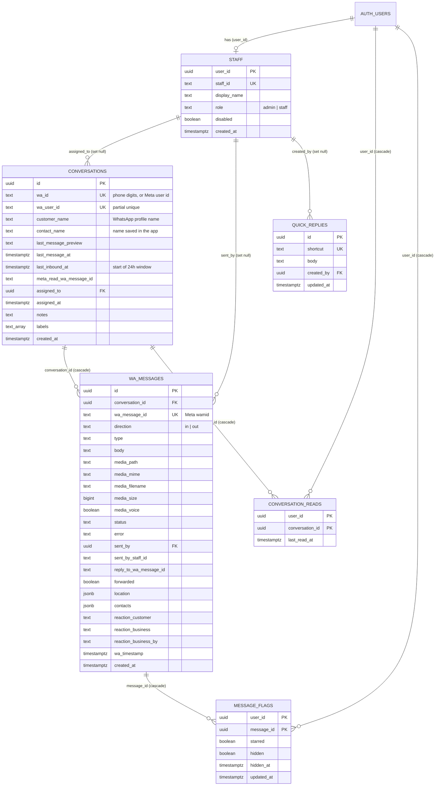

# Database documentation

> **Phase 2 notice (2026-11-16):** this document describes the single-tenant schema (migrations 1-4). Four newer migrations add tenants, connections, Vault tokens and tenant isolation; see MULTI_TENANT_MIGRATIONS.md. Table and policy details here are out of date for conversations, wa_messages, quick_replies, staff and storage.

> Status labels: see [README.md](README.md#status-labels-used-in-all-documents).
> Everything below was verified two ways: against `supabase/migrations/*.sql` and against the **live hosted database**
> (system catalogs, schema only; no message contents were read for this document).
> Related: [BACKEND_DOCUMENTATION.md](BACKEND_DOCUMENTATION.md) · [MESSAGE_DELETION_DOCUMENTATION.md](MESSAGE_DELETION_DOCUMENTATION.md) ·
> [SECURITY_DOCUMENTATION.md](SECURITY_DOCUMENTATION.md)

## 1. Overview

PostgreSQL 17.11 on Supabase. Six tables in schema `public`, **no triggers**, 22 functions (21 from this project plus one
Supabase platform helper, see 8), row level security **enabled on all six tables**, and a private Storage bucket `files`.

Design rules that explain the whole schema:

1. **Clients can only read tables.** `authenticated` has `SELECT` and nothing else on every table; `anon` has nothing.
2. **All writes go through functions.** Staff-facing writes are `SECURITY DEFINER` RPCs that check `is_active_staff()`;
   webhook/sending writes are RPCs executable only by `service_role` (Edge Functions).
3. **Per-user data is keyed by `auth.uid()`**, taken from the login session, never from a client parameter.
4. **Nothing is ever hard-deleted by the application.** (The deleted-for-me feature is a soft delete.)

## 2. Migrations

Applied in file-name order; each is idempotent (safe to run twice). `whatsapp_setup.sql` at the repository root is the
**concatenation of all migrations** (`npm run check:sql` compares them; `node scripts/check-sql-sync.mjs --fix` rebuilds it).

| Migration | Adds |
| --- | --- |
| `20261114000000_whatsapp_inbox.sql` | Tables `staff`, `conversations`, `wa_messages`, `conversation_reads`; indexes; `is_active_staff()`, `is_admin()`; RLS + select policies; realtime publication; private bucket `files` + storage policies; RPCs `take_conversation`, `release_conversation`, `mark_conversation_read`, `unread_counts`; `message_preview`; first versions of `ingest_incoming_message`, `create_outgoing_message`, `apply_message_status`. |
| `20261115000000_whatsapp_features.sql` | Columns for every Cloud API message type, replies, reactions, location, contacts, voice flag, size, business-scoped user id, notes, labels, `meta_read_wa_message_id`; widened `type`/`status` checks; tables `message_flags`, `quick_replies`; bucket widened to 16 MiB and more mime types; replaces the two old ingest/create functions with `ingest_incoming(jsonb)` and `create_outgoing(jsonb)`; `apply_message_status` (adds `played`), `apply_customer_reaction`, `set_message_flags`, `save_quick_reply`, `delete_quick_reply`, `update_conversation_info`, `search_messages`; new `message_preview`. |
| `20261116000000_contacts.sql` | `conversations.contact_name`; RPCs `start_conversation`, `rename_contact`. |
| `20261117000000_message_delete.sql` | `message_flags.hidden_at` (+ one-time backfill); RPCs `delete_message_for_me`, `restore_message_for_me`, `visible_last_messages`; updated `set_message_flags`. |

**How they were applied to the hosted project.** The first three were run as SQL (whole `whatsapp_setup.sql`, via the
Supabase Management API / SQL editor); the fourth was applied as a single file through the Management API
(`POST /v1/projects/<ref>/database/query`) after a before/after hash check of all messages. Consequently the hosted
project has **no `supabase_migrations.schema_migrations` history table** (the live query for it failed with "relation does
not exist"). If `supabase db push` is ever used, mark these four versions as applied first (see
[DEPLOYMENT_AND_OPERATIONS.md](DEPLOYMENT_AND_OPERATIONS.md)). The local stack applies them through `supabase start`.

## 3. Entity-relationship diagram

## 4. Tables

### 4.1 `staff` - who may use the system
| Column | Type | Notes |
| --- | --- | --- |
| `user_id` | uuid PK | FK -> `auth.users(id)` ON DELETE CASCADE |
| `staff_id` | text, unique | check `^[A-Z0-9]{3,20}$` |
| `display_name` | text, default `''` | |
| `role` | text, default `'staff'` | check in (`admin`,`staff`) |
| `disabled` | boolean, default false | a disabled user fails `is_active_staff()` immediately |
| `created_at` | timestamptz | |

Used by RLS and by the Edge Functions. The single app login corresponds to one `admin` row; the hosted table has 2 rows.

### 4.2 `conversations` - contacts and chats (one row per phone number)
There is **no separate contact table**: a contact *is* a conversation row.

| Column | Type | Notes |
| --- | --- | --- |
| `id` | uuid PK | |
| `wa_id` | text, **unique** | phone digits with country code; or Meta's business-scoped user id when the number is hidden. This is the address messages are sent to. |
| `wa_user_id` | text | Meta business-scoped user id; **partial unique index** where not null |
| `customer_name` | text | profile name from WhatsApp (updated by incoming messages) |
| `contact_name` | text | name saved in the app (`start_conversation`, `rename_contact`); **wins** over `customer_name` in the UI and is never overwritten by the webhook |
| `last_message_preview`, `last_message_at` | text, timestamptz | **shared** server-side preview and sort time (kept by the ingest/create functions). Not user-specific; the UI derives per-user previews separately (section 7). |
| `last_inbound_at` | timestamptz | when the customer last wrote: drives the 24-hour window |
| `meta_read_wa_message_id` | text | newest incoming message already marked read at Meta |
| `assigned_to`, `assigned_at` | uuid FK -> `staff`, timestamptz | "take chat"; **not used by the current UI** |
| `notes`, `labels` | text, text[] | internal notes and tags; **not used by the current UI** |
| `created_at` | timestamptz | |

Indexes: `conversations_last_message_at_idx (last_message_at desc)`, unique `wa_id`, partial unique `wa_user_id`.

### 4.3 `wa_messages` - every message, both directions
| Column | Type | Notes |
| --- | --- | --- |
| `id` | uuid PK | app-level id; used by the frontend and as the stable reference (flags, quotes in the UI) |
| `conversation_id` | uuid FK -> conversations, cascade | |
| `wa_message_id` | text, **unique** | Meta's `wamid.…`; null until an outgoing message is accepted. The unique constraint is what makes duplicate webhooks harmless. |
| `direction` | text | check `in` / `out` |
| `type` | text | check in `text, image, document, audio, video, sticker, location, contacts, interactive, button, template, other` |
| `body` | text | text, caption, template name, or a note for unsupported types |
| `media_path`, `media_mime`, `media_filename`, `media_size`, `media_voice` | | file in Storage and its metadata |
| `status` | text | check in `received, sending, sent, delivered, read, played, failed` |
| `error` | text | reason for a failed send, or why a file was not stored |
| `sent_by`, `sent_by_staff_id` | uuid FK -> staff (set null), text | who sent an outgoing message (kept as text if the staff row is removed) |
| `reply_to_wa_message_id` | text | the quoted message's wamid (not a foreign key) |
| `forwarded` | boolean | |
| `location`, `contacts` | jsonb | `{latitude, longitude, name, address, url}` / `[ {name, phones[]} ]` |
| `reaction_customer`, `reaction_business`, `reaction_business_by` | text | one reaction per side, stored on the reacted message |
| `wa_timestamp` | timestamptz | time reported by WhatsApp (incoming) |
| `created_at` | timestamptz | arrival time on our server; the ordering key |

Indexes: `wa_messages_conversation_idx (conversation_id, created_at)`, `wa_messages_sent_by_idx (sent_by, created_at)`
(used by the rate limiter), unique `wa_message_id`.

### 4.4 `conversation_reads` - per-user read position
PK (`user_id`, `conversation_id`), `last_read_at`. Unread count for a user = incoming messages newer than their
`last_read_at` (`unread_counts()`). Written only by `mark_conversation_read()` (server clock).

### 4.5 `message_flags` - per-user flags on messages (stars and "deleted for me")
PK (`user_id`, `message_id`); `starred`, `hidden`, `hidden_at`, `updated_at`. Both FKs cascade. See section 7 and
[MESSAGE_DELETION_DOCUMENTATION.md](MESSAGE_DELETION_DOCUMENTATION.md).

### 4.6 `quick_replies` - shared saved snippets
`id`, `shortcut` (unique, check `^[a-z0-9_-]{1,30}$`), `body` (1-4096 chars), `created_by`, `updated_at`. Three starter rows
(`hello`, `thanks`, `hours`) are inserted only when the table is empty.

## 5. Row Level Security policies (verified live)

RLS is enabled on all six tables; table grants: `authenticated` has **only SELECT**, `anon` nothing.

| Table | Policy | Command | Rule |
| --- | --- | --- | --- |
| `staff` | `staff_select` | SELECT | own row, **or** `is_active_staff()` |
| `conversations` | `conversations_select` | SELECT | `is_active_staff()` |
| `wa_messages` | `wa_messages_select` | SELECT | `is_active_staff()` |
| `conversation_reads` | `conversation_reads_select` | SELECT | `user_id = auth.uid()` and `is_active_staff()` |
| `message_flags` | `message_flags_select` | SELECT | `user_id = auth.uid()` and `is_active_staff()` |
| `quick_replies` | `quick_replies_select` | SELECT | `is_active_staff()` |
| `storage.objects` | `files_staff_read` | SELECT | bucket `files` and `is_active_staff()` |
| `storage.objects` | `files_staff_upload` | INSERT | bucket `files`, `is_active_staff()`, first folder `outgoing`, second folder = the caller's own `auth.uid()` |

`is_active_staff()` = a `staff` row for `auth.uid()` with `disabled = false` (`SECURITY DEFINER`, `search_path = ''`).
There are no INSERT/UPDATE/DELETE policies on the tables: client writes are impossible except through the functions.
Shared inbox consequence: every active staff member can read **all** conversations and messages; only flags and read
positions are private to a user.

## 6. SQL functions and RPCs (verified live: signature, security, who may execute)

| Function | Security | Callable by | Purpose |
| --- | --- | --- | --- |
| `is_active_staff()`, `is_admin()` | definer | authenticated, service_role | role checks used by policies |
| `take_conversation(uuid)`, `release_conversation(uuid)` | definer | authenticated | assignment; release only by owner or admin. **Unused by the UI.** |
| `mark_conversation_read(uuid)` | definer | authenticated | upsert `conversation_reads` with `now()` |
| `unread_counts()` | invoker | authenticated | `(conversation_id, unread)` for the caller; RLS applies |
| `start_conversation(p_phone, p_name)` | definer | authenticated | digits only, 7-15 digits, upsert by `wa_id`, returns the row; a given name sets `contact_name` |
| `rename_contact(uuid, text)` | definer | authenticated | sets `contact_name` (max 80 chars) |
| `set_message_flags(uuid, bool, bool)` | definer | authenticated | star / hide; keeps `hidden_at` consistent; kept for the Android app |
| **`delete_message_for_me(uuid)`** | definer | authenticated | hide one message for the caller (soft delete) |
| **`restore_message_for_me(uuid)`** | definer | authenticated | undo |
| **`visible_last_messages()`** | **invoker** | authenticated | newest message per chat that the caller has not deleted |
| `search_messages(text, uuid, int)` | invoker | authenticated | ILIKE on body and file name, >= 2 chars, excludes messages the caller deleted, max 100 rows |
| `save_quick_reply(uuid, text, text)`, `delete_quick_reply(uuid)` | definer | authenticated | shared snippets |
| `update_conversation_info(uuid, text, text[])` | definer | authenticated | notes + up to 10 labels. **Unused by the UI.** |
| `message_preview(type, body, filename)` | invoker, immutable | none directly (used inside definer functions) | text for `last_message_preview` |
| `ingest_incoming(jsonb)` | definer | **service_role only** | store one incoming message (see 9) |
| `create_outgoing(jsonb)` | definer | **service_role only** | store an outgoing message as `sending` |
| `apply_message_status(text, text, text)` | definer | **service_role only** | monotonic status update |
| `apply_customer_reaction(text, text)` | definer | **service_role only** | set/clear `reaction_customer` |

All definer functions set `search_path = ''` and use fully qualified names. `anon` cannot execute any project function.

## 7. Message deletion architecture (verified against `20261117000000_message_delete.sql` and the live catalog)

**`message_flags`** holds one row per (user, message) that the user starred and/or deleted for themself.
**`hidden_at`** (`timestamptz`, null by default) records *when* the message was deleted for that user (audit); the older
boolean `hidden` is the visibility switch the UI and `search_messages` read.

| Function | What it does exactly |
| --- | --- |
| `delete_message_for_me(p_message_id uuid)` | Requires `is_active_staff()` (else `42501 not allowed`); raises `P0002 Message not found` if the id does not exist in `wa_messages`; then upserts `(auth.uid(), message_id)` with `hidden = true`, `hidden_at = coalesce(existing, now())`. Calling it twice keeps the first deletion time. |
| `restore_message_for_me(p_message_id uuid)` | Requires staff; sets `hidden = false`, `hidden_at = null` on the caller's own row only; then deletes the row if it is neither starred nor hidden (a star set before deletion survives). |
| `visible_last_messages()` | For each conversation, a `LATERAL` subquery returns the newest `wa_messages` row that has **no** `message_flags` row with `hidden = true` for `auth.uid()`; returns only `conversation_id, message_id, direction, type, body, media_filename, media_voice, created_at`. `SECURITY INVOKER`, so RLS applies. A conversation with every message deleted returns **no row**. |

**Why one user's deletion cannot affect another's view.** (a) The flag row's key includes `user_id = auth.uid()`, taken
from the JWT inside the function; no parameter can name another user. (b) The select policy returns only the caller's flag
rows, so a user cannot even see anyone else's flags. (c) `wa_messages` itself is never written by these functions.
(d) `visible_last_messages()` evaluates the flags of the *calling* user. A shared `conversations.last_message_id` column
was deliberately **not** added, because it would leak one user's deleted message (or hide another's). This isolation is
tested at SQL level (user A deletes; user B's preview, search and flag visibility are unchanged) - see
[TESTING_AND_QA.md](TESTING_AND_QA.md). In practice there is currently one login, so multi-user isolation is verified by
tests only, not by real users.

The shared columns `conversations.last_message_preview` and `last_message_at` still contain the newest message's text;
the UI shows `visible_last_messages()` instead and uses the server preview only (a) when the RPC does not exist or
(b) for a chat whose newest message changed a moment ago and the per-user preview has not refreshed yet (a brand-new
message cannot be one the user deleted).

## 8. Triggers and other objects

- **Triggers:** none in `public` (verified: 0 non-internal triggers). All "maintenance" (previews, `last_inbound_at`) is done
  inside `ingest_incoming` / `create_outgoing`.
- **Realtime:** publication `supabase_realtime` contains `public.conversations` and `public.wa_messages` only.
- **`rls_auto_enable()`:** a function that exists on the hosted database, is `SECURITY DEFINER`, and is executable by `anon`
  and `authenticated`. It is **not created by any migration in this repository** (probably a Supabase platform helper that
  enables RLS on new tables; origin **unverified**). Recommendation: review it before going to production
  ([KNOWN_ISSUES_AND_ROADMAP.md](KNOWN_ISSUES_AND_ROADMAP.md)).

## 9. How a message moves through the database

**Incoming** (`whatsapp-webhook` -> `ingest_incoming(p jsonb)`):
1. Look up the conversation by phone (`wa_id`) or by business-scoped user id (`wa_user_id`/`wa_id`), locking the row.
   None found -> insert `conversations(wa_id, wa_user_id, customer_name)`; found -> update `customer_name` (never `contact_name`) and learn a missing user id / phone number.
2. `insert into wa_messages (...) status = 'received' ... on conflict (wa_message_id) do nothing returning id`.
3. If nothing was inserted (duplicate delivery) return `null`; the webhook counts it as a duplicate.
4. Else update the conversation: `last_message_at = now()`, `last_inbound_at = greatest(..., message time)` (this opens the 24-hour
   window), `last_message_preview = message_preview(...)`.
5. The webhook then downloads media (if any), uploads it to Storage and sets `media_path`, `media_size`.
6. Realtime publishes the `conversations` and `wa_messages` changes to the browser.

**Outgoing** (`send-whatsapp` -> `create_outgoing(p jsonb)` ... `finishOutgoing`):
1. Insert `wa_messages(direction 'out', status 'sending', sent_by, sent_by_staff_id, ...)` and update the conversation's
   `last_message_at` and preview.
2. After the Graph call: update the row to `sent` with `wa_message_id`, or `failed` with `error`.
3. `apply_message_status` moves it to `delivered` -> `read` -> `played` when Meta reports (forward only; `failed` only from
   `sending`/`sent`).

**Reactions:** `apply_customer_reaction` sets `reaction_customer` on the reacted message (empty emoji clears it); the
business reaction is written by `send-whatsapp` into `reaction_business`.

## 10. Storage (`storage.buckets` / `storage.objects`)

Bucket `files`: **private** (`public = false`, verified), size limit **16,777,216 bytes**, allowed mime types (verified):
`image/jpeg, image/png, image/webp, audio/ogg, audio/mpeg, audio/mp4, audio/aac, audio/amr, video/mp4, video/3gpp,
application/pdf, text/plain, text/csv`, Word, Excel and PowerPoint (`.doc/.docx/.xls/.xlsx/.ppt/.pptx`) types.
Object paths: `incoming/<customer wa_id or user id>/<message uuid>.<ext>` (written by the webhook with the service role) and
`outgoing/<user uuid>/<random uuid>.<ext>` (uploaded by the browser; the policy forces the second folder to equal the
uploader's `auth.uid()`). The database stores only the **path** in `wa_messages.media_path`; the browser asks Storage for a
signed URL. Each message owns its own object, so no file is shared between messages. No application code deletes files.
At audit time the bucket held 2 objects (one incoming, one outgoing).

## 11. Contact storage

Contacts are `conversations` rows keyed by phone number. The *saved name* is `contact_name`; the WhatsApp profile name is
`customer_name`; display order is `contact_name` -> `customer_name` -> formatted number (`customerLabel()` in
`web/src/lib/format.ts`). Customers who hide their number appear with `wa_id` = Meta's user id; the UI shows
"Number hidden by WhatsApp".

## Phase 2.1 additions (migrations 9 and 10; local only)

* `staff.must_change_password boolean not null default false` (no client write grant). `current_tenant_ids()`, `is_active_staff()`, `is_admin()` return nothing/false while it is true. `set_must_change_password(uuid, boolean)` and the 8-argument `create_client_account` are service-role only.
* `webhook_quarantine` (RLS on, no policies, service role only): unroutable change sets with `reason`, 7-day `expires_at`, replay bookkeeping; payload erased after a successful replay. `webhook_events` gained `event_id`, `reason`, `quarantine_id`.
* Functions: `record_webhook_event` (9 args), `quarantine_webhook_change`, `claim_quarantine`, `finish_quarantine_replay`, `purge_expired_webhook_data` (service role), `admin_routing_diagnostics()` (authenticated; admin check inside; metadata only).
