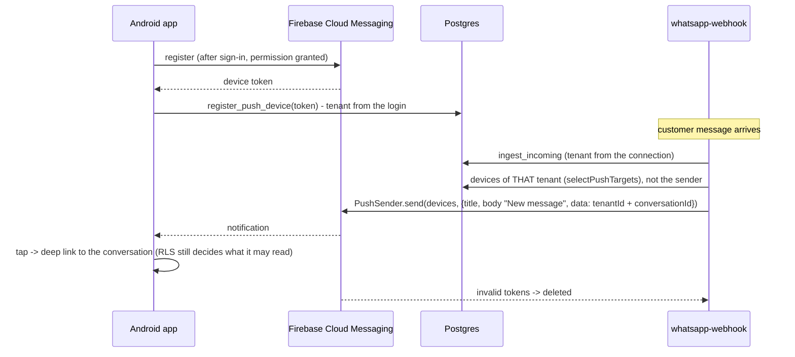

# Firebase Cloud Messaging and notifications: architecture and what you need to configure

> Status labels: see [README.md](README.md#status-labels-used-in-all-documents). **No Firebase project exists, no push provider is configured, and there are no placeholder or fake credentials anywhere in the code.**
> What exists is the *seam*: interfaces, a null implementation, database support and the tenant-safety rule. Related: [MULTI_TENANT_ARCHITECTURE.md](MULTI_TENANT_ARCHITECTURE.md) · [ANDROID_DEVICE_TEST_CHECKLIST.md](ANDROID_DEVICE_TEST_CHECKLIST.md)

## 1. What is built (Tested locally)

| Piece | File | State |
| --- | --- | --- |
| Device table: `push_devices(user_id, tenant_id, fcm_token UNIQUE, platform, last_seen_at)` | migration `20261118000000` | Implemented |
| `register_push_device(token, platform)`: tenant taken from the login; **a token re-registered by another login is re-assigned**, so the previous account stops receiving pushes on that phone | migration `20261118000300` | Implemented, SQL-tested |
| `unregister_push_device(token)`: only your own device | same | Implemented, SQL-tested |
| Server seam: `PushSender` interface, `NullPushSender`, `selectPushTargets` (only devices of the message's tenant, never the sender, no duplicate tokens), `buildPushMessage` (message text excluded unless previews are on; payload is only `tenantId` + `conversationId` for the deep link) | `supabase/functions/_shared/push.ts` | Implemented, 4 Deno tests |
| App seam: `PushService` interface, `NullPushService`, `installPushService`, `registerPushDevice` / `unregisterPushDevice` | `web/src/native/pushService.ts` | Implemented, type-checked |
| Sending a push when a message arrives | not wired | **Pending** (needs a provider) |
| Android FCM plugin, notification channels, deep links | not built | **Pending** (Android phase) |

## 2. Target flow (not active yet)

Rules that are already enforced in code: tenant-scoped targeting; no message text on the lock screen by default; the app opens the chat by id and **RLS decides whether it can read it**, so a mis-delivered notification cannot expose another client's data; sign-out unregisters the device.
Not relying on an open WebSocket: pushes are sent from the server when the webhook stores a message, independent of whether the app is open.

## 3. What you need to configure later (exactly)

1. **Create a Firebase project** (console.firebase.google.com), owned by the company account. Do not register the Android app yet: the package id and branding are still provisional (`io.cosmichameleon.cosmiconnect`). **Do not register the final Firebase app until you confirm the branding**, because the package id is part of the registration and changing it later means a new app.
2. After you confirm the package id: add an **Android app** in Firebase with that package id and the **SHA-256 fingerprint** of the signing key (debug key for development; the release key once it exists). Download `google-services.json`.
3. Put `google-services.json` in the Android project (`android/app/`). It is **not secret** but must not be committed with a wrong project; keep it out of git until the final project is chosen.
4. For the server, create a **service account key** for FCM HTTP v1 (Project settings -> Service accounts). Store the JSON **only** as a Supabase secret (for example `FCM_SERVICE_ACCOUNT`), never in git, the app or chat. The server sends through the FCM HTTP v1 API with a short-lived OAuth token minted from it. (The exact current FCM HTTP v1 request format must be read from Google's documentation when this is implemented: **Unverified here**.)
5. Android 13 and later require the runtime permission `POST_NOTIFICATIONS`; the app must ask for it at a sensible moment (after sign-in), and handle "denied" by explaining how to enable it.
6. Decide notification privacy: previews off (default) or on per client (`tenants.settings`), and the notification channel names/sounds.
7. Decide whether the owner also wants **token-expiry alerts** by push (the dashboard already shows expiry; alerts need the Phase 3 poller).

## 4. Test it when built
See the notification section of [ANDROID_DEVICE_TEST_CHECKLIST.md](ANDROID_DEVICE_TEST_CHECKLIST.md). Minimum: two logins of two different clients on two phones; a message to client A must notify only A's phone; signing out and signing in as B on A's phone must stop A's notifications there.
