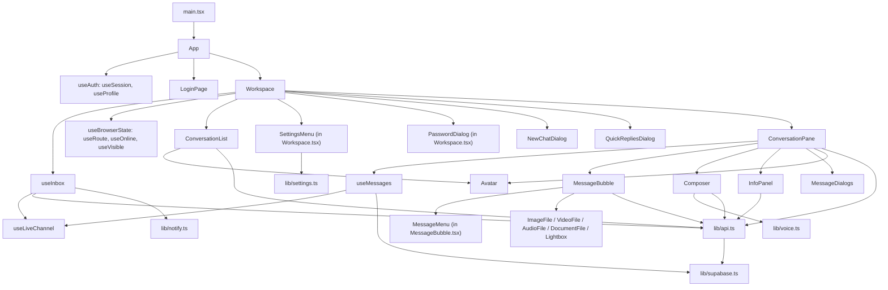

# Frontend documentation

> **Phase 2 notice (2026-11-16):** this document describes the single-login app. Login is now Staff ID + password, with role routing, an admin console, a forced password change and brand configuration; see MULTI_TENANT_ARCHITECTURE.md section 7.


> Status labels: see [README.md](README.md#status-labels-used-in-all-documents).
> Architecture context: [SYSTEM_ARCHITECTURE.md](SYSTEM_ARCHITECTURE.md). Tests: [TESTING_AND_QA.md](TESTING_AND_QA.md).

## 1. Technology and libraries

| Item | Version (from `web/package.json`) | Use |
| --- | --- | --- |
| React / React DOM | ^19.3.1 | UI |
| TypeScript | ^6.0.3 (`strict`, `noUnusedLocals`) | Types |
| Vite + `@vitejs/plugin-react` | ^8.3.8 / ^6.3.0 | Dev server and build. `base: "./"` (relative asset paths so it works under a GitHub Pages sub-path). Dev port 5173, `strictPort`. |
| `@supabase/supabase-js` | ^2.119.0 | Auth, tables, RPC, Edge Function calls, Storage, Realtime |
| ESLint 10 + `typescript-eslint` + `eslint-plugin-react-hooks` | | Lint (React-hooks rules are strict: no set-state-in-effect) |
| `@playwright/test` | 1.63.0 (pinned) | Browser tests |

No UI framework, no router library, no state library, no emoji or icon package (icons are inline SVG in `Icons.tsx`,
the emoji set is a fixed array in `lib/emoji.ts`). Styling is one plain stylesheet, `web/src/styles.css`.

The app reads exactly two build-time variables from `web/.env`: `VITE_SUPABASE_URL` and `VITE_SUPABASE_ANON_KEY`
(`web/src/lib/supabase.ts`). If they are missing, `App.tsx` shows a "Setup needed" screen.

## 2. Folder structure

```
web/
  index.html                 entry HTML (title "Chats")
  vite.config.ts  tsconfig.json  eslint.config.js  playwright.config.ts
  .env.example               VITE_SUPABASE_URL, VITE_SUPABASE_ANON_KEY (web/.env is git-ignored)
  public/                    favicon.svg, _headers, _redirects (see SECURITY: not used by GitHub Pages)
  src/
    main.tsx                 mounts <App/> in StrictMode
    App.tsx                  session + profile gate: setup screen | spinner | LoginPage | error | Workspace
    styles.css               all styling (light/dark themes via CSS variables)
    lib/                     non-React code
      supabase.ts            the single supabase client (anon key only)
      api.ts                 EVERY call to the backend (RPCs, Edge Functions, Storage, signed URLs)
      types.ts               row types: Conversation, Message, MessageFlag, VisibleLast, QuickReply, Staff
      format.ts              labels, times, previewText(), copyableText(), messageSummary()
      settings.ts            theme / sound / notifications in localStorage ("inbox-settings")
      notify.ts              Web Audio "ding" and browser Notification
      voice.ts               microphone recording + WebM/Opus -> OGG/Opus repackaging
      emoji.ts               reaction emojis (6) and picker emojis (80)
    hooks/
      useAuth.ts             useSession(), useProfile()
      useInbox.ts            chat list, unread counts, flags, per-user previews, delete/restore
      useMessages.ts         one chat's messages, paging, jump-to-message
      useLiveChannel.ts      resilient Realtime subscription (reload on every reconnect)
      useBrowserState.ts     useOnline, useVisible, useRoute/navigate (hash routing), useNow
    components/              see section 4
  e2e/                       Playwright specs (4 files, 39 tests x 2 viewports)
```

## 3. Page structure

There is **one screen** after login, built by `Workspace.tsx`:

```
+--------------------------+---------------------------------------------+
| Sidebar (ConversationList)| Detail pane                                 |
|  "Chats"   [+ new] [...]  |  Conversation (ConversationPane)            |
|  search box               |   header: avatar, name, number, search, info|
|  [All][Unread][Starred]   |   message list (bubbles, date dividers)     |
|  chat rows                |   composer (emoji, attach, text, mic/send)  |
|                           |  + optional info panel on the right         |
+--------------------------+---------------------------------------------+
```

- **Desktop (>= 768 px):** sidebar and detail side by side (sidebar `clamp(320px, 30vw, 460px)`).
- **Phone (< 768 px):** one pane at a time. Opening a chat adds class `detail-open`, which hides the sidebar; the back
  arrow (a link to `#/`) returns to the list. The settings menu therefore lives in the *list* header.
- **Routes** (`useBrowserState.ts`, hash based, no library): `#/` list, `#/c/<conversation uuid>` a chat,
  `#/c/<conversation uuid>/m/<message uuid>` a chat scrolled to a message (used by search and starred). `parseRoute`
  also recognises `#/admin`, but **no admin page exists any more** (it was removed from the UI; the route just shows the
  welcome screen).

## 4. Component reference

| Component (`web/src/components/`) | Responsibility | Depends on |
| --- | --- | --- |
| `App.tsx` (in `src/`) | Chooses what to show: setup / loading / `LoginPage` / error / "Login not active" / `Workspace`. Clears the signed-URL cache on logout. | `useSession`, `useProfile`, `lib/supabase` |
| `LoginPage` | Password-only form; signs in as `OWNER_EMAIL`; maps errors to messages ("Wrong password", rate limit, offline). | `supabase.auth`, `useOnline` |
| `Workspace` | Layout; owns `useInbox`; marks the open chat read; sets the tab title with the unread count; holds dialogs (new chat, quick replies, change password); contains `PasswordDialog` and `SettingsMenu` (⋯ menu). | `useInbox`, `useRoute`, all below |
| `ConversationList` | Sidebar: title, new-chat and menu buttons, search, All/Unread/Starred chips, chat rows with unread badges and **per-user previews**; message-text search results; Starred list. | `Inbox` object, `api.searchMessages`, `api.loadMessagesByIds`, `format.previewText` |
| `Avatar` | Round avatar: first letter, or a person icon for numbers; colour from a hash of the number. | `Icons` |
| `ConversationPane` | The open chat: header, search-in-chat, notices, message list (grouping, date and unread dividers, infinite scroll, "scroll to latest"), window banner, `Composer`, `InfoPanel`, dialogs; drag-and-drop files; all message actions (reply, react, star, copy, delete). | `useMessages`, `MessageBubble`, `Composer`, `InfoPanel`, `MessageDialogs`, `Lightbox` |
| `MessageBubble` | One message: quote, media (image, video, audio, document, sticker), location and contact cards, text, ticks, reactions, and the three-dot `MessageMenu`. Contains `ImageFile`, `VideoFile`, `AudioFile`, `DocumentFile`, `Lightbox` (photo preview). | `api.signedFileUrl`, `format`, `Icons` |
| `MessageDialogs` | `DeleteForMeDialog` ("Delete message?") and `DeleteForEveryoneDialog` (explains the limitation). Focus handling and Escape. | none |
| `Composer` | Text box, emoji picker, file attach, paste/drop images, voice recording, quick-reply slash list, reply preview, caption rules; sends via `api.sendMessage`. Shows the **template sender** instead when the 24-hour window is closed. Sends the "typing…" signal (throttled 20 s). | `api.sendMessage`, `api.markReadAtWhatsApp`, `lib/voice` |
| `InfoPanel` | Contact info: editable saved name, number, starred messages of this chat, "deleted for you" restore button, list of Business-API limits. | `api.renameContact`, `api.loadMessagesByIds` |
| `NewChatDialog` | Add a phone number (+ optional name) and open the chat. | `api.startConversation`, `navigate` |
| `QuickRepliesDialog` | Create, edit, delete saved snippets (`/shortcut`). | `api.saveQuickReply`, `api.deleteQuickReply` |
| `Icons` | Inline SVG icon set and the `Ticks` component. | none |

### Component relationship diagram



## 5. State management

There is no global store. State sits in three places:

1. **Server state, kept live** - `useInbox` (conversations, `unread`, `flags`, `previews`, `staff`) and `useMessages`
   (messages of one chat). Both receive Realtime events and also **reload completely** whenever the channel
   (re)connects, the browser comes back online or the tab becomes visible (`useLiveChannel`'s `onSync`). While a reload
   is running, incoming changes are queued and replayed on top of it so a slow reload cannot overwrite newer data.
2. **UI state** - ordinary `useState` inside the component that owns it (open dialogs, current search text, the message
   being deleted, scroll position refs).
3. **Preferences** - `lib/settings.ts` (theme, sound, notifications) in `localStorage` key `inbox-settings`, exposed with
   `useSyncExternalStore`. The theme is applied by setting `data-theme` on `<html>` at import time.

`ConversationPane` is mounted with `key={conversationId}`, so all its state resets when another chat opens.

Realtime subscriptions (`useLiveChannel`): channel `inbox:<user id>` listens to `conversations` and `wa_messages`
(unfiltered; row level security limits what Realtime delivers), and `messages:<conversation id>` listens to
`wa_messages` filtered to the open chat. `message_flags` and `quick_replies` are **not** in the Realtime publication;
they refresh on reload/sync only.

## 6. API communication

All backend access is in `web/src/lib/api.ts` (plus reads/subscriptions in the hooks). Never call Supabase from a
component directly except through the hooks.

| Function in `api.ts` | Backend call |
| --- | --- |
| `sendMessage(userId, input)` | (media) Storage upload to `outgoing/<user id>/<uuid>.<ext>` as raw bytes with the full Content-Type, then Edge Function `send-whatsapp`. |
| `sendReaction(conversationId, messageId, emoji)` | Edge Function `send-whatsapp` with `reaction`. |
| `markReadAtWhatsApp(conversationId, typing)` | Edge Function `mark-read`; failures are ignored (best effort). |
| `signedFileUrl(path)` | Storage `createSignedUrl` (1 hour), cached in memory until 5 minutes before expiry. |
| `loadFlags`, `setMessageFlags` | table `message_flags` (read), RPC `set_message_flags` (stars). |
| `deleteMessageForMe`, `restoreMessageForMe` | RPC `delete_message_for_me`, `restore_message_for_me`. |
| `loadVisibleLastMessages` | RPC `visible_last_messages`; returns `null` if the function does not exist (older server) so the UI falls back. |
| `loadQuickReplies`, `saveQuickReply`, `deleteQuickReply` | table `quick_replies`, RPC `save_quick_reply`, `delete_quick_reply`. |
| `updateConversationInfo` | RPC `update_conversation_info` (notes and labels; **no UI uses it any more**). |
| `searchMessages`, `loadMessagesByIds` | RPC `search_messages`, table `wa_messages`. |
| `startConversation`, `renameContact` | RPC `start_conversation`, `rename_contact`. |
| `changePassword` | `supabase.auth.updateUser` (minimum 8 characters enforced in the client). |

Errors from Edge Functions are turned into plain `Error` messages by `callFunction` (it reads the JSON `error` field).

## 7. Features and where they are implemented

| Feature | Implementation |
| --- | --- |
| **Chat sidebar** | `ConversationList.tsx`. Rows come from `inbox.conversations` sorted by `last_message_at`. |
| **Conversation panel** | `ConversationPane.tsx`. Page size 50 (`PAGE_SIZE`), older pages load when scrolling within 200 px of the top. Messages within 5 minutes from the same sender are grouped (`GROUP_GAP_MS`). Unread divider decided once when the chat opens. |
| **Message bubbles** | `MessageBubble.tsx`; ticks in `Icons.tsx` (`Ticks`): clock = sending, one grey tick = sent, two grey = delivered, two blue = read/played, red mark = failed. |
| **Three-dot message menu** | `MessageMenu` in `MessageBubble.tsx`: reactions row (only when the message has a WhatsApp id and the window is open), Reply, Copy message, Star, Delete for me, Delete for everyone. On phones the popover becomes a bottom sheet (CSS). Click outside or Escape closes it. |
| **New-chat dialog / contact creation** | `NewChatDialog.tsx`: keeps digits only, strips leading zeros, a **10-digit number gets `91`** (`DEFAULT_COUNTRY`), accepts 7-15 digits, calls `start_conversation`, then navigates to the chat. The saved name lives in `conversations.contact_name` and wins over the WhatsApp profile name (`customerLabel()` in `format.ts`). |
| **Search and filters** | Sidebar search matches name/number locally and message text through RPC `search_messages` (debounced 300 ms, >= 2 characters); a query that looks like a number also matches `wa_id`. Chips: All / Unread / Starred. In-chat search (magnifier) uses the same RPC with the conversation id; a result jumps to the message. |
| **Starred messages** | Menu "Star" -> `set_message_flags`. Starred list (chip) and info panel use `loadMessagesByIds`; **deleted starred messages are excluded**. |
| **Reply** | Menu "Reply" sets `replyTo`; `Composer` shows a preview and sends `reply_to` (message uuid). Quotes render the quoted message (or "Earlier message" if not loaded, or "You deleted this message"). Needs an open 24-hour window and a message with a WhatsApp id. |
| **Copy message** | `copyableText()` in `format.ts`: text and captions; document -> file name; location -> map link; contacts -> names and numbers; photo/voice without caption -> item disabled. Uses `navigator.clipboard`. |
| **Delete for me** | Menu -> `DeleteForMeDialog` -> `inbox.deleteForMe` -> RPC. See [MESSAGE_DELETION_DOCUMENTATION.md](MESSAGE_DELETION_DOCUMENTATION.md). |
| **Delete for everyone explanation** | Menu item with `aria-disabled="true"` (still clickable) opens `DeleteForEveryoneDialog` with the sentence "Delete for everyone is not supported through the current WhatsApp Cloud API integration." and a "Delete for me instead" button. No network call is made. |
| **Undo deletion** | Success notice offers Undo -> `restoreForMe`. "Show them again" in the empty-chat state and the info panel restore too. |
| **Media previews** | `ImageFile` (click -> `Lightbox`), `VideoFile` (native controls), `AudioFile` (native player, mic icon for voice notes), `DocumentFile` (card with type, size, Download), stickers, location card (Google Maps link built from stored coordinates), contact cards. All files use signed URLs (`useFileUrl`). |
| **Voice notes** | `lib/voice.ts`: records with `MediaRecorder` in mono; Chromium records WebM/Opus, which is repackaged into OGG/Opus in the browser (`webmOpusToOgg`) because Meta accepts OGG/Opus, not WebM; Firefox records OGG directly; Safari records AAC/MP4 (sent as normal audio, not a voice note). |
| **Quick replies** | Typing `/` at the start of the box lists shared snippets (`quick_replies`); Enter/Tab inserts. Managed in `QuickRepliesDialog`. |
| **Notifications and sound** | `lib/notify.ts`; triggered from `useInbox` for new incoming messages unless that chat is open and visible. Settings in the ⋯ menu. |
| **Mobile responsive design** | CSS media query at 767 px; safe-area insets; bottom-sheet menus and dialogs on phones; tested at Pixel 7 size. |
| **Dark and light themes** | CSS variables: `:root` (light) and `:root[data-theme="dark"]`. Default is **dark**; the ⋯ menu offers Dark / Light / Same as device. Stored in `localStorage`. |
| **Offline / reconnect** | Banner "You are offline"; connection state shown in the ⋯ menu ("Live", "Reconnecting…", "Offline"); data reloads on reconnect. |
| **Typing and read signals** | Opening a chat or receiving a message in the open chat calls `mark-read`; typing calls it with `typing: true` at most every 20 s. |

## 8. Things in the frontend that exist but are not used by the interface

`updateConversationInfo` (notes and labels), `conversations.labels/notes` rendering, the `#/admin` route, the
take/release chat RPCs, and the `admin-staff` Edge Function are all still present for the future Android app, but the
current screens do not use them.

## 9. Rules when changing the frontend

- Keep all backend calls in `lib/api.ts` and all row types in `lib/types.ts`.
- Do not add a UI or state library without a reason; the app is intentionally small.
- Add `data-testid` attributes for anything a test must reach; existing tests depend on them (for example
  `message-menu`, `menu-delete-me`, `delete-confirm`, `chat-notice`, `conversation-item`).
- Run `npm run lint`, `npm run typecheck`, `npm run build` and the Playwright suite ([TESTING_AND_QA.md](TESTING_AND_QA.md)).
