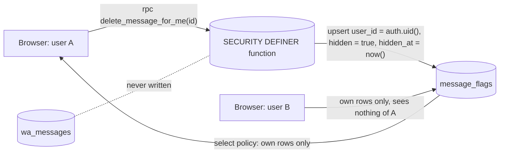

# Message deletion documentation

> Status labels: see [README.md](README.md#status-labels-used-in-all-documents). Verified against
> `supabase/migrations/20261117000000_message_delete.sql`, `supabase/tests/message_delete.sql`, `web/e2e/delete.spec.ts`,
> `web/src/hooks/useInbox.ts`, `web/src/components/ConversationPane.tsx` and the live catalog.
> Related: [DATABASE_DOCUMENTATION.md](DATABASE_DOCUMENTATION.md#7-message-deletion-architecture-verified-against-20261117000000_message_deletesql-and-the-live-catalog) ·
> [WHATSAPP_API_INTEGRATION.md](WHATSAPP_API_INTEGRATION.md)

## 1. What exists

| Feature | Status |
| --- | --- |
| **Delete for me** (any message, incoming or outgoing, any type) | Implemented · Tested locally (SQL + browser) · Tested live (see section 7) |
| **Undo** (toast after deleting, ~ seconds) | Implemented · Tested locally · Tested live |
| **Delete for everyone** | **Unsupported by API.** The menu item is visible but disabled (`aria-disabled`); clicking it only explains the limit. |
| Delete whole chat / clear chat | Not implemented |
| Permanent deletion of messages or files | Not implemented, by design |

**Why "for everyone" is not offered.** The WhatsApp Cloud API has no endpoint to revoke a message that a business already sent.
Revoke and edit *webhooks* exist only for coexistence setups, so the app cannot remove a message from the customer's phone, and
pretending to would mislead staff. The dialog says: "Delete for everyone is not supported through the current WhatsApp Cloud API
integration. The message can only be removed from this application's view using Delete for me." No Meta call is made (checked by
the browser test: no `/functions/v1/` request and no delete RPC is sent).

## 2. What "Delete for me" does and does not do

Does: records a private flag for the logged-in user; the message disappears from that user's chat, search, starred list, chat-list preview,
quote targets and info panel.

Does **not**: remove the row from `wa_messages`, delete files from Storage, change any status, stop delivery/read receipts, notify the
customer, or affect any other staff user. Both the database test and the browser tests assert the row and the file are unchanged, and that a
later delivery receipt still updates a message that was deleted for the user.

## 3. Data model

- Table `message_flags(user_id, message_id, starred, hidden, hidden_at, updated_at)`, PK `(user_id, message_id)`, both FKs `ON DELETE CASCADE`.
- `hidden` is the visibility switch; `hidden_at` is when the user deleted it (audit; kept as the first deletion time if deleted twice).
- RPCs: `delete_message_for_me(p_message_id uuid)`, `restore_message_for_me(p_message_id uuid)`, `visible_last_messages()`
  (names verified against the migration and the live database). The older `set_message_flags(uuid, bool, bool)` is kept for compatibility
  with the earlier star/hide UI.
- Errors: not an active staff user -> `42501 not allowed`; unknown message id -> `P0002 Message not found`.
- Existing rows that were hidden before the migration were backfilled with a `hidden_at` value (one-time `UPDATE` in the migration, only where it was null).

## 4. User-facing behaviour

1. Hover/long-press a message -> menu with **Copy**, **Delete for me**, **Delete for everyone (unavailable)** etc.
2. **Delete for me** opens a confirmation dialog explaining what will happen. Cancel, Escape and clicking outside do nothing.
3. Confirm -> the RPC runs; the message leaves the screen **only after the server confirmed** (a failure shows the error inside the dialog and deletes nothing).
4. A toast "Message deleted." with **Undo** appears; Undo calls `restore_message_for_me`. The toast fades by itself; an error toast stays until dismissed.
5. Reload: the message is still gone (the flag is server-side, not local).
6. If the deleted message was the newest, the chat-list preview falls back to the previous visible message; if none remain, the chat list shows the placeholder "You deleted all messages" (in the chat itself: "You deleted all the messages loaded in this chat.") instead of leaking the old text.

### Preview logic (why there is no `last_message_id` column)
The shared preview on `conversations.last_message_preview` still holds the newest text for everybody. For each user the app calls
`visible_last_messages()` (security invoker) which returns the newest message that user has not deleted. `useInbox` keeps `previewDirty`:
for a chat whose newest message just changed, the server preview is shown until the per-user preview refreshes, so a brand-new message
is never briefly shown as "deleted". A shared "last visible message" column was rejected because it would leak one user's deletion to others.

## 5. Security properties

| Property | How enforced |
| --- | --- |
| A user can only affect their own view | `auth.uid()` read inside the function; no user-id parameter |
| Others cannot read my flags | select policy `user_id = auth.uid()` |
| Anonymous or non-staff callers refused | `is_active_staff()` check; `anon` has no EXECUTE |
| Clients cannot write the flags table directly | no INSERT/UPDATE/DELETE policy or grant (tested: direct write returns 401/403) |
| The conversation/message history is untouched | functions never write `wa_messages`; no triggers |

Currently there is a single login in production, so the cross-user isolation is **proved by SQL tests with two simulated users**, not by two real people.

## 6. Tests

| Layer | File | What it covers |
| --- | --- | --- |
| SQL (local DB only, one rolled-back transaction) | `supabase/tests/message_delete.sql` (19 `pass(...)` calls counted in the file) | idempotence, row hash unchanged, per-user previews, B cannot see/undo A's flags, search per user, all-deleted -> no preview, delivery status still applies, new incoming still ingests, non-staff refused |
| Browser (Playwright, desktop + Pixel 7) | `web/e2e/delete.spec.ts` (14 tests) | dialog wording and cancel paths, incoming/outgoing text, photo/PDF/voice files kept, Undo, "for everyone" disabled and makes no calls, no leaks (list, starred, info, quotes, reply target), Copy, reactions/replies around deletions, unauthorised requests refused, layout on phone, failed deletion shown inside the dialog |

Reported results from the implementation session (not re-run during this documentation task): 25 SQL checks, 78 browser checks.
A count of `select pg_temp.pass(` in the file gives 19, not 25; the difference is **unexplained** (assertions may be counted per user/row in the runner output). Re-run `npm run test:sql` against the local DB to confirm. See [TESTING_AND_QA.md](TESTING_AND_QA.md).

## 7. Live verification

After the migration was applied to the hosted database and the site was redeployed, a scratch script (kept **outside** the repository, so
it is not reproducible from the repo) created a temporary test conversation and ran 24 checks against the live API: RPC availability, deleting incoming/outgoing
messages, restore, previews, search, flags, direct-write refusal, anonymous refusal, and that `wa_messages` hashes were identical before and after. All 24 were reported passing, and
the test data was cleaned up. Existing production conversations were hash-compared before and after the migration. These are **Tested live** on the
author's account only; the script itself is not in the repo and was not re-run here.

## 8. Rollback

The migration is additive (one column, three functions, one replaced function). To undo it: drop the three functions, restore the previous
`set_message_flags`, optionally drop `hidden_at`. No message data would be lost because messages were never modified. Do this only with
explicit approval ([AI_DEVELOPER_CONTEXT.md](AI_DEVELOPER_CONTEXT.md)).

## 9. Future options (not started)

Delete whole chat for me (same pattern, per-user hide of a conversation); admin-only permanent purge with audit log; bulk selection; "delete for everyone" only if
Meta adds a supported API. See [KNOWN_ISSUES_AND_ROADMAP.md](KNOWN_ISSUES_AND_ROADMAP.md).
