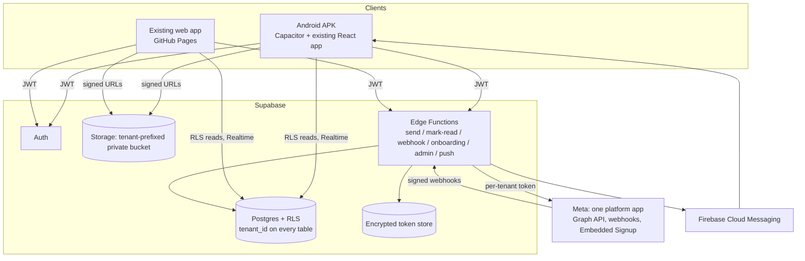
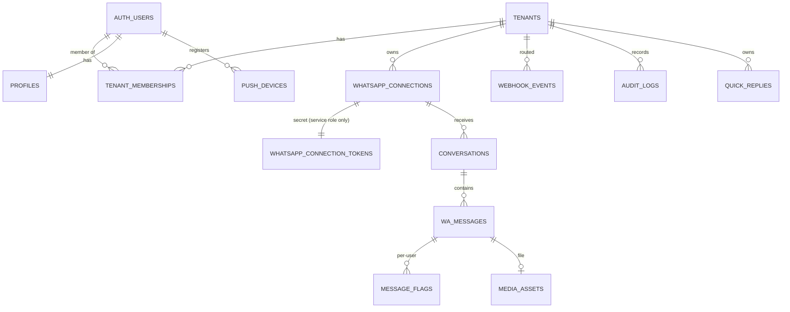

# Multi-tenant platform and Android APK: Phase 0 audit and Phase 1 architecture plan

> **Status: plan only. No application code, database, secret, Meta setting or deployment has been changed for this plan.**
> Status labels: see [README.md](README.md#status-labels-used-in-all-documents). Written against the documents and code audited earlier in this project.
> Items I could not verify are marked **Unverified**; the biggest source of that is that `developers.facebook.com` is not reachable from the build
> session (DNS failure), so Meta's pages were seen only through search snippets and third-party mirrors, never read directly.

## 1. Phase 0 result: where the system stands against the new requirements

| Requirement | Today (verified in code/DB) | Gap |
| --- | --- | --- |
| One APK for Admin and Staff, role routing | `staff.role` (admin/staff) exists; the web UI deliberately hides roles; `admin-staff` function creates users | Role-based UI, admin dashboard, Android shell |
| Separate WhatsApp connection per client | **One global** connection: secrets `WA_TOKEN`, `WA_PHONE_ID`, `WA_BUSINESS_ACCOUNT_ID`; webhook drops events whose `phone_number_id` differs from `WA_PHONE_ID` | **Largest gap.** Needs a per-tenant connection table, encrypted per-tenant tokens, routing by `phone_number_id` |
| Staff sees only their own conversations | RLS gives every active staff user **all** conversations (shared inbox) | Add `tenant_id` everywhere; rewrite every policy and RPC |
| Tenant isolation of storage | bucket `files`, policy "active staff" reads everything | Tenant-prefixed paths and policies |
| Embedded Signup / Coexistence | Not implemented. Only a manual `subscribe_waba` diagnostic action | New backend flow + Facebook JS SDK launch in the app |
| Coexistence webhooks (`history`, `smb_app_state_sync`, `smb_message_echoes`, `account_update`) | Webhook handles only the `messages` field | New handlers and tables |
| Push notifications (FCM), deep links | Browser Notification API only | `push_devices`, FCM sender function, Android plugin |
| Camera, gallery, native file picker, native mic | Browser APIs (`MediaRecorder`, file input); WebM->OGG remux in `voice.ts` | Capacitor plugins; real-device verification |
| Audit log, usage statistics, token-expiry monitoring | None | New tables and functions |
| Delete for me, replies, reactions, stars, search | Implemented | Must be re-scoped by tenant, not rebuilt |
| Location | Incoming location messages are stored and rendered; sending not implemented | Requirement is "no location permissions": keep **incoming** cards only; no Android location permission, no send button |

Two facts shape the plan: (1) the current schema has no tenant concept at all, so tenancy is a cross-cutting migration, not a feature; (2) all
existing data (4 chats on the test number) must survive it.

## 2. Environment constraints discovered

| Check | Result |
| --- | --- |
| Java and Gradle 8.14 | present |
| Android SDK / `adb` | **not installed**; downloadable (`dl.google.com` and Google Maven reachable) so a debug/release APK can be **built** here |
| Real Android device or emulator | **none**: this cloud session cannot run an emulator with camera/mic or receive FCM on hardware. Anything "tested on a real phone" needs you (or a device farm) |
| Docker / local Supabase | Docker daemon is **not running** here, so local migrations and RLS tests cannot run until it is available (a different machine or a working daemon) |
| Supabase CLI | not installed in this session |
| `developers.facebook.com` | **not reachable** (blocked or unresolvable): needs to be allowed before Meta docs can be read directly |
| npm registry | reachable |

Consequence: I can write code, migrations, tests and build an APK in this environment, but I cannot honestly claim a real-device, real-Meta or
real-FCM test. Those are listed as owner-run acceptance steps, and results will be labelled accordingly.

## 3. Target architecture



### 3.1 Roles
- **Platform admin** (you): a `profiles.platform_role = 'admin'`; sees all tenants through admin-only functions, never through client-side `tenant_id`.
- **Tenant member**: a user with a `tenant_memberships` row (`role` = `owner` | `agent`, `disabled`). Initially one `owner` per client; more agents can be added later without schema change.
- Staff ID login is preserved (`<STAFFID>@<domain>` synthetic email, as today). The existing "no staff/admin labels" rule applies to the **staff** UI; the **admin** dashboard is a separate route shown only to platform admins.

### 3.2 Data model (new tables; existing tables gain `tenant_id` and `connection_id`)



| Table | Key columns / rules |
| --- | --- |
| `tenants` | `id`, `name`, `status` (active/suspended), `created_at` |
| `profiles` | `user_id` pk, `display_name`, `platform_role` (null or `admin`) |
| `tenant_memberships` | pk (`tenant_id`,`user_id`), `role`, `disabled`, `staff_id` unique per platform |
| `whatsapp_connections` | `id`, `tenant_id`, `waba_id`, `phone_number_id` **globally unique**, `display_phone_number`, `status` (pending/connected/disconnected/error), `coexistence` (bool), `onboarding_state`, `token_expires_at`, `last_webhook_at`, `last_error`; unique (`waba_id`,`phone_number_id`) |
| `whatsapp_connection_tokens` | `connection_id` pk, `ciphertext`, `key_version`, `rotated_at`; **no grants to anon/authenticated**; read only by Edge Functions |
| `conversations`, `wa_messages`, `message_flags`, `quick_replies`, `conversation_reads` | add `tenant_id` (and `connection_id` for conversations); uniques become per tenant: `(connection_id, wa_id)` for conversations; `wa_message_id` stays globally unique |
| `media_assets` | `id`, `tenant_id`, `message_id`, `storage_path`, `mime`, `size`, `sha256` (replaces loose `media_path` in time; migrate with a compatibility view first) |
| `webhook_events` | raw-event ledger: `id`, `received_at`, `phone_number_id`, `field`, `connection_id` (nullable), `payload_hash`, `outcome`; no message bodies; supports idempotency and failure diagnostics |
| `push_devices` | `user_id`, `tenant_id`, `fcm_token`, `platform`, `last_seen_at` |
| `audit_logs` | `tenant_id`, `actor_user_id`, `action`, `target`, `detail jsonb` (no secrets), `created_at`; insert-only |

**Isolation rule.** Every policy and RPC derives the tenant from the **database** (`tenant_memberships` for `auth.uid()`), never from a parameter.
A helper `current_tenant_ids()` (SECURITY DEFINER, stable) is the single source. Admin-only cross-tenant reads go through named admin functions that check
`profiles.platform_role = 'admin'`. Storage paths become `t/<tenant_id>/incoming|outgoing/...` with a policy comparing the first folder to the caller's tenant.

**Preserving existing data.** Migration order: (1) create new tables; (2) create one tenant "Owner (test)" and one connection for the current test number
(ids copied from the existing secrets by an approved one-off step, **never printed**); (3) backfill `tenant_id`/`connection_id` on all existing rows; (4) add NOT NULL
and new policies only after backfill is verified by row-count and hash comparison; (5) keep old functions as thin wrappers until clients are updated.
No message or file is deleted. This is rehearsed on a local copy first.

### 3.3 Token management
- One platform app (App ID, App Secret, verify token) stays in Supabase secrets. Per-client business tokens live in `whatsapp_connection_tokens`, encrypted
  with AES-256-GCM using a master key held only as an Edge Function secret (`TOKEN_ENC_KEY`, with `key_version` for rotation). Alternative to evaluate: Supabase Vault. **Decision needed** (section 8).
- Functions decrypt in memory per request; tokens never reach the browser, the APK, logs, or any selectable column. Admin screens show only status and expiry, never any part of a token.
- Expiry: Embedded Signup business tokens can be long-lived or non-expiring depending on the setup (**Unverified** against the current docs); a scheduled check calls `debug_token` per connection, writes `token_expires_at`, and raises an admin alert and a push.
- Disconnect/revoke/rotate are admin functions with audit entries.

### 3.4 Message routing
- **Webhook:** verify HMAC with the platform App Secret first; then for each `entry/changes/value`, look up `whatsapp_connections` by `metadata.phone_number_id`
  (and cross-check `entry.id` = `waba_id`). Unknown id -> store a `webhook_events` row with outcome `unrouted`, return 200, do nothing else. All writes carry the resolved `tenant_id`.
- **Outgoing:** `send-whatsapp` resolves the caller's tenant and the conversation's connection server-side, checks `conversation.tenant_id = caller tenant`, decrypts that
  tenant's token, sends. A client-supplied `tenant_id` is ignored/rejected.
- **Realtime:** Realtime applies RLS, so tenant-scoped policies also scope live updates; tested explicitly.

### 3.5 Onboarding (Embedded Signup + Coexistence)

```mermaid
sequenceDiagram
  autonumber
  participant Ad as Admin (app)
  participant EF as onboarding function
  participant C as Client (app, Meta popup)
  participant M as Meta
  Ad->>EF: create tenant + start onboarding (admin only)
  EF-->>Ad: onboarding link/session (state nonce stored server-side)
  C->>M: Embedded Signup (v4 config; coexistence feature type)
  M-->>C: code + session info (waba_id, phone_number_id)
  C->>EF: code + state (JWT of the signed-in client)
  EF->>M: exchange code for business token (server side, App Secret)
  EF->>M: verify assets, subscribe WABA to the app, register webhook fields
  EF->>EF: encrypt + store token, create connection, link to tenant
  EF-->>Ad: status Connected / error (visible in dashboard)
```

Details that come from Meta's coexistence page as seen through search snippets (**Unverified, read the official page before coding**): `featureType` =
`whatsapp_business_app_onboarding` with `sessionInfoVersion` 3; completion event `FINISH_WHATSAPP_BUSINESS_APP_ONBOARDING`; v4 is "phone number first" and enters coexistence
automatically when the number is on the Business App; minimum Business App version 2.24.17; you must be a **Tech Provider or Solution Partner**.
The client authorises in Meta's popup; we never see their Meta credentials.

**Hard prerequisite (owner action, cannot be coded around):** the Meta app must be an approved Tech Provider with Embedded Signup configured, business verification, and the
`whatsapp_business_management` / `whatsapp_business_messaging` permissions through App Review. Until then Phase 3 can be built and unit-tested but **not run for real**.

### 3.6 Coexistence webhooks
New handlers (stored through new RPCs, idempotent, tenant-routed): `smb_message_echoes` (messages sent from the native Business App; stored as outgoing with a source marker),
`history` (backlog chunks within Meta's window; progress tracked on the connection; media often unavailable), `smb_app_state_sync` (contacts -> `conversations.contact_name`),
`account_update` (onboarding/disconnect state). Existing `messages` and statuses stay unchanged. Edit/revoke webhook shapes are **Unverified** (conflicting sources, see 5).

### 3.7 Android architecture
**Capacitor wrapping the existing React app** (recommended): same code for web and APK, plugins for camera, filesystem/picker, push (FCM), local notifications, secure storage,
app lifecycle and deep links. Voice notes: a native recorder plugin producing a native format (AAC/M4A is trivial; OGG/Opus needs either an Opus-capable recorder or transcoding), and the
existing WebM->OGG remux remains the web fallback. Native/web differences live behind small adapters (`web/src/native/`) so the web build keeps working.
Package id `com.<yourbrand>.<app>` and name/icon/splash are **your decision** (section 8). No location permission is declared; a build check will fail if one appears in the manifest.
Signing keystore is generated outside the repo (and never committed); a `.gitignore` entry and a build script that reads it from an environment path are added.
Rewrite to React Native/Kotlin is not warranted: nothing in the requirements needs it.

## 4. Admin and staff experience

- Admin routes (visible only to platform admins): overview, tenants/staff list, create client (generates Staff ID, temporary password shown **once**, forced change at first login), activate/deactivate,
  reset password, connections (status, number, token expiry, last webhook, coexistence state, errors), usage statistics (counts only), API-error log, audit log, permissions.
- Staff routes: the existing WhatsApp-style app scoped to their tenant, plus profile/settings.
- Branding: own name, logo, colours and icon; no WhatsApp logo or "official" claims.

## 5. Feature capability matrix (initial; verify each row against Meta's current docs before implementing)

Labels: **Full** = supported; **Restricted** = supported with limits; **App-only** = only in the native Business App; **Needs eligibility** = extra Meta API/approval; **Unsupported**; **Unverified** = not checked against current official docs.

| Feature | Expected status | Basis |
| --- | --- | --- |
| 1:1 text, emoji | Full | already live-tested earlier |
| Images, videos, documents, audio files | Restricted (types/sizes) | implemented; real-phone delivery **not yet verified** |
| Voice notes | Restricted (OGG/Opus required) | implemented in browser; native Android path to be built and device-tested |
| Reply (quote), reactions | Full | implemented, simulated tests only |
| Delete for me, star, copy, search | App-level (ours) | implemented |
| Delete for everyone from our API | Unsupported **(Unverified for 2026)** | earlier research: no Cloud API operation; re-check before final claim |
| Edit / revoke arriving from the native app via coexistence | Unverified: Meta's onboarding page (April 2026, via search snippet) says edit/revoke is supported for 1:1 chats; an older partner page says it is not | read Meta's page directly before building |
| Edit from our API | Unverified (no documented endpoint known to me) | do not implement without an official endpoint |
| Contact cards (receive) | Full | implemented |
| Contact cards (send), forwarding | Unverified | investigate |
| Contact sync, history sync | Restricted (coexistence, time window, consent) | needs real onboarding |
| Groups | Needs eligibility (Groups API, Official Business Account) and not for coexistence numbers | per your brief; Unverified |
| Calls, status updates, channels, broadcast lists, disappearing, view-once, live location | App-only or Unsupported for our integration | to confirm per row |
| Location sharing (send) | **Excluded by your decision** | no UI, no permission |
| Incoming unsupported types | Handled (stored as a note) | implemented |

The final matrix will cite the exact Meta page and date per row; any row I cannot read stays **Unverified**.

## 6. Phases, exit criteria and what each needs

| Phase | Deliverable | Exit criteria | Blocked by |
| --- | --- | --- | --- |
| 0 Audit | done (this section 1-2) | - | - |
| 1 Architecture | this document; separate ER/flow docs after your approval | you approve decisions in section 8 | your input |
| 2 Tenants, roles, isolation | migrations (separate files), RLS rewrite, admin/staff functions, role routing, Staff ID + forced password change, audit log | SQL isolation tests (two tenants, admin, disabled user, IDOR attempts), Deno tests, browser tests, **existing 4 chats intact** (hash-verified locally) | a working local Supabase (Docker) |
| 3 Onboarding + coexistence | token store, onboarding function, webhook routing by phone id, coexistence handlers, admin connection screens | unit/integration tests with a fake Meta; **real onboarding needs Tech Provider approval and a consenting test client** | Meta approval |
| 4 Messaging features | native camera/gallery/files/voice adapters, previews/captions, native-capability gating | Deno/browser tests; **device tests by you** | Phase 5 shell |
| 5 Android shell | Capacitor project, plugins, FCM, deep links, icon/splash, no-location check | debug APK builds here; installs and runs on your phone | Android SDK download, Firebase project |
| 6 Testing | full suites + security tests + checklist for real-device runs | results reported per label (automated / real / not done) | devices |
| 7 APK build | debug + signed release APK, version info, SHA-256, install guide | checksum recorded; keystore outside git | your keystore decision |
| 8 Production readiness | Meta approval checklist, backups, monitoring, runbooks | documented and reviewed | owner actions |

Each phase ends with a stop for your review; nothing is pushed or deployed, and no production migration is run, without your explicit approval.

## 7. Risks

| Risk | Mitigation |
| --- | --- |
| Tenancy migration corrupts or hides existing data | local rehearsal, hash/count comparison, additive steps, wrappers, rollback script, production only with approval |
| RLS mistakes leak across tenants | dedicated two-tenant SQL tests, IDOR tests on every RPC/function, Realtime test, policy review checklist |
| Per-tenant tokens expire silently | scheduled `debug_token` checks, admin alerts, push to the owner |
| Tech Provider approval takes weeks | build and fake-test first; keep test number mode working |
| No real device/emulator here | clearly labelled owner-run acceptance tests; no "works on Android" claim without them |
| Native voice format mismatch | decide recorder plugin early; test OGG/Opus acceptance by Meta on a real send |
| Cost: paid messaging on real numbers | test numbers and allowed recipients only until you approve |
| Docs unreachable in this session | allow `developers.facebook.com` (and optionally `www.facebook.com`) or paste the pages; unresolved rows stay Unverified |

## 8. Decisions and inputs I need from you before Phase 2

1. **Meta status:** is the Meta app already a Tech Provider with Embedded Signup and App Review done? If not, Phase 3 can be built but not run for real.
2. **Brand:** app name, Android package id (for example `com.yourbrand.messenger`), colours; logo/icon file if you have one (otherwise I create a placeholder).
3. **Firebase:** a Firebase project for FCM (I cannot create it); `google-services.json` kept out of git.
4. **Token encryption:** custom AES-GCM with a master key secret (my recommendation, simple and testable) or Supabase Vault.
5. **Existing 4 test chats:** keep them under a new "Owner (test)" tenant (recommended).
6. **Local environment:** I need Docker running (or another machine) to test migrations and RLS; and the session network must allow `developers.facebook.com` to read Meta's docs.
7. **Staff list visibility:** confirm the staff UI stays free of staff/admin wording while the admin dashboard is a separate role-gated area.
8. **Devices:** who will run the real-phone acceptance tests (camera, mic, FCM, coexistence)?

## 9. What I will not do without approval
Push, deploy, apply production migrations, change Supabase secrets or Auth settings, change Meta settings, onboard any real client, send paid messages, or run unofficial WhatsApp automation.
