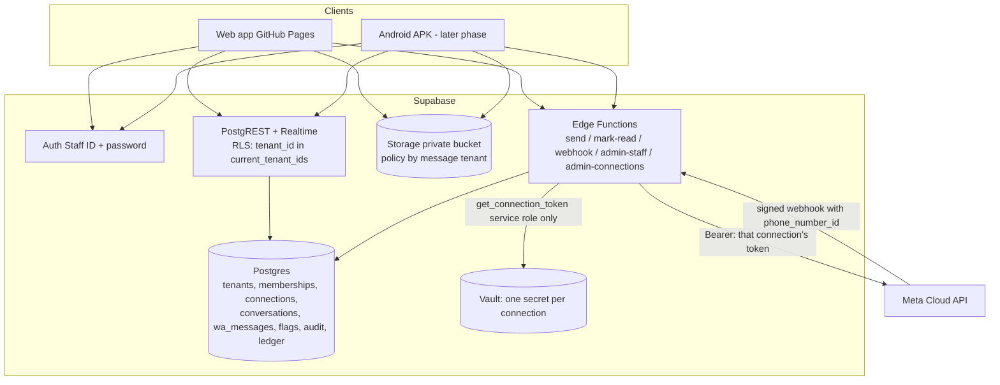
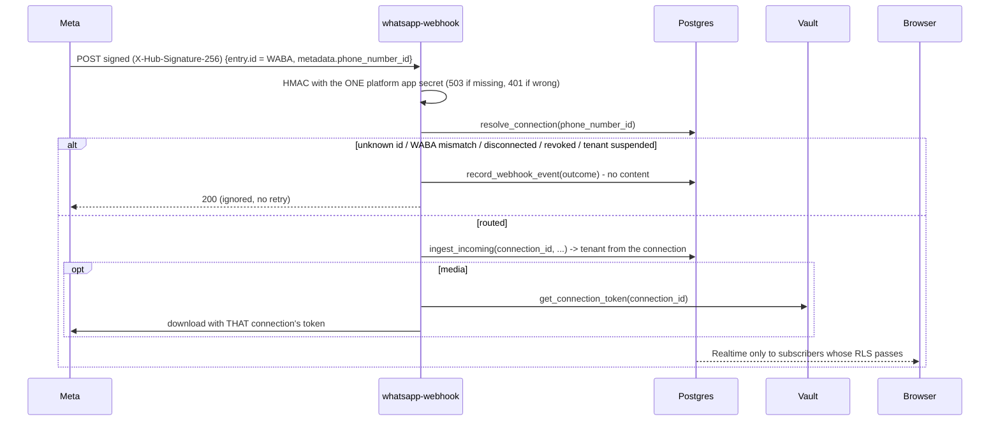
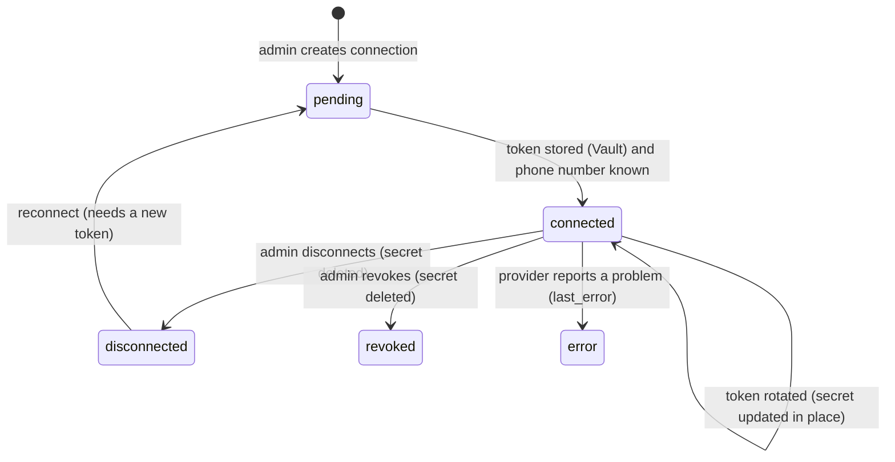
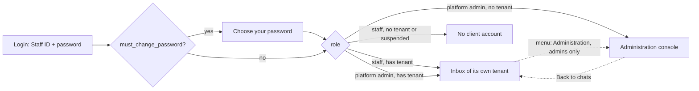

# Multi-tenant architecture (as built in Phase 2)

> This document describes what **exists in the code and was run locally**. It supersedes the single-tenant parts of
> [SYSTEM_ARCHITECTURE.md](SYSTEM_ARCHITECTURE.md), [DATABASE_DOCUMENTATION.md](DATABASE_DOCUMENTATION.md) and
> [SECURITY_DOCUMENTATION.md](SECURITY_DOCUMENTATION.md) where they differ. The plan it implements is
> [MULTI_TENANT_ANDROID_PLAN.md](MULTI_TENANT_ANDROID_PLAN.md).
> Status labels: see [README.md](README.md#status-labels-used-in-all-documents). Everything below is **Tested locally**; nothing is applied to the hosted project.
> Related: [MULTI_TENANT_MIGRATIONS.md](MULTI_TENANT_MIGRATIONS.md) · [MULTI_TENANT_SECURITY.md](MULTI_TENANT_SECURITY.md) · [META_TECH_PROVIDER_REQUIREMENTS.md](META_TECH_PROVIDER_REQUIREMENTS.md)

## 1. Concepts

| Term | Meaning in the code |
| --- | --- |
| **Tenant** (client) | One business using the platform. Row in `tenants` (`status` active or suspended). |
| **Login** | A Supabase Auth user with a `staff` row (Staff ID, display name, `role`, `disabled`). Signs in with **Staff ID + password** (mapped to a synthetic e-mail). |
| **Membership** | `tenant_memberships(tenant_id, user_id, role owner/agent, disabled)`. **One tenant per login** (UNIQUE `user_id`); the roles leave room for several logins per client. |
| **Platform admin** | `staff.role = 'admin'`. Oversees tenants, connections, usage and the audit log. **Does not read message content** of a tenant it is not a member of. |
| **Connection** | `whatsapp_connections`: one WhatsApp number of one tenant (WABA id, phone number id, status, coexistence state, token expiry). **No token in the row.** |
| **Owner (test)** | The tenant (`slug owner-test`) that adopted all pre-existing data and logins, with the Meta test number as its single connection. |

## 2. Overall picture



## 3. Data model (ER)

```mermaid
erDiagram
  TENANTS ||--o{ TENANT_MEMBERSHIPS : has
  STAFF ||--o| TENANT_MEMBERSHIPS : "one tenant per login"
  TENANTS ||--o{ WHATSAPP_CONNECTIONS : owns
  WHATSAPP_CONNECTIONS ||--o{ CONVERSATIONS : "receives (composite FK id+tenant)"
  CONVERSATIONS ||--o{ WA_MESSAGES : "contains (composite FK id+tenant)"
  TENANTS ||--o{ QUICK_REPLIES : owns
  WA_MESSAGES ||--o{ MESSAGE_FLAGS : "per user"
  CONVERSATIONS ||--o{ CONVERSATION_READS : "per user"
  TENANTS ||--o{ AUDIT_LOGS : "insert only"
  WHATSAPP_CONNECTIONS ||--o{ WEBHOOK_EVENTS : "routing ledger"
  STAFF ||--o{ PUSH_DEVICES : registers

  TENANTS { uuid id PK text slug UK text name text status jsonb settings }
  TENANT_MEMBERSHIPS { uuid tenant_id PK uuid user_id PK_UK text role bool disabled }
  WHATSAPP_CONNECTIONS {
    uuid id PK
    uuid tenant_id FK
    text waba_id
    text phone_number_id UK "global"
    text credential_source "vault or platform_env"
    uuid vault_secret_id "reference only"
    text status
    text coexistence
    timestamptz token_expires_at
    timestamptz last_webhook_at
  }
  CONVERSATIONS { uuid id PK uuid tenant_id uuid connection_id text wa_id "unique per connection" }
  WA_MESSAGES { uuid id PK uuid tenant_id uuid conversation_id text wa_message_id UK }
```

The database itself keeps tenants apart, independent of application code:
- `conversations (connection_id, tenant_id)` -> `whatsapp_connections (id, tenant_id)`: a chat can only name a connection **of its own tenant**.
- `wa_messages (conversation_id, tenant_id)` -> `conversations (id, tenant_id)`: a message can only carry its conversation's tenant.
- `whatsapp_connections.phone_number_id` is unique on the whole platform; the single legacy connection is guaranteed by a partial unique index.
- Per-customer uniqueness is per connection: the **same customer number can exist under two tenants** as two separate chats.
- `message_flags`, `conversation_reads`, `push_devices` belong to a login; since a login has one tenant, the tenant follows from the user.

## 4. Who can see what

| Data | Staff of tenant A | Staff of tenant B | Platform admin | Edge Functions (service role) |
| --- | --- | --- | --- | --- |
| A's conversations, messages, files, quick replies | read (RLS) | **nothing** | **nothing** (unless a member of A) | all |
| A's connection row (status, numbers) | read, without the Vault reference column | nothing | read all | all |
| Token of A's connection | **never** | never | **never** (counts and expiry only) | decrypt, in memory |
| Staff list | own tenant only | own tenant only | all | all |
| Audit log, routing ledger | no | no | read | insert only |
| Counts per tenant (`admin_overview`, `admin_tenant_summary`) | refused | refused | yes (numbers only) | - |

All writes by clients go through `SECURITY DEFINER` functions that take the tenant from `auth.uid()` (`current_tenant_id()`); no function trusts a `tenant_id` argument, and a
forged one is rejected. A resource of another tenant is reported as "not found", exactly like a missing one.

## 5. Message routing


Statuses and reactions are applied **only if the message belongs to the connection that reported them** (`apply_message_status(..., connection_id)`), so one tenant's number cannot alter another tenant's message even if it knows its message id.

Outgoing: `send-whatsapp` takes the login from the JWT, its **active tenant from the database**, loads the conversation and refuses (404) unless `conversation.tenant_id` equals it, then resolves **that conversation's connection** and uses its token and phone number id.
`create_outgoing` re-checks that the sender is an active member of the conversation's tenant.

### The legacy test number
The Owner (test) connection has `credential_source = 'platform_env'`: it keeps using the global secrets `WA_TOKEN` / `WA_PHONE_ID` (unchanged, **not copied or moved**). Its `phone_number_id` is learned from the first webhook that carries the secret `WA_PHONE_ID`
(`bind_legacy_connection`, once, never to an id another connection already has). So the current test setup keeps working without reading or writing any secret.

## 6. Token lifecycle (Vault)


- Storage: `store_connection_token` creates or updates **one Vault secret per connection** (`wa_conn_<id>`); the connection keeps only `vault_secret_id`.
- Retrieval: `get_connection_token` (service role only) decrypts; **no policy, grant or function exposes it to `anon`, `authenticated` or the platform admin**.
- Rotation replaces the secret in place; revocation and disconnection **delete** it.
- The browser/APK never receives a token or the Vault reference (column-level grant).
- The audit log records who stored, rotated, disconnected or revoked, **never the token**.
- Direct manual token entry (`set_token`) is for development only: it is **off unless `ALLOW_MANUAL_TOKEN=true`**, and the real path (Embedded Signup) is **off** behind `FEATURE_EMBEDDED_SIGNUP`.
- Key backup and recovery: see [MULTI_TENANT_SECURITY.md](MULTI_TENANT_SECURITY.md#8-vault-key-backup-and-recovery).

## 7. Admin and staff experience (web, same code later in the APK)


- **Administration console** (admins only; every call is checked again on the server): Overview (counts, expiring tokens, unrouted events), Clients (create client + login, suspend/reactivate, disable/enable logins, reset passwords), WhatsApp numbers (create connection, disconnect/reconnect/revoke, token expiry, Embedded Signup gate), Audit log.
- **Temporary passwords:** generated on the server (16 characters, no look-alike characters), returned **once**, never stored or logged; the account must replace it at the first sign-in.
- **Client view:** the existing WhatsApp-style app, scoped by RLS to its tenant, with a small banner when the number is not connected. No staff, admin or tenant labels appear in a client's UI.
- **Branding:** `web/src/brand.ts` (name CosmiConnect, company CosmiChameleon, package id `io.cosmichameleon.cosmiconnect`, tagline, accent and charcoal overrides) is configurable through `VITE_BRAND_*`; nothing else hard-codes the name. Dark charcoal with green accents is the default theme. No WhatsApp logo or "official" claim is used.

## 8. Edge Functions (changes)

| Function | Change |
| --- | --- |
| `whatsapp-webhook` | Routes by `phone_number_id`, checks WABA id, ledger, per-connection token for media, tenant-checked status/reaction |
| `send-whatsapp` | Tenant check, per-connection credentials, `connection_inactive` (409) |
| `mark-read` | Same; never blocks reading when a number is disconnected |
| `admin-staff` | Creates tenant + membership + staff in one transaction; generated Staff ID and one-time temporary password; audit |
| `admin-connections` (new) | create/update/set_token (flag)/disconnect/revoke/reconnect; `start_onboarding` refused by flag |
| `wa-diagnose` | Unchanged: still a platform diagnostic of the test number (global secrets) |
| `_shared/connections.ts` (new) | Credential lookup; Vault or legacy env; token-free errors |
| `_shared/push.ts` (new) | Provider-neutral notification seam, tenant-scoped targeting, no provider configured |

## 9. Push notifications (seam only)
`PushSender` (server) and `PushService` (app) are interfaces with null implementations. `register_push_device` stores a device token for the login's own tenant and **re-assigns** it if another login signs in on the same device. `selectPushTargets` never returns a device of another tenant. Message text is left out of notifications unless previews are enabled. No Firebase credentials exist anywhere; see [FIREBASE_AND_NOTIFICATIONS.md](FIREBASE_AND_NOTIFICATIONS.md).

## 10. What is not in Phase 2
Embedded Signup and Coexistence handlers; token expiry polling; the Android shell, camera, microphone and FCM; edit/revoke synchronisation; per-agent assignment UI; signed release APK. See the phase table in [MULTI_TENANT_ANDROID_PLAN.md](MULTI_TENANT_ANDROID_PLAN.md).
