# Phase 2 final review report

> **Date:** 2026-11-16 · **Scope:** the multi-tenant foundation built in Phase 2, reviewed on the **local** stack only · **Base commit:** `c4eb38e` (nothing from Phase 2 is committed)
> **Constraints honoured in this review:** no migration applied to hosted Supabase, no commit, no push, no deployment, no change to Meta settings or production secrets, **Phase 3 not started**.
> Every claim below points at evidence: a file path and line, a migration name, SQL taken from the live catalog, a saved test output, or a screenshot. Where something **cannot be verified from this environment**, it says so (section 12).
> This report is deliberately different from [PHASE2_IMPLEMENTATION_REPORT.md](PHASE2_IMPLEMENTATION_REPORT.md): it re-ran every suite today, re-queried the database, found and probed weaknesses, rehearsed the rollback from scratch, and records only what that evidence supports.

## 0. How to read this report

### 0.1 The five status categories
| Mark | Category | Meaning |
| --- | --- | --- |
| ✅ **V** | **Completed and verified** | Built, and demonstrated by a test, a catalog query or a screenshot **in this review** (evidence cited). |
| 🟡 **I** | **Implemented but not fully tested** | The code exists, but a part of it is untested, only tested with fakes, or has a known gap. The gap is named. |
| ⏳ **P** | **Pending** | Not built yet. |
| 🔒 **M** | **Blocked by Meta approval** | Cannot be built *and run for real* until Meta confirms something. |
| 👤 **Y** | **Requires your action** | Only you can do it (accounts, dashboards, legal, decisions, approvals). |

### 0.2 Evidence index
All raw outputs were produced **today (2026-11-16) on the local stack** and are stored in `docs/evidence/`:

| File | Content | How it was produced |
| --- | --- | --- |
| `01_catalog_policies_privileges.txt` | RLS flags, every policy's exact definition, table/column/function privileges, Vault access, constraints | `psql` queries against the local Postgres 17 catalog |
| `02_static_checks.txt` | `deno check`, `deno lint`, `check:sql`, web `tsc`, `eslint` | commands in the file |
| `03_deno_tests.txt` | the 134 Edge Function unit tests, one line per test | `deno test --no-config supabase/functions/tests/` |
| `04_sql_message_delete.txt`, `04_sql_multi_tenant.txt` | 25 and 92 SQL checks, one line per check | `psql -f supabase/tests/*.sql` |
| `05_rollback_rehearsal.txt` | the full rollback cycle, from a restored pre-migration backup | `supabase/rollbacks/rehearse_local.sh` |
| `06_integration_real_http.txt` | 100 checks over real Auth, PostgREST, Storage, Realtime, Vault and Edge Functions | `scripts/verify-multi-tenant-local.mjs` |
| `07_file_inventory.txt` | line counts and `file:line` of each control | `wc`, `grep -n` |
| `08_finding_F1_probe.txt` | proof of review finding F1 and F6 | `scripts/probe-temp-password-local.mjs` |
| `09_sources_read.txt` | Meta and Supabase pages read: URL, "Updated" date, content hash | `curl` |
| `10_data_preservation_fingerprints.txt` | md5 fingerprint of every pre-existing table, before and after the migrations | `supabase/tests/tenant_migration_fingerprint.sql` |
| `11_playwright_full_run.txt` | the 86-test browser run, desktop and phone | `npx playwright test` |
Screenshots are in `docs/screenshots/` (17 files, local demo data, demo clients removed afterwards).

### 0.3 Environment of the evidence
Local stack: Postgres 17.11 (Supabase image), Supabase Auth/PostgREST/Storage/Realtime containers, Edge Functions served by `supabase functions serve` with `WA_DRY_RUN=true`, Deno 2.9.6, Node 22, Playwright 1.63.0, Vite dev server. **No call was made to the hosted Supabase project or to Meta's APIs** (the only outbound requests were `GET`s of public documentation pages). Every script that writes data refuses a non-local URL.

## 1. Executive summary

**Verdict:** the multi-tenant foundation does what it was built to do on the local stack: clients are separated by the database itself, tokens are per connection in Vault, the webhook routes by Phone Number ID, the admin and client experiences exist, and the migrations can be rolled back and forward with proof. It is **not ready for real clients**: Meta Tech Provider status is unverified and Embedded Signup/Coexistence are not built, two medium review findings (F1, F8) are open, nothing has been rehearsed or deployed on hosted, and the Android app does not exist.

| Category | Count | Detail |
| --- | --- | --- |
| ✅ Completed and verified | 16 | section 2, items V1-V16 |
| 🟡 Implemented, not fully tested | 10 | I1-I10 |
| ⏳ Pending | 14 | P1-P14 |
| 🔒 Blocked by Meta approval | 8 | M1-M8 |
| 👤 Requires your action | 14 | Y1-Y14 |
| Could not be verified here | 14 | section 12 |

**Fresh results (today):** SQL 25/25 + 92/92 · Deno 134/134 · real-HTTP 100/100 · static checks clean · rollback rehearsal all checks passed · Playwright 86/86 passed.
**Review findings (new):** 12, of which 2 medium to fix before real clients (F1 forced password change is UI-only and self-clearable; F8 a mis-set `WA_PHONE_ID` would make the test number's webhooks be silently dropped).

## 2. Status register: every item, with its category and evidence

### 2.1 ✅ Completed and verified
| ID | Item | Evidence |
| --- | --- | --- |
| V1 | Four tenant migrations apply cleanly and are idempotent | Files `supabase/migrations/20261118000000_tenants_core.sql` (186 lines), `...000100_vault_tokens.sql`, `...000200_tenant_isolation.sql`, `...000300_routing_admin.sql`; applied twice, and again after the rollback: `docs/evidence/05_rollback_rehearsal.txt` section 5 ("PASS applied ..." x4) |
| V2 | **Existing data preserved** (ids, statuses, media links, flags, files) | `docs/evidence/10_data_preservation_fingerprints.txt`: identical md5 of all 8 fingerprint rows before vs after migration; also identical before vs after rollback and roll-forward (`05_rollback_rehearsal.txt`) |
| V3 | Tenant isolation in the database (RLS, composite foreign keys, uniqueness) | Policy SQL in section 5.1; constraints in `01_catalog_policies_privileges.txt` section 5; `04_sql_multi_tenant.txt` 92/92 |
| V4 | Isolation over the real API (REST, RPC, Storage, Realtime, Edge Functions) | `06_integration_real_http.txt` 100/100 (24 named attack checks, storage, send, Realtime) |
| V5 | Webhook routing by Phone Number ID (+ WABA cross-check, inactive/suspended handling, ownership of statuses and reactions) | Code `supabase/functions/whatsapp-webhook/handler.ts:286` (`routeChange`); Deno tests named `routing:` in `03_deno_tests.txt`; integration lines "routed by phone number id", "unknown phone number id", "WABA id that does not match", "replaying A's message id" |
| V6 | One Vault secret per connection; store, decrypt, rotate in place, revoke, disconnect | `supabase/migrations/20261118000100_vault_tokens.sql:14,58`; SQL checks "each connection decrypts to its own token", "rotation replaces the token in place", "revoking A deletes its secret", "disconnecting B removes its token too"; integration "tokens are stored (Vault) and never echoed" |
| V7 | Admin functions: create client (staff + tenant + membership in one transaction), generated Staff ID and one-time temporary password, disable/enable, reset, audit | `supabase/functions/admin-staff/handler.ts:155`, `migrations/...000300_routing_admin.sql:105`; 17 Deno tests; integration; browser test `web/e2e/tenancy.spec.ts` |
| V8 | Admin console and client views work in a real browser (desktop and phone) | `web/e2e/tenancy.spec.ts` (4 tests x 2 projects) in `11_playwright_full_run.txt`; screenshots 01-17 |
| V9 | Embedded Signup is **refused** while the feature flag is off | `supabase/functions/admin-connections/handler.ts:212`; Deno test "Embedded Signup stays behind its feature flag"; integration "Embedded Signup is behind its feature flag (refused)"; screenshot `07-admin-whatsapp-numbers.png` |
| V10 | No regression of the existing app | Playwright full run (78 existing tests + 8 new = 4 new tests x 2 projects), Deno 134, SQL delete suite 25/25 on the tenant schema |
| V11 | Down-migration exists, refuses when unsafe, restores the exact previous schema and data | `supabase/rollbacks/20261118_multi_tenant_down.sql`, `schema_signature.sql`, `rehearse_local.sh`; `05_rollback_rehearsal.txt` ("RESULT: ALL REHEARSAL CHECKS PASSED") |
| V12 | Static checks clean | `02_static_checks.txt` |
| V13 | Branding is configurable; no WhatsApp branding or "official" claim | `web/src/brand.ts:24`; browser tests "login screen carries the brand" (title, no "official whatsapp"); screenshot `01-login.png` |
| V14 | Suspension and disabling lock a client out immediately (reads, sends, webhooks, sign-in) | SQL "tenant B is locked out the moment it is suspended"; integration "suspended tenant B reads nothing immediately", "A can no longer send", "A cannot sign in again" |
| V15 | The Meta requirements in this report were read from Meta's own pages | `09_sources_read.txt` (14 Meta pages with "Updated" dates and hashes; 4 Supabase pages) |
| V16 | Client/secret hygiene: no secret in any new or changed file | Scan of `git diff` and untracked files for key patterns: 0 matches (command in section 5.6); `.env`, `web/.env`, `supabase/functions/.env` are git-ignored (`git check-ignore`) |

### 2.2 🟡 Implemented but not fully tested
| ID | Item | What is untested or incomplete |
| --- | --- | --- |
| I1 | **Forced password change** | Works in the UI and is browser-tested, but is **not enforced by the server** and the flag is user-writable: finding F1, proven in `08_finding_F1_probe.txt` |
| I2 | Push notification seam (`_shared/push.ts`, `web/src/native/pushService.ts`, `register_push_device`) | 4 Deno tests + SQL tests of device registration; **no provider, no device, no real push** |
| I3 | Legacy test connection (`credential_source = 'platform_env'`) | Verified locally with the local `WA_PHONE_ID` (the whole existing e2e suite runs through it) and with SQL tests of `bind_legacy_connection`; **hosted behaviour unverified** (finding F8) |
| I4 | Admin overview and tenant summary numbers | Shape and presence tested; the **counts were not independently reconciled** against raw tables |
| I5 | Token expiry display ("days left", "expiring within 7 days") | Rendered; **no automated test of the visual states and no poller** (display only) |
| I6 | Admin UI actions beyond create/suspend | Disable, reset password, disconnect, reconnect, revoke are tested at API level (Deno + integration) but **not clicked through in a browser test** |
| I7 | Manual token entry (development flag) | Server side fully tested; the web button (`VITE_ENABLE_MANUAL_TOKEN`) is **not browser-tested** |
| I8 | Realtime isolation | Verified locally with signed-in clients; **hosted Realtime unverified** |
| I9 | Phone-size layouts | One overflow check in the browser test + screenshots 12-14; no systematic responsive test |
| I10 | Performance at scale | Local data only (about 5,900 messages); **no load test** (finding F10) |

### 2.3 ⏳ Pending (not built)
| ID | Item | Where planned |
| --- | --- | --- |
| P1 | Phase 2.1 hardening: F1, F2, F3, F4, F5, F6, F8 | section 5.5 |
| P2 | Embedded Signup flow (onboarding page, code exchange, token to Vault, subscribe) | section 11 |
| P3 | Coexistence handlers: `account_update`, `smb_message_echoes`, `smb_app_state_sync`, `history` | section 11 |
| P4 | Customer **edit** and **revoke** synchronisation (today they are stored as an "unsupported type" note) | section 11 |
| P5 | Token health polling, expiry alerts, reconnect flow | section 11 |
| P6 | Per-connection send guard (Coexistence caps throughput at 20 messages per second) | section 11 |
| P7 | Android shell (Capacitor), native camera, microphone, file picker, deep links | Phases 4-7 |
| P8 | FCM sender and Android push | `docs/FIREBASE_AND_NOTIFICATIONS.md` |
| P9 | Monitoring and alerts (webhook failures, `unrouted`, failed sends, stale webhooks) | readiness doc |
| P10 | Hosted rehearsal on a scratch project, then the maintenance window | section 8 |
| P11 | Scheduled purge of `webhook_events` (function exists, nothing schedules it) | finding F3 |
| P12 | Staging environment and CI that runs the suites | readiness doc |
| P13 | Client-facing onboarding guide, admin guide, privacy policy and terms (drafts) | Phase 8 |
| P14 | Down-migration for every future migration (rule going forward) | section 8 |

### 2.4 🔒 Blocked by Meta approval
| ID | Item | What Meta must confirm |
| --- | --- | --- |
| M1 | Tech Provider status of the app "WT" | Business verification + App Review (`docs/evidence/09_sources_read.txt`: get-started-for-tech-providers) |
| M2 | Advanced access to `whatsapp_business_messaging` and `whatsapp_business_management` | App Review (two videos, written justification) |
| M3 | Embedded Signup for real clients (v5) | M1 and M2, live mode, Facebook Login for Business configuration, allowed HTTPS domains |
| M4 | Coexistence onboarding of real WhatsApp Business app numbers | M1-M3, client app 2.24.17+, four extra webhook fields |
| M5 | Contacts and chat-history sync | M4; client consent; 24-hour window |
| M6 | Onboarding more than 10 clients per rolling 7 days | Business Verification + App Review + Access Verification (*the last is not defined on the pages read*) |
| M7 | Templates beyond `hello_world` for client accounts | Per-account template approval by Meta |
| M8 | Confirming business-token lifetime and whether Hosted ES supports Coexistence | Both **unverified** in the pages read |

### 2.5 👤 Requires your action
| ID | Action |
| --- | --- |
| Y1 | Start or confirm **business verification and App Review** now (longest lead time) |
| Y2 | Confirm in the Meta dashboards whether WT is a Tech Provider, and the state of Access Verification |
| Y3 | Approve **Phase 2.1** hardening (F1, F8 first) before any real client |
| Y4 | Approve a **rehearsal on a scratch Supabase project**; later the maintenance window |
| Y5 | Confirm the **Supabase plan**; enable daily backups or **PITR**; back up Storage objects |
| Y6 | Confirm the hosted secrets exist: `WA_PHONE_ID`, `WA_TOKEN`, `WA_APP_SECRET`, `WA_VERIFY_TOKEN` (finding F8) |
| Y7 | Rotate the admin password and the Supabase access token that were shown in chat; raise the hosted Auth minimum password length (6) and fix `site_url` |
| Y8 | Choose the **HTTPS domain** for the onboarding page |
| Y9 | Decide **history retention/consent** and the **billing model** |
| Y10 | Write or approve the **privacy policy and terms** (also needed for App Review) |
| Y11 | Create the **Firebase project** when ready (deferred by you) |
| Y12 | Run the **real-device checklist** on your phone once an APK exists |
| Y13 | Investigate `rls_auto_enable()` on the hosted project (executable by `anon`, not in any migration) |
| Y14 | Decide whether to **commit** the Phase 2 work (nothing is committed) |

## 3. Architecture walkthrough, with evidence

### 3.1 The model in one picture
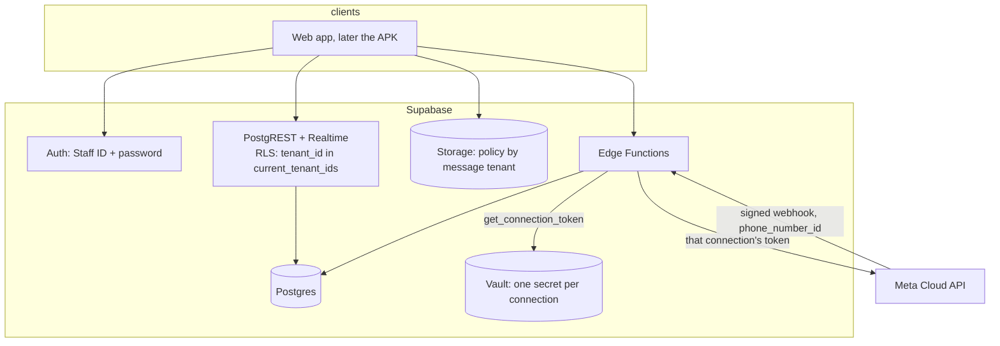

### 3.2 Where each part lives (evidence: `docs/evidence/07_file_inventory.txt`)
| Concern | File : line |
| --- | --- |
| Tenant derived from the login, never from a client | `supabase/migrations/20261118000000_tenants_core.sql:120` (`current_tenant_ids()`) |
| One tenant per login | `...000000_tenants_core.sql:38` (`tenant_memberships_one_tenant_per_user`) |
| Phone Number ID is unique on the whole platform | `...000000_tenants_core.sql:67` |
| Owner (test) tenant and backfill | `...000000_tenants_core.sql:165` |
| A chat's connection must be of the chat's tenant; a message's tenant must equal its chat's | `supabase/migrations/20261118000200_tenant_isolation.sql:29` and `:33` |
| Column-level grant that hides the Vault reference | `...000200_tenant_isolation.sql:92` |
| Per-RPC tenant check pattern | `...000200_tenant_isolation.sql:247` (`delete_message_for_me`) and the other ten RPCs |
| Message and status writes take the tenant from the connection | `...000200_tenant_isolation.sql:365` (`ingest_incoming`), `:476` (`apply_message_status`) |
| Routing lookup | `supabase/migrations/20261118000300_routing_admin.sql:12` (`resolve_connection`) |
| Account creation in one transaction | `...000300_routing_admin.sql:105` (`create_client_account`) |
| Insert-only audit log | `...000300_routing_admin.sql:96` |
| Webhook: HMAC before anything else | `supabase/functions/whatsapp-webhook/handler.ts:181` |
| Webhook: routing, WABA cross-check, inactive handling | `supabase/functions/whatsapp-webhook/handler.ts:286` |
| Webhook: media downloaded with the connection's token | `supabase/functions/whatsapp-webhook/handler.ts:511` |
| Send: another tenant's chat is "not found" | `supabase/functions/send-whatsapp/handler.ts:200` |
| Send: the conversation's own credentials | `supabase/functions/send-whatsapp/handler.ts:244` |
| Credentials from Vault or the legacy secret | `supabase/functions/_shared/supabase_store.ts:65` |
| Generated Staff ID and temporary password | `supabase/functions/admin-staff/handler.ts:155` |
| Feature flags | `supabase/functions/admin-connections/handler.ts:141` (manual token), `:212` (Embedded Signup) |
| Client-side: forced password gate, admin entry only for admins | `web/src/App.tsx:66`, `:104` |
| Brand configuration | `web/src/brand.ts:24` |
| Notification seam, tenant-scoped targeting | `supabase/functions/_shared/push.ts:45` |
| Rollback guard | `supabase/rollbacks/20261118_multi_tenant_down.sql:29` |

### 3.3 The actual tenant helper (migration `20261118000000_tenants_core.sql`, lines 120-145)
```sql
create or replace function public.current_tenant_ids()
returns setof uuid
language sql
stable
security definer
set search_path = ''
as $$
  select m.tenant_id
    from public.tenant_memberships m
    join public.tenants t on t.id = m.tenant_id
    join public.staff s on s.user_id = m.user_id
   where m.user_id = (select auth.uid())
     and not m.disabled
     and not s.disabled
     and t.status = 'active';
$$;

create or replace function public.current_tenant_id()
returns uuid
language sql
stable
security definer
set search_path = ''
as $$
  select t from public.current_tenant_ids() as t limit 1;
$$;
```
It returns nothing for a disabled login, a disabled membership or a suspended tenant, so every policy that uses it closes at once (SQL checks "disabled staff account sees nothing", "user of a suspended tenant sees nothing and cannot act").

### 3.4 The database refuses cross-tenant rows (migration `20261118000200_tenant_isolation.sql`, lines 27-42)
```sql
    alter table public.conversations add constraint conversations_id_tenant_key unique (id, tenant_id);
  end if;
  if not exists (select 1 from pg_constraint where conname = 'conversations_connection_tenant_fkey') then
    alter table public.conversations add constraint conversations_connection_tenant_fkey
      foreign key (connection_id, tenant_id) references public.whatsapp_connections (id, tenant_id) on delete restrict;
  end if;
  if not exists (select 1 from pg_constraint where conname = 'wa_messages_conversation_tenant_fkey') then
    alter table public.wa_messages add constraint wa_messages_conversation_tenant_fkey
      foreign key (conversation_id, tenant_id) references public.conversations (id, tenant_id) on delete cascade;
  end if;
  if not exists (select 1 from pg_constraint where conname = 'quick_replies_tenant_fkey') then
    alter table public.quick_replies add constraint quick_replies_tenant_fkey
      foreign key (tenant_id) references public.tenants (id) on delete restrict;
  end if;
end $$;
```
Evidence it works: SQL checks "a conversation cannot name a connection of another tenant (composite FK)" and "a message cannot carry a tenant different from its conversation (composite FK)" (`04_sql_multi_tenant.txt`). Live constraint text: `01_catalog_policies_privileges.txt` section 5.

### 3.5 Routing a webhook (`whatsapp-webhook/handler.ts`, lines 286-330)
```ts
async function routeChange(
  deps: WebhookDeps,
  rawPhoneId: unknown,
  rawWabaId: unknown,
  field: unknown,
): Promise<RoutedConnection | null> {
  const { store, env } = deps;
  const phoneId = typeof rawPhoneId === "string" && rawPhoneId.length > 0 && rawPhoneId.length <= 64 ? rawPhoneId : null;
  const wabaId = typeof rawWabaId === "string" && rawWabaId.length <= 64 ? rawWabaId : null;
  const record = async (outcome: RoutingEvent["outcome"], connectionId: string | null, detail?: string) => {
    try {
      await store.recordEvent({ phoneNumberId: phoneId, wabaId, field: String(field), connectionId, outcome, detail });
    } catch (err) {
      logError("whatsapp-webhook: could not record the routing outcome", err); // never fail the webhook for the ledger
    }
  };

  if (!phoneId) {
    await record("unrouted", null, "no phone_number_id");
    return null;
  }
  let connection = await store.resolveConnection(phoneId);
  // The legacy test number learns its phone number id the first time its own webhook arrives.
  if (!connection && env.phoneId && phoneId === env.phoneId) {
    if (await store.bindLegacyConnection(phoneId, wabaId)) connection = await store.resolveConnection(phoneId);
  }
  if (!connection) {
    await record("unrouted", null, "no connection for this phone number id");
    return null;
  }
  if (connection.wabaId && wabaId && connection.wabaId !== wabaId) {
    await record("mismatch", connection.connectionId, "WABA id does not match the connection");
    return null;
  }
  if (!connection.tenantActive || connection.status === "disconnected" || connection.status === "revoked") {
    await record("inactive", connection.connectionId, `connection ${connection.status}${connection.tenantActive ? "" : ", tenant suspended"}`);
    return null;
  }
  await record("routed", connection.connectionId);
  return connection;
}

const USER_ID = /^[\w.:-]{1,128}$/;

function normalizeMessage(message: Record<string, unknown>, names: Map<string, string>): IncomingMessage | null {
```
Evidence: Deno tests "routing: each phone number id stores into its own connection", "a WABA id that does not match the connection is refused (mismatch)", "a disconnected, revoked or suspended connection is acknowledged but stores nothing", "a status or reaction from another connection cannot touch this connection's message" (`03_deno_tests.txt`); integration checks "webhooks are routed by phone number id", "replaying A's message id on B's number does not copy or change it" (`06_integration_real_http.txt`).

### 3.6 Sending uses the conversation's own tenant and connection (`send-whatsapp/handler.ts`, lines 195-205)
```ts
  }

  // 3. Conversation and the 24-hour window.
  const conversation = await store.getConversation(conversationId);
  // Another tenant's conversation is reported exactly like a missing one.
  if (!conversation || conversation.tenant_id !== staff.tenant_id) {
    throw new HttpError(404, "Conversation not found", "not_found");
  }
  if (type !== "template" && !isWindowOpen(conversation.last_inbound_at, now)) {
    throw new HttpError(409, WINDOW_CLOSED, "window_closed");
  }
```
Evidence: Deno tests "tenant: another tenant's conversation is 'not found' (no sending, no storing, no credential lookup)" and "the message is sent with the credentials of the conversation's own connection"; integration "B cannot send into A's chat (404, nothing stored)".

### 3.7 Roles and screens
| Who | Sees | Evidence |
| --- | --- | --- |
| Platform admin with a client account | Inbox, plus **Administration** in the menu | `screenshots/03-menu-with-administration.png`, browser test "admin console: overview, create a client..." |
| Platform admin without a client account | Administration console | `web/src/App.tsx:104`; browser test |
| Client | Own inbox only; no admin entry; banner when the number is not connected | `screenshots/10-client-inbox-own-tenant-only.png`; browser test asserts `menu-admin` count is 0 |
| Client on a temporary password | "Choose your password" (UI only: see F1) | `screenshots/09-client-first-login-choose-password.png` |
| Disabled client / suspended client | "No client account" | integration "suspended tenant B reads nothing immediately"; browser test "No client account" |

### 3.8 Onboarding flow, today and intended
**Works today (local, no Meta):** admin creates a client (one transaction: login + tenant + membership), the server returns a temporary password **once**, the admin creates a connection (pending, unique Phone Number ID), the client signs in and must choose a password (UI-enforced). Evidence: `06_integration_real_http.txt` ("admin creates client A with a generated Staff ID...", "first login is flagged...", "admin creates a connection for each client"); screenshots 05, 06, 07, 09.
**Intended (Phase 3, blocked):** the client authorises their own WhatsApp Business account through Embedded Signup v5; the server exchanges the code for the client's business token, stores it in Vault, subscribes the Messaging account, and (for Business-app numbers) runs the Coexistence sync. Diagram: `docs/PHASE2_WALKTHROUGH.md` section 4.2; steps and Meta calls: section 11 below.

## 4. Screenshots (local demo data; demo clients removed afterwards)

| # | File | What it demonstrates |
| --- | --- | --- |
| 01 | 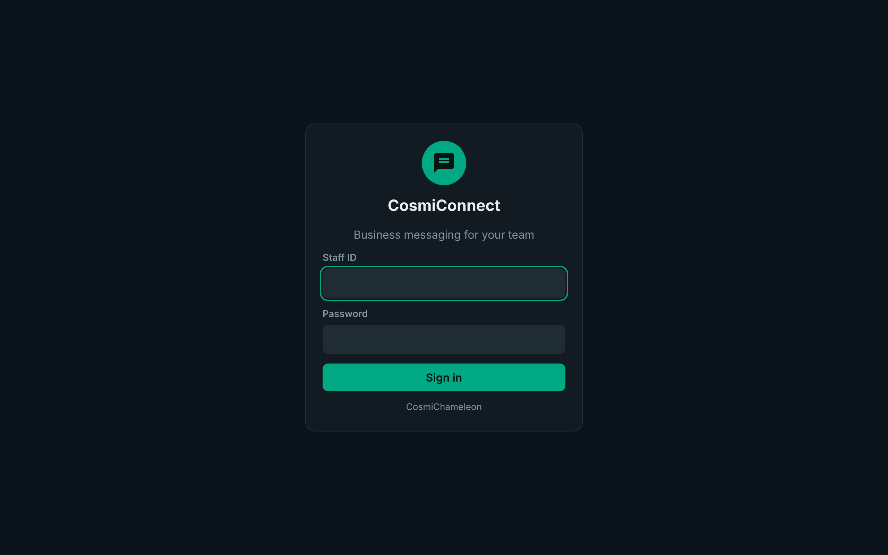 | Staff ID + password login with the brand (CosmiConnect / CosmiChameleon) |
| 03 | 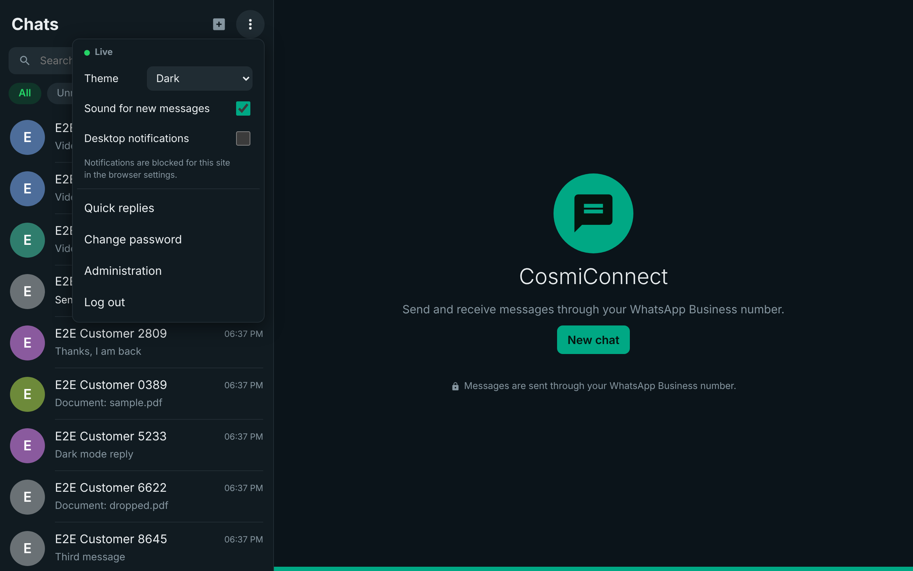 | **Administration** entry in the admin's menu |
| 04 | 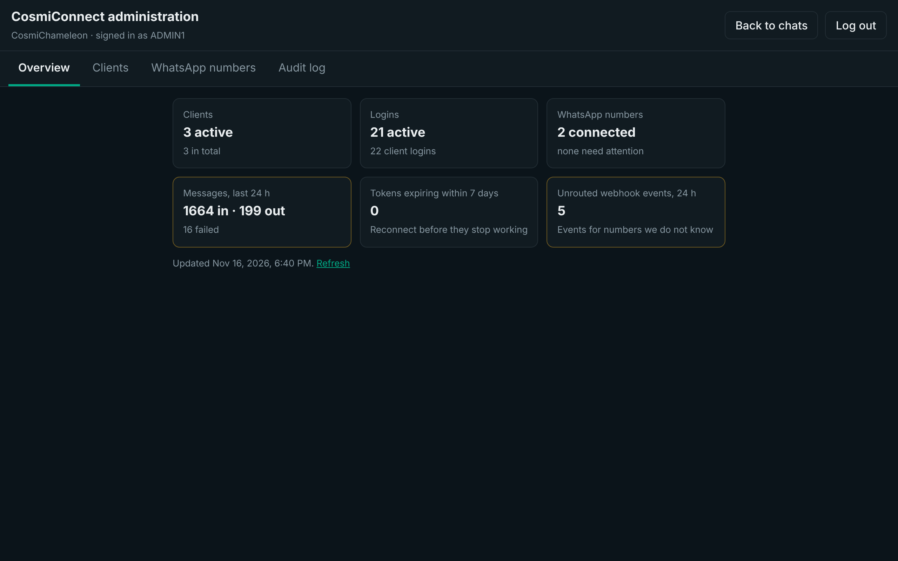 | Overview: counts only |
| 05 | 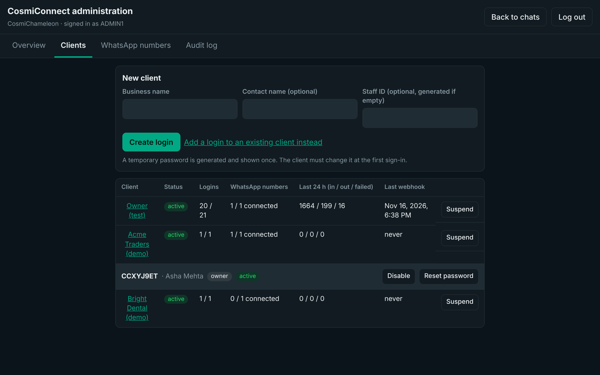 | Clients, per-client logins, suspend, reset password |
| 06 | 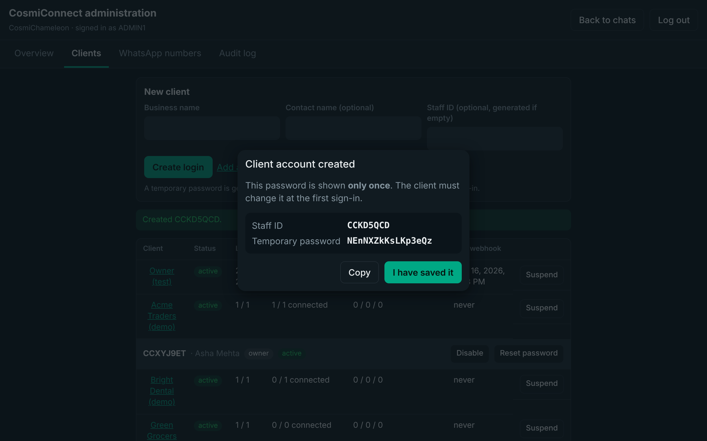 | One-time temporary password dialog |
| 07 | 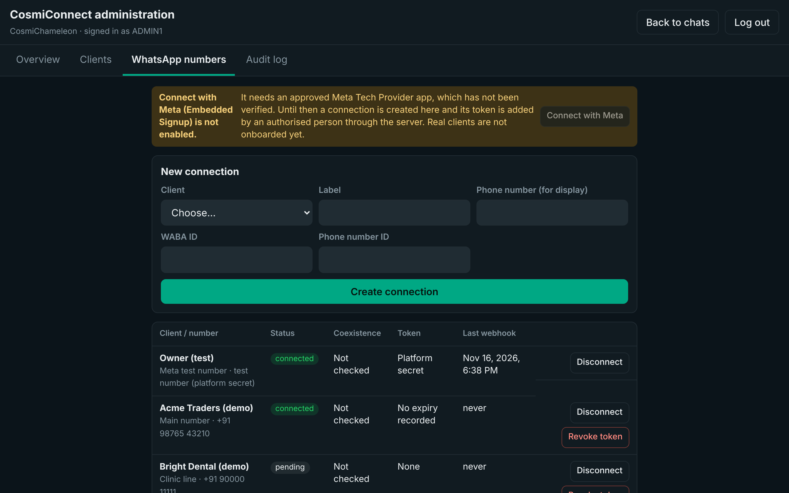 | Connections, token expiry, **Embedded Signup disabled** |
| 08 | 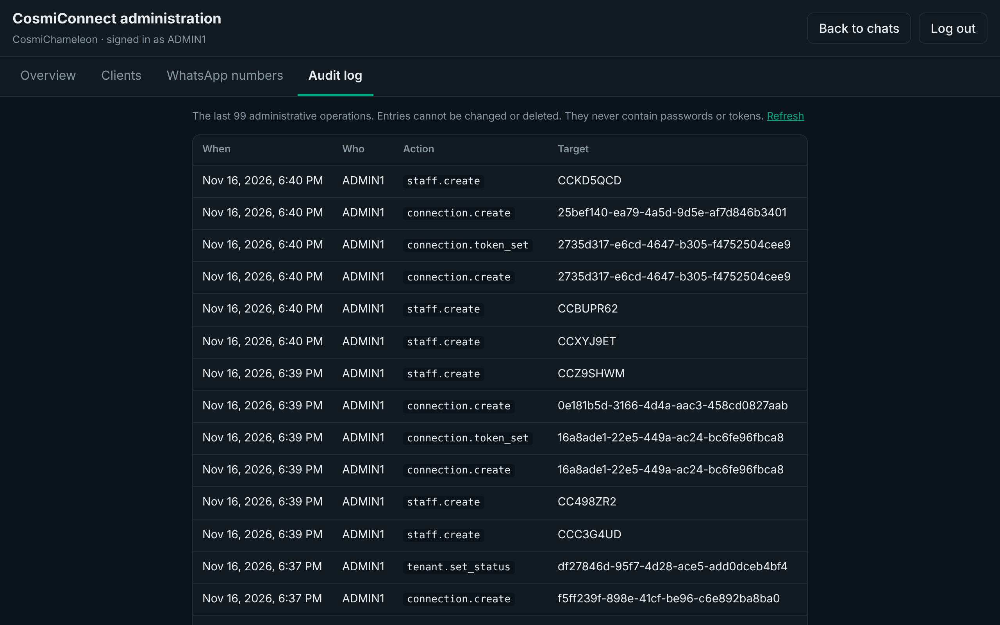 | Insert-only audit log |
| 09 | 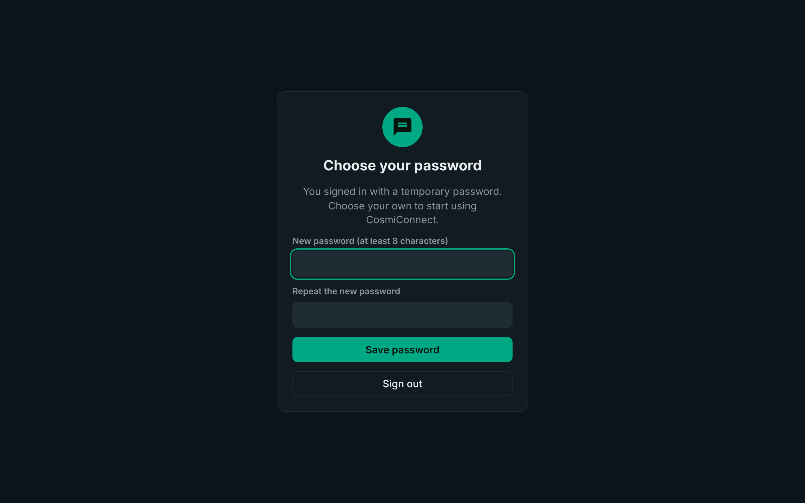 | First login with a temporary password |
| 10 | 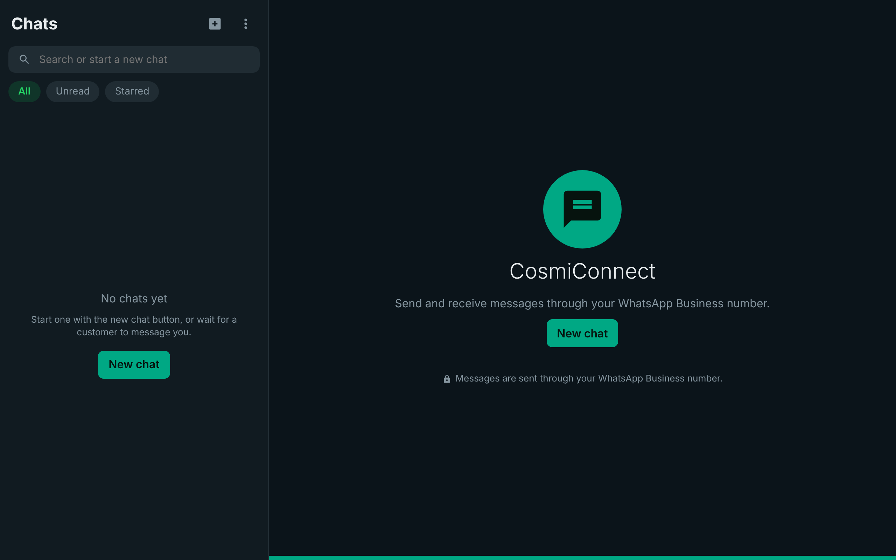 | A client's inbox: none of Owner (test)'s hundreds of chats |
| 11 | 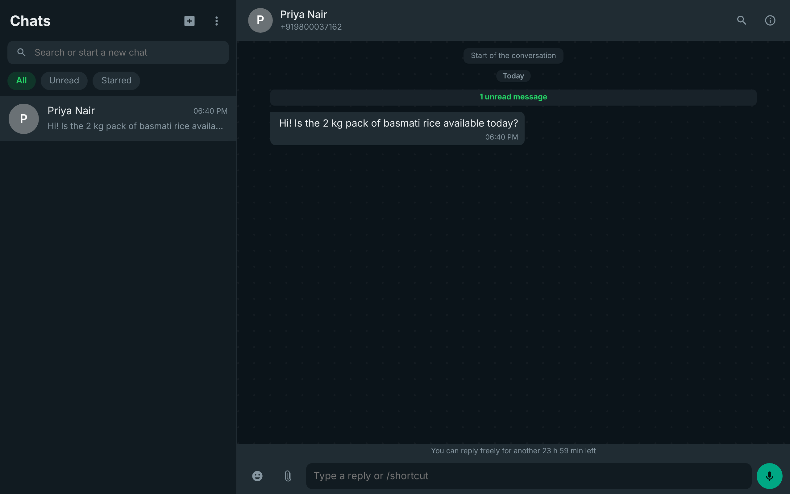 | A message routed by Phone Number ID to this client |
| 15 |  | **Isolation**: client A, same customer number |
| 16 | 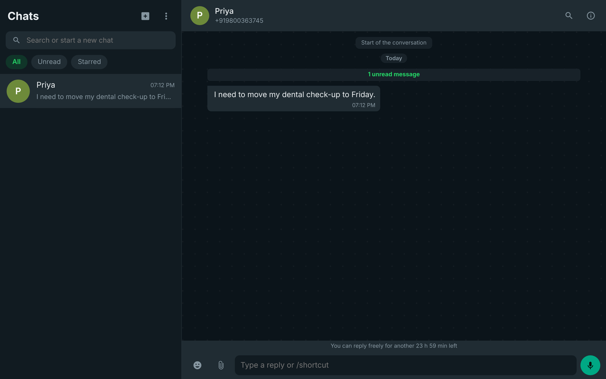 | **Isolation**: client B, same customer number, a different conversation |
| 17 | 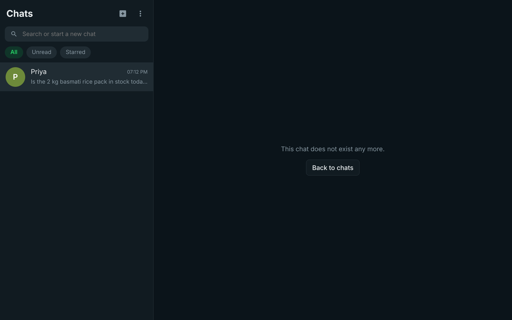 | **Isolation**: A opens B's chat link and gets "This chat does not exist any more." |
| 12-14 | `screenshots/12-phone-login.png`, `13-phone-admin-overview.png`, `14-phone-admin-clients.png` | Phone-sized screens |
Not covered by a screenshot: the Audit and Connections tabs on a phone, the connection banner for a client with a pending or disconnected number (asserted by browser tests, not photographed), the token-expiry colours.

## 5. Security review

### 5.1 Policies: the exact definitions in the local database
Source: `pg_policies` at capture time (`01_catalog_policies_privileges.txt` section 2). 14 policies, all `SELECT` except one storage `INSERT`; **no INSERT/UPDATE/DELETE policy exists on any table**.
```sql
CREATE POLICY audit_logs_select ON public.audit_logs FOR SELECT TO authenticated
  USING (is_admin());
CREATE POLICY conversation_reads_select ON public.conversation_reads FOR SELECT TO authenticated
  USING (((user_id = ( SELECT auth.uid() AS uid)) AND (EXISTS ( SELECT 1 FROM current_tenant_ids() current_tenant_ids(current_tenant_ids)))));
CREATE POLICY conversations_select ON public.conversations FOR SELECT TO authenticated
  USING ((tenant_id IN ( SELECT current_tenant_ids() AS current_tenant_ids)));
CREATE POLICY message_flags_select ON public.message_flags FOR SELECT TO authenticated
  USING (((user_id = ( SELECT auth.uid() AS uid)) AND (EXISTS ( SELECT 1 FROM current_tenant_ids() current_tenant_ids(current_tenant_ids)))));
CREATE POLICY files_staff_read ON storage.objects FOR SELECT TO authenticated
  USING (((bucket_id = 'files'::text) AND (EXISTS ( SELECT 1 FROM current_tenant_ids() current_tenant_ids(current_tenant_ids))) AND ((((storage.foldername(name))[1] = 'outgoing'::text) AND ((storage.foldername(name))[2] = (( SELECT auth.uid() AS uid))::text)) OR (EXISTS ( SELECT 1 FROM wa_messages m WHERE ((m.media_path = objects.name) AND (m.tenant_id IN ( SELECT current_tenant_ids() AS current_tenant_ids))))))));
CREATE POLICY files_staff_upload ON storage.objects FOR INSERT TO authenticated
  WITH CHECK (((bucket_id = 'files'::text) AND (EXISTS ( SELECT 1 FROM current_tenant_ids() current_tenant_ids(current_tenant_ids))) AND ((storage.foldername(name))[1] = 'outgoing'::text) AND ((storage.foldername(name))[2] = (( SELECT auth.uid() AS uid))::text)));
CREATE POLICY push_devices_select ON public.push_devices FOR SELECT TO authenticated
  USING ((user_id = ( SELECT auth.uid() AS uid)));
CREATE POLICY quick_replies_select ON public.quick_replies FOR SELECT TO authenticated
  USING ((tenant_id IN ( SELECT current_tenant_ids() AS current_tenant_ids)));
CREATE POLICY staff_select ON public.staff FOR SELECT TO authenticated
  USING (((user_id = ( SELECT auth.uid() AS uid)) OR is_admin() OR (user_id IN ( SELECT m.user_id FROM tenant_memberships m WHERE (m.tenant_id IN ( SELECT current_tenant_ids() AS current_tenant_ids))))));
CREATE POLICY tenant_memberships_select ON public.tenant_memberships FOR SELECT TO authenticated
  USING (((tenant_id IN ( SELECT current_tenant_ids() AS current_tenant_ids)) OR is_admin()));
CREATE POLICY tenants_select ON public.tenants FOR SELECT TO authenticated
  USING (((id IN ( SELECT current_tenant_ids() AS current_tenant_ids)) OR is_admin()));
CREATE POLICY wa_messages_select ON public.wa_messages FOR SELECT TO authenticated
  USING ((tenant_id IN ( SELECT current_tenant_ids() AS current_tenant_ids)));
CREATE POLICY webhook_events_select ON public.webhook_events FOR SELECT TO authenticated
  USING (is_admin());
CREATE POLICY whatsapp_connections_select ON public.whatsapp_connections FOR SELECT TO authenticated
  USING (((tenant_id IN ( SELECT current_tenant_ids() AS current_tenant_ids)) OR is_admin()));
```

### 5.2 Privileges (measured, `01_catalog_policies_privileges.txt`)
| Check | Measured result |
| --- | --- |
| Public tables with row level security | **12 of 12** |
| Table privileges of `authenticated` (public) | `SELECT` only, on: audit_logs, conversation_reads, conversations, message_flags, push_devices, quick_replies, staff, tenant_memberships, tenants, wa_messages, webhook_events |
| Table privileges of `anon` (public) | none |
| Column-level SELECT on `whatsapp_connections` for `authenticated` | coexistence, created_at, credential_source, display_phone_number, id, label, last_error, last_webhook_at, onboarding_method, phone_number_id, status, tenant_id, token_expires_at, updated_at, waba_id |
| `vault_secret_id` readable by `authenticated` | **no** |
| Functions in `public` executable by `anon` | **0** |
| Functions in `public` executable by `authenticated` | 23 (client RPCs, invoker search/unread/last-message functions, admin report RPCs that check `is_admin()` inside, push registration) |
| Functions executable by the service role and **not** by clients | apply_customer_reaction, apply_message_status, bind_legacy_connection, create_client_account, create_outgoing, get_connection_token, ingest_incoming, message_preview, purge_webhook_events, record_webhook_event, resolve_connection, revoke_connection_token, set_connection_state, store_connection_token, write_audit |
| `SECURITY DEFINER` functions without a pinned `search_path` | none |
| `service_role` privileges on `audit_logs` | INSERT, REFERENCES, SELECT, TRIGGER (no UPDATE/DELETE/TRUNCATE) |

### 5.3 Test evidence
| Suite | Result today | File |
| --- | --- | --- |
| SQL: delete-for-me on the tenant schema | **25 / 25** | `04_sql_message_delete.txt` |
| SQL: multi-tenant (two tenants + disabled, suspended, tenant-less, anonymous, admin logins) | **92 / 92** | `04_sql_multi_tenant.txt` |
| Deno: Edge Functions (send, mark-read, webhook, admin-staff, admin-connections, push, Graph, errors) | **134 / 134** | `03_deno_tests.txt` |
| Real HTTP: Auth, PostgREST, Storage, Realtime, Vault, Edge Functions with real logins | **100 / 100** | `06_integration_real_http.txt` |
| Browser: Playwright, desktop + phone | 86/86 passed | `11_playwright_full_run.txt` |
| Static: `deno check`, `deno lint`, `tsc`, `eslint`, `check:sql` | clean | `02_static_checks.txt` |
| Rollback rehearsal | all checks passed | `05_rollback_rehearsal.txt` |
**Does the suite detect breakage?** Mutation check done during the build and recorded in `docs/MULTI_TENANT_MIGRATIONS.md` section 3: opening one policy to all staff and making the status function ignore its connection each made the SQL suite fail; restoring made it pass. This was **not re-run today**.

### 5.4 The attacks that were executed and refused (from `06_integration_real_http.txt`)
```
PASS  a client cannot call the admin functions
PASS  unauthenticated calls to the admin functions are refused
PASS  the same phone number id cannot be attached to a second client
PASS  clients cannot decrypt tokens (RPC refused)
PASS  admin cannot decrypt tokens either
PASS  clients cannot read the Vault reference column (nor select *)
PASS  an unknown phone number id is acknowledged and stores nothing
PASS  a WABA id that does not match the connection is refused
PASS  replaying A's message id on B's number does not copy or change it
PASS  attack: read B's conversation by id
PASS  attack: read B's messages by conversation id
PASS  attack: read B's messages by tenant id
PASS  attack: list all conversations: only own tenant
PASS  attack: PATCH B's conversation is refused
PASS  attack: DELETE B's conversation is refused
PASS  attack: INSERT a conversation straight into B's tenant is refused
PASS  attack: INSERT a message straight into A's tenant is refused
PASS  attack: mark_conversation_read on B's chat is refused
PASS  attack: rename_contact on B's chat changes nothing
PASS  attack: B's contact name is untouched
PASS  attack: delete_message_for_me on B's message is refused
PASS  attack: set_message_flags (star) on B's message is refused
PASS  attack: search cannot find B's text
PASS  attack: search finds A's own text
PASS  attack: B's staff row is invisible to A
PASS  attack: other tenants are invisible
PASS  attack: memberships of other tenants are invisible
PASS  attack: audit log is invisible to a client
PASS  attack: webhook ledger is invisible to a client
PASS  attack: admin report RPCs are refused
PASS  attack: service-only RPCs are refused
PASS  attack: a forged tenant_id in start_conversation is ignored (tenant comes from the login)
PASS  attack: anonymous (anon key only) reads nothing
PASS  B cannot send into A's chat (404, nothing stored)
PASS  B cannot send a template into A's chat
PASS  B cannot mark A's chat read
PASS  A's chat holds A's incoming message and A's reply, nothing from B
PASS  B cannot sign a URL for A's file
PASS  an anonymous caller cannot sign a URL
PASS  B cannot download A's file directly
PASS  B cannot upload into A's outgoing folder
PASS  B cannot sign A's pending upload
PASS  Realtime delivers A's new message to A
PASS  Realtime delivers NOTHING at all (not even an empty event) to the other tenant
PASS  Realtime delivers B's message to B and not to A
PASS  admin does NOT read the message content of clients
PASS  a disconnected number's webhook is acknowledged but stores nothing
PASS  the routing ledger recorded the refused event (admin only)
PASS  Embedded Signup is behind its feature flag (refused)
PASS  suspended tenant B reads nothing immediately
PASS  suspended tenant B cannot send
PASS  and its webhook is acknowledged but stores nothing
PASS  A's still-valid token now reads nothing
PASS  A can no longer send (refused: 401 banned session or 403 disabled)
PASS  A cannot sign in again
PASS  clients still cannot change audit rows
```
56 of the 100 checks are shown (every check that tries to cross a boundary or confirms a refusal); all 100 pass: `docs/evidence/06_integration_real_http.txt`.

### 5.5 Review findings, each with its evidence
| # | Severity | Finding | Evidence (today) | Proposed fix | Status |
| --- | --- | --- | --- | --- | --- |
| F1 | **Medium** | The forced password change is enforced only by the UI; the flag is in user-writable `user_metadata` | `08_finding_F1_probe.txt`: HTTP 200 on data API with a temporary-password session; flag cleared without a password change; `app_metadata` write refused (403) | Flag in `app_metadata`; `current_tenant_ids()` and the functions treat such a session as having no tenant; `complete-password-change` function; test | ⏳ P1, 👤 Y3 |
| F2 | Low-Medium | WABA cross-check skipped when the connection has no `waba_id` | Code: `whatsapp-webhook/handler.ts` `routeChange` (`connection.wabaId && wabaId && ...`) | Require `waba_id` before `connected` | ⏳ P1 |
| F3 | Low | `webhook_events` has no retention; purge function not scheduled | `purge_webhook_events` in `...000300_routing_admin.sql`; row count in `01_catalog_policies_privileges.txt` section 7; `pg_cron` available but not installed | Schedule 30-day purge | ⏳ P11 |
| F4 | Low | A Vault secret would be orphaned if a connection row were deleted by hand | `01_catalog...` section 6: 0 orphans today; no code deletes connections | `delete_connection` that revokes first; orphan health query | ⏳ P1 |
| F5 | Low | Audit row is written after the Auth action; a failed insert returns 500 after the action applied | `supabase/functions/admin-staff/handler.ts` order of `store.setDisabled` / `store.audit` | Decide the policy (log loudly, or intent row first) | ⏳ P1 |
| F6 | Low (cosmetic) | "No WhatsApp number is connected" is HTTP 500 (code `P0002`) though the message shows | `08_finding_F1_probe.txt` last line | Custom errcode mapped to 4xx | ⏳ P1 |
| F7 | Medium (accepted) | The service-role key can read decrypted tokens (platform grant) | section 7 | Key hygiene, rotation runbook | 👤 Y |
| F8 | **Medium (operational)** | If hosted `WA_PHONE_ID` is missing or different, the test connection never binds and its webhooks are acknowledged and dropped | Behaviour shown by integration "an unknown phone number id is acknowledged and stores nothing" (same code path); code `routeChange` | Confirm secret; answer 500 when the id equals `WA_PHONE_ID` but binding fails; alert on `unrouted` | ⏳ P1, 👤 Y6 |
| F9 | Low (choice) | A suspended client's inbound messages are acknowledged and not stored | Integration "its webhook is acknowledged but stores nothing" | Decide: keep or buffer | 👤 |
| F10 | Low | Scale untested | I10 | Load test | ⏳ |
| F11 | Info | Rate limit is per login, not per number | `send-whatsapp/handler.ts` `countRecentSends` | Per-connection guard | ⏳ P6 |
| F12 | Info | `rls_auto_enable()` on hosted is unexplained | Earlier audit; absent locally (`01_catalog...` section 4 lists no such function) | Investigate on hosted | 👤 Y13 |

### 5.6 Secrets hygiene
```
(git diff; git ls-files --others --exclude-standard | xargs cat) | grep -cE "eyJ[A-Za-z0-9_-]{30,}|sbp_[A-Za-z0-9]{10,}|EAA[A-Za-z0-9]{30,}"   ->  0 matches
git check-ignore supabase/functions/.env .env web/.env   ->  all three ignored
```
Not covered: a dedicated secret scanner over git history (not run); the anon key committed in `.github/workflows/deploy-web.yml` is public by design and unchanged.

## 6. Migration review

### 6.1 Facts per migration
| Migration | Lines | What it does | Verified by |
| --- | --- | --- | --- |
| `20261118000000_tenants_core.sql` | 192 | 6 tables, 2 helper functions, nullable tenant columns, Owner (test) tenant, memberships, legacy connection, backfill | fingerprint identical; SQL checks; idempotent re-run |
| `20261118000100_vault_tokens.sql` | 118 | Vault extension; 3 service-role-only functions; note on the platform's Vault grants | SQL checks (token isolation, rotation, revoke); integration |
| `20261118000200_tenant_isolation.sql` | 533 | NOT NULL, composite FKs, per-connection/per-tenant uniqueness, 14 policies (8 replaced, 6 new), column grants, 11 RPCs rewritten, 4 service functions rewritten | SQL 92/92, integration 100/100 |
| `20261118000300_routing_admin.sql` | 248 | Routing, ledger, audit, account creation, admin reports, push registration | SQL, Deno, integration |

### 6.2 Data preserved (evidence `10_data_preservation_fingerprints.txt`)
```
## A. Taken on the local database BEFORE the four tenant migrations were applied (2026-11-16, build session)
conversation_reads|585|1f55c2393c2c98e90deb23e56350945d
conversations|634|a00acccc47aa2d3df298bfdb1b11d8eb
media_links_ok|452|452
message_flags|96|76d59eded7d2af563a7fa6ee776a8c2c
quick_replies|6|e3bee11992351cb5635118984f48824a
staff|21|89645419db23241a8fe19b050b09ce62
storage_objects|452|95db8551c54b98670fb817faabb1e057
wa_messages|5394|99307ab0bf6d445abe7769a608f96335

## B. Taken immediately AFTER applying the four migrations (same database, same moment in the data)
conversation_reads|585|1f55c2393c2c98e90deb23e56350945d
conversations|634|a00acccc47aa2d3df298bfdb1b11d8eb
media_links_ok|452|452
message_flags|96|76d59eded7d2af563a7fa6ee776a8c2c
quick_replies|6|e3bee11992351cb5635118984f48824a
staff|21|89645419db23241a8fe19b050b09ce62
storage_objects|452|95db8551c54b98670fb817faabb1e057
wa_messages|5394|99307ab0bf6d445abe7769a608f96335

## C. diff A B
IDENTICAL (no differing line): every row, id, status, media path and file name is unchanged; every media path still points at an existing Storage object (media_links_ok: n|n)
```

### 6.3 Bugs this review found in its own migrations
| Bug | Evidence | Fixed? |
| --- | --- | --- |
| Re-applying `...000200` re-granted UPDATE/DELETE on `audit_logs` to `service_role`, undoing `...000300`'s revoke | Found during the mutation re-apply; `service_role` privileges on `audit_logs` today: `INSERT, REFERENCES, SELECT, TRIGGER` (`01_catalog...` section 3c); SQL check "audit log rows cannot be altered, even by the service role" | Yes, in `...000200` |
| An attempted `revoke` on the Vault views was a silent no-op (the migration appeared to restrict something it did not) | `01_catalog...` section 6 (`service_role` still has SELECT on `vault.decrypted_secrets`) | The no-op was **removed** and the limit documented (`...000100_vault_tokens.sql:109`) |

### 6.4 Dropped and replaced objects (deployment-order risk)
`apply_message_status(text,text,text)` and `apply_customer_reaction(text,text)` are **dropped** and replaced by versions with a `connection_id` argument, and `ingest_incoming` now requires `connection_id`. Consequence: the **old Edge Functions stop working the moment the migration is applied**; migration and deployment must be done back to back (section 8.3).

## 7. Vault limitations

### 7.1 What was measured (`01_catalog_policies_privileges.txt` section 6)
```
## 6. Vault: who can touch it
                                vault_view_select                                 
----------------------------------------------------------------------------------
 anon select decrypted_secrets: false | authenticated: false | service_role: true
(1 row)

config.toml: 8:schemas = ["public"]
                        ?column?                        
--------------------------------------------------------
 vault secrets total=0 ; orphans (no live connection)=0
(1 row)
```

### 7.2 The boundary, stated plainly
| Who | Can obtain a token? | Evidence |
| --- | --- | --- |
| Browser, APK, any client login, **the platform admin** | **No** | SQL: "A: service-only functions are not callable" (token functions raise 42501), "admin still cannot call token functions", "A cannot read the Vault reference column"; integration: "clients cannot decrypt tokens (RPC refused)", "admin cannot decrypt tokens either" |
| Anonymous | **No** | SQL "anonymous sees and calls nothing" |
| Edge Functions (service-role key) | **Yes, deliberately**, in memory for one request | `supabase/functions/_shared/supabase_store.ts:65` → `get_connection_token` |
| **Anyone holding the service-role key** | **Yes** | **The limit.** The platform grants `service_role` SELECT on `vault.decrypted_secrets`; a migration cannot revoke it (owner is `supabase_admin`); the attempted revoke was a no-op (see 6.3) |
| The REST API | The `vault` schema is not exposed | `supabase/config.toml` `[api] schemas = ["public"]`; HTTP 406 for the `vault` profile (checked during the build) |

### 7.3 What Supabase documents (`09_sources_read.txt`: database/vault, platform/backups, migrating-within-supabase)
Authenticated encryption; the key is **not stored in the database**; a **unique key per project**, retrievable through the Management API pgsodium endpoint; same-project restore and PITR keep the key; "Restore to a new project" and branching copy it; a **manual `pg_dump`/`pg_restore` to a new project gets a fresh key and cannot decrypt** unless the old root key is copied; "pgsodium (pending deprecation)" appears in Supabase's extension list.

### 7.4 Recovery strategy (principle: a client token is re-obtainable, so Vault is never the only copy of anything irreplaceable)
| Scenario | Outcome | Action |
| --- | --- | --- |
| Backup, same-project restore, PITR | Tokens decrypt | Nothing |
| Restore to a new project (Dashboard) / branching | Key copied by Supabase | Test one decrypt |
| Manual dump/restore to a new project | Tokens **cannot** be decrypted | Copy the root key first (Management API) |
| Project and key lost | All stored tokens unreadable | Mark connections `error`; re-onboard each client |
| Token leaked | Attacker can message as that client | Revoke at Meta, revoke in the console (secret deleted), reconnect |
| `WA_TOKEN` (owner's legacy number) | Not in Vault; a Supabase secret | Keep the permanent token in a password manager |
Back up the **root key** only once a first real client token exists, offline, access limited to two named people. **Not verified here:** your Supabase plan; whether the hosted project has the Vault extension; whether a new business token can be minted for an already-onboarded client without re-running Embedded Signup. Full text: `docs/VAULT_BOUNDARY_AND_RECOVERY.md`.

## 8. Backup and rollback plan

### 8.1 What exists and is proven (evidence `05_rollback_rehearsal.txt`)
| Step in the rehearsal | Result today |
| --- | --- |
| Restore the **pre-migration backup** into a scratch database; take its schema signature | 260 signature lines |
| Add a second tenant, run the down script | **Refused** ("Rollback refused: there is more than one tenant..."), schema unchanged |
| Run the down script on the real local data (5,890 messages, 717 conversations, 533 files) | Completed in one transaction |
| Compare rolled-back schema with the pre-migration signature | **Identical** (260 lines; columns, constraints, indexes, function bodies, privileges, policies) |
| Compare data before and after | **Identical** (8 md5 rows incl. all media links) |
| Original delete-for-me suite from git `HEAD` on the rolled-back schema | 25 rows, no failure |
| Old `ingest_incoming` and 3-argument `apply_message_status` | Work |
| Roll forward (4 migrations again) | Schema and data identical to before the rollback; both suites pass |
Files: `supabase/rollbacks/20261118_multi_tenant_down.sql` (guard at line 29, snapshot into `rollback_snapshot`, drops, restores old policies and function bodies), `schema_signature.sql`, `rehearse_local.sh`.

### 8.2 Limits of that proof (not verified)
Local database, not hosted · the **old Edge Function code was not run end to end** against a rolled-back database (only its SQL functions and the original SQL suite) · after a roll-forward the legacy phone number id is re-learned from the next webhook and audit rows stay in `rollback_snapshot` (restoring them is manual) · no rehearsal on a **restored copy of hosted data**.

### 8.3 The hosted plan (not executed; `docs/BACKUP_AND_ROLLBACK_PLAN.md` has the full runbook)
**Before:** confirm the plan and enable daily backups or **PITR** (Supabase: daily backups for Pro/Team/Enterprise, 7/14/30 days; PITR add-on with about two-minute RPO; restores take the project offline; **backups exclude Storage objects**); take a manual logical backup (`roles`, `schema`, `data`); copy all Storage objects with hashes; record the fingerprint on hosted (read-only SELECTs) and the secret names, Auth settings, deployed function list and live git commit; verify Vault availability and `WA_PHONE_ID`; **rehearse on a scratch project restored from the backup**, including the down script.
**Window (needs your approval):** apply migrations 5-8 in order (each one transaction), compare the fingerprint, deploy the five Edge Functions immediately (old functions break the moment the migration lands), deploy the web app, verify (`wa-diagnose`, a signed test webhook binds the legacy connection, admin sign-in, Owner (test) data), keep both feature flags off.
**Rollback decision:** migration failed → each file is a transaction, fix and re-run · migrations applied but nothing real exists → run the down script and redeploy the previous functions and web build · a real client or Vault connection exists → the script **refuses**; fix forward, suspend the affected client, or restore the backup (accepting data loss since the backup; Storage restored separately).
**Estimates (not measurements on hosted):** preparation and rehearsal half a day to a day; the window 15-30 minutes; the down script seconds on this data size.

## 9. Onboarding blockers (evidence status per row)

| # | Blocker | Type | Category | Evidence of current state |
| --- | --- | --- | --- | --- |
| A1 | Tech Provider status, App Review with Advanced access to the two permissions | HARD | 🔒 M1-M2, 👤 Y1-Y2 | **Not verifiable from code**; Meta's steps in `09_sources_read.txt` |
| A2 | App in live mode; Embedded Signup configuration; HTTPS allowed domains; v5 | HARD | 🔒 M3, 👤 Y8 | Not done; the flag refuses (V9) |
| A3 | Four extra webhook fields subscribed | HARD for Coexistence | 🔒 M4, 👤 | Only `messages` was confirmed earlier (`wa-diagnose`, earlier session); **not re-checked** |
| A4 | Each client adds a payment method | HARD per client | 👤 (client) | Process to document |
| A5 | Onboarding limit 10/7 days until verification complete | SOFT | 🔒 M6 | Stated by Meta |
| B1 | Phase 2.1 hardening (F1, F8 first) | HARD | ⏳ P1, 👤 Y3 | `08_finding_F1_probe.txt` |
| B2-B4 | Embedded Signup, Coexistence handlers, token health | HARD | ⏳ P2-P5 | Not built |
| B5 | Per-connection throughput guard | SOFT | ⏳ P6 | Not built |
| B6-B7 | Android app; Firebase | HARD for the APK | ⏳ P7-P8, 👤 Y11-Y12 | Not built |
| C1 | Hosted rehearsal and migration; verify Vault and Realtime on hosted; `rls_auto_enable()` | HARD | ⏳ P10, 👤 Y4, Y13 | Not done |
| C2 | Backups and Storage backup; restore drill; root-key backup | HARD | 👤 Y5 | Plan unknown |
| C3 | Rotate shared admin password and Supabase token; hosted Auth min length 6 and `site_url`; security headers on Pages | HARD | 👤 Y7 | Open since the first audit |
| C4 | Monitoring and alerts | HARD | ⏳ P9 | None |
| D1-D5 | Privacy policy, terms, consent and retention for imported history, onboarding guide, billing, support | HARD | 👤 Y9-Y10, ⏳ P13 | Not started |
Full table with owners: `docs/REAL_CLIENT_ONBOARDING_READINESS.md`. **Critical path:** A1 → A2/A3 → Phase 2.1 → Phase 3 → hosted rehearsal, backups, monitoring → pilot with your own second number → one friendly client.

## 10. Which features require which Meta approval

| Capability | Requirement (Meta pages read) | App Review / Advanced access? |
| --- | --- | --- |
| Messaging with **your own test number** (today) | A Meta app with the WhatsApp use case; a user with a role on the app | **No**: Standard access; "if you are using the API for yourself as a Direct Developer you do not need Advanced access or app review" |
| Messaging **other businesses' numbers** through the platform | **Tech Provider** (business verification + App Review) and business tokens from Embedded Signup | **Yes**: Advanced access to `whatsapp_business_messaging` and `whatsapp_business_management` |
| Embedded Signup (v5) | Tech Provider/Solution Partner; Facebook Login for Business configuration; HTTPS allowed domains; live mode | Yes |
| Coexistence | Tech Provider/Solution Partner; client app 2.24.17+; Embedded Signup with session logging; `account_update`, `history`, `smb_app_state_sync`, `smb_message_echoes` subscribed | Yes |
| Contacts and history sync | Coexistence; client shares history; `smb_app_data` calls within **24 hours**; up to **180 days** of messages; media ids only for the last 14 days | Same |
| Mirroring Business-app messages (`smb_message_echoes`) | Coexistence | Same |
| Customer **edit** (within 15 minutes) and **revoke** (within two days) events | Coexistence; delivered as `messages` webhooks | Same |
| Client templates | Meta reviews each template per account | Yes for client accounts |
| Media, voice notes, reactions, replies, read receipts, typing | Part of `whatsapp_business_messaging` | Yes for client accounts |
| More than 10 new clients per rolling 7 days | Business Verification + App Review + Access Verification (the last is not defined on the pages read) | Yes |
| Groups | Per your brief: Groups API needs Official Business Account eligibility, not for Coexistence numbers; Meta's Coexistence table lists group chats as not supported; the Groups API page itself was **not read** | **Unverified** |
| Calls, broadcast lists, disappearing/view-once, status, channels, live location, business profile/catalog | **Not supported** for a Business-app number on Cloud API (Meta's table) | n/a |
| Business-side edit / "delete for everyone" | No operation on the pages read | n/a (Unsupported by API) |

## 11. Phase 3 implementation plan (not started; needs your approval)
Detail: `docs/PHASE3_PLAN_EMBEDDED_SIGNUP_COEXISTENCE.md`.

**Decision first: how the client launches Embedded Signup.** (A) our HTTPS page with the Facebook JS SDK and `FB.login(config_id, response_type=code, extras{version:"v5"})`, listening for the `WA_EMBEDDED_SIGNUP` message event (needs the domain on Meta's allowed-domains and redirect-URI lists, HTTPS; **must not run inside the APK's WebView**); or (B) Meta-hosted link, completion detected by the `account_update` `PARTNER_ADDED` webhook, business token fetched with the System User Access Tokens API (cannot be customised; **Coexistence support unverified**). Recommendation: A.

**Server steps (all Meta calls from the pages read):** `GET /oauth/access_token` (app id, app secret, code) → business token; `GET /<phone_number_id>?fields=is_on_biz_app,platform_type,...`; `GET /debug_token`; token to Vault; `POST /<WABA_ID>/subscribed_apps`; non-Coexistence only: `POST /<phone_number_id>/register` with a 6-digit PIN; Coexistence: **skip registration**, then `POST /<phone_number_id>/smb_app_data` with `sync_type: smb_app_state_sync` and then `history`, **each once, within 24 hours**.

**Data additions:** `onboarding_sessions` (single-use, expiring), `connection_sync_state`, `wa_messages.source/edited_at/original_body/revoked_at`, a short-retention raw-payload table for `history`, health fields on connections; each with tenant-isolation tests and a **tested down script**.

**Webhook handlers:** `account_update` (`PARTNER_ADDED`/`PARTNER_REMOVED` + `disconnection_info`, `ACCOUNT_OFFBOARDED`, `ACCOUNT_RECONNECTED`), `smb_message_echoes` (stored as outgoing, source `business_app_echo`), `smb_app_state_sync` (contacts add/edit/remove), `history` (store first, process asynchronously, order by `chunk_order`, phases 0-1 day, 1-90, 90-180, `progress` 100 = done, error 2593109 = declined), `messages` types `edit` and `revoke`, error 131060 as an info note.

**Functions and screens:** `onboarding-start`, the HTTPS onboarding page (consent text, app version, keep the app open), `onboarding-complete`, `connection-sync`, `connection-health`; admin timeline, coexistence badge and sync progress, reconnect/offboard; client "connecting" banner.

**Tests before touching real Meta:** a fake Meta server; webhook fixtures shaped like Meta's examples; ordering/duplicate/very large `history` chunks; users without phone numbers (business-scoped ids); isolation tests on every new table; state single-use/expiry/tenant-bound; forged-origin events ignored; token never logged or returned; browser tests with a mocked SDK; real tests with a consenting test client **only after approval**.

| Step | Content | Size | Depends on |
| --- | --- | --- | --- |
| 3.0 | Phase 2.1 hardening (F1, F2, F3, F8) | S | your approval |
| 3.1 | Read remaining Meta pages; settle A vs B | S | you |
| 3.2 | Migrations + down scripts + isolation tests | M | 3.0 |
| 3.3 | Webhook handlers with fixtures | M | 3.2 |
| 3.4 | `history` ingestion | L | 3.3 |
| 3.5 | Fake Meta + onboarding start/page/complete (flag off) | L | 3.2 |
| 3.6 | Sync and health jobs, alerts | M | 3.5 |
| 3.7 | Admin and client screens | M | 3.5 |
| 3.8 | Full tests, security review, docs, rollback rehearsal | M | all |
| 3.9 | Real onboarding tests with a consenting client | S effort, long lead | Meta approval |
Sizes are author estimates (S < 1 day, M 1-3, L 3-5 days of focused work). Risks: the 24-hour sync window; volume and privacy of imported history; unconfirmed token lifetime (Meta's configuration template is named "...60 Expiration Token"); unsupported companion devices send no webhooks; 20 messages/second cap; Graph v27.0 vs our v26.0; client behaviour such as inactivity disconnects.

## 12. What could not be verified (stated explicitly)
1. **Anything on the hosted Supabase project**: that the Vault extension is enabled, Realtime behaviour with the new policies, `WA_PHONE_ID` and the other secrets, backups, the plan, `rls_auto_enable()`, and the hosted data volume.
2. **Meta account state**: whether WT is a Tech Provider; business verification, App Review and Access Verification status; live mode; which webhook fields are subscribed now.
3. **Real WhatsApp behaviour**: real delivery of photos, voice, location, reactions, quotes and templates; real blue ticks; Meta's webhook retry schedule.
4. **A real Android device**: camera, microphone, push, background, upgrade (no APK exists).
5. **Meta's Postman collection** (not readable without a Postman key) and the **Groups API** page (not read).
6. **Business-token lifetime**, and whether a token can be re-minted for an already-onboarded client without re-running Embedded Signup.
7. **Hosted ES and Coexistence**: the page read does not mention it.
8. **What "Access Verification" is** (named on Meta's overview page as a condition for the 200-client limit, not defined on the pages read).
9. **Supabase plan limits and pricing** (not read).
10. **The old Edge Function code against a rolled-back database, end to end** (only SQL-level).
11. **Performance and load** beyond about 5,900 local messages.
12. **Counts shown in the admin overview** reconciled against raw tables (shape tested only).
13. **A dedicated secret scan of git history** (only the changed and new files were scanned).
14. **The mutation check on the SQL suite was not re-run today** (done during the build, recorded in `docs/MULTI_TENANT_MIGRATIONS.md`).

## 13. Stop point and what I need from you
This review is complete and I have **stopped**. I will not start Phase 3, apply anything to hosted, commit, push, deploy or touch Meta or production secrets until you approve.

**To proceed I need your decisions on:** (1) Phase 2.1 hardening first, yes or no; (2) a scratch-project rehearsal; (3) the Meta Tech Provider / App Review status and whether to start it now; (4) the HTTPS domain and Option A vs B; (5) history retention/consent and billing; (6) whether to commit the Phase 2 work. The full list is section 2.5.

## Appendix A: the SQL checks, as run today (`04_sql_multi_tenant.txt`)
```
92 checks, all PASS:
PASS  A cannot read tenant B conversation by id
PASS  A cannot read tenant B message by id
PASS  A cannot read the audit log
PASS  A cannot read the token rotation column
PASS  A cannot read the Vault reference column
PASS  A cannot read the webhook ledger
PASS  A cannot use select * on connections (restricted columns)
PASS  a conversation cannot name a connection of another tenant (composite FK)
PASS  a login can belong to one tenant only
PASS  a message cannot carry a tenant different from its conversation (composite FK)
PASS  A no longer sees the moved device token
PASS  a phone number id can belong to only one connection
PASS  A reads only tenant A conversations
PASS  A reads only tenant A messages
PASS  A sees its own file and not the file of tenant B
PASS  A sees only its own connection
PASS  A sees only its own quick reply (same shortcut exists in B)
PASS  A sees only its own tenant row
PASS  A sees only members of its own tenant
PASS  A sees only staff of its own tenant
PASS  A: admin functions are refused
PASS  A: cannot insert into tables directly
PASS  A: delete_message_for_me on a B message is "not found"
PASS  A: mark_conversation_read on a B conversation is "not found"
PASS  A: registered a push device in tenant A
PASS  A: same shortcut allowed in a different tenant (saved /hello-two and it exists in B too)
PASS  A: service-only functions are not callable
PASS  A: set_message_flags (star) on a B message is "not found"
PASS  A: start_conversation creates new chats in tenant A on A's connection
PASS  A: start_conversation with the number tenant B also has returns A's own chat
PASS  A: storage upload into the own folder is allowed
PASS  A: storage upload outside the own folder is refused
PASS  admin cannot read the Vault reference either
PASS  admin does NOT read message content of tenants it does not belong to
PASS  admin overview and tenant summary return counts only
PASS  admin sees audit log and webhook ledger
PASS  admin sees every tenant and connection
PASS  admin still cannot call token functions
PASS  admin suspended tenant B and the audit log recorded it
PASS  and has access again after reactivation
PASS  and not a second time
PASS  anonymous sees and calls nothing
PASS  audit log rows cannot be altered, even by the service role
PASS  B does not see A's push device
PASS  B reads only tenant B data
PASS  B sees its own file only
PASS  B: a device token re-registered by B moves to B
PASS  B's quick reply list does not include A's snippets
PASS  B's start_conversation with the shared number returns B's own chat
PASS  bind_legacy_connection binds the legacy connection once
PASS  bind_legacy_connection refuses a phone number id that belongs to another connection
PASS  create_outgoing for the right tenant works and takes the tenant from the conversation
PASS  create_outgoing refuses a disabled sender
PASS  create_outgoing refuses a sender from another tenant
PASS  disabled membership sees nothing and cannot act
PASS  disabled staff account cannot call RPCs
PASS  disabled staff account sees nothing
PASS  disconnecting B removes its token too
PASS  duplicate wamid is ignored (idempotent)
PASS  each connection decrypts to its own token
PASS  every public table has row level security enabled
PASS  every stored message carries the tenant of its connection
PASS  incoming message on connection A creates a chat in tenant A
PASS  ingest for an unknown connection is refused
PASS  ledger records routing outcomes and stamps last_webhook_at on the routed connection
PASS  login without a tenant sees nothing and cannot act
PASS  no flag rows or read rows were created on B's data by A
PASS  no table row contains token text
PASS  only one connection may use the global WA_TOKEN
PASS  reaction from the right connection is applied
PASS  reaction from the wrong connection is ignored
PASS  resolve_connection maps SQLT_PHONE_A to tenant A and B to tenant B
PASS  resolve_connection reports the suspended tenant
PASS  revoking A deletes its secret and status, and B keeps working
PASS  rotation replaces the token in place and leaves B alone
PASS  search cannot find text that only tenant B has
PASS  search finds own text
PASS  status from the right connection applies, and never goes backwards
PASS  status from the WRONG connection does not change the message
PASS  tenant B conversation, message and quick reply unchanged after A's attacks
PASS  tenant B is locked out the moment it is suspended
PASS  tenant without a WhatsApp connection cannot start a chat (clear error)
PASS  the legacy platform_env connection cannot store a Vault token
PASS  the same customer number on connection B is a different chat in tenant B
PASS  the same customer number twice on one connection is refused
PASS  the same wamid replayed on ANOTHER connection does not copy or overwrite the message
PASS  the vault schema is not granted to anon or authenticated
PASS  two separate Vault secrets exist, only references are stored on the connections
PASS  unknown phone number id resolves to nothing
PASS  unread_counts shows only tenant A
PASS  user of a suspended tenant sees nothing and cannot act
PASS  visible_last_messages only returns tenant A chats
```

## Appendix B: the Deno tests, as run today (`03_deno_tests.txt`)
```
93 test lines + summary: ok | 134 passed | 0 failed (1s)
ok  fetchWithRetry backs off exponentially: 500 ms, then 1000 ms
ok  fetchWithRetry returns the last 5xx response after the final attempt
ok  push: only devices of the message's own tenant are targeted
ok  push: the sender of an action is not notified about it, and duplicate tokens are sent once
ok  push: message text stays out of the notification unless previews are on
ok  push: with no provider configured nothing is sent and the reason is reported
ok  unauthenticated: no token is 401
ok  unauthenticated: invalid token is 401
ok  signed-in user without a staff row is 403
ok  disabled staff is 403
ok  empty message is 400
ok  invalid input is 400
ok  unknown conversation is 404
ok  closed 24h window: text is refused with 409 and nothing is sent
ok  closed 24h window: customer never wrote is also closed
ok  closed 24h window: template is still allowed
ok  dry run success: no call to Meta, fake id, status sent
ok  real send: text goes to the Graph API with the bearer token
ok  real send: image uses a short-lived signed URL
ok  real send: PDF is sent as a document with its file name
ok  file checks: too large, wrong type, missing
ok  rate limit: 429 after too many recent sends
ok  Graph API rejection: message is marked failed with the reason, 502
ok  Graph API 5xx is retried with backoff, then succeeds
ok  Graph API down after all retries: failed, 502
ok  a connection without a token (not dry run) is a 500 and nothing is stored
ok  CORS preflight is answered
ok  reply: the quoted message goes into the Cloud API context field
ok  reply: a message from another chat, or one WhatsApp never got, cannot be quoted
ok  reaction: sent as a reaction message and stored on the target
ok  reaction: empty emoji removes it; text is not an emoji; window must be open
ok  reaction: when Meta refuses, nothing is stored and the reason is mapped
ok  voice note: OGG/Opus is sent as audio with voice=true
ok  audio in another format is sent as plain audio; a caption on audio is refused
ok  video: MP4 is sent as video with a caption
ok  photo larger than Meta's 5 MB image limit is refused before sending
ok  WA_MEDIA_MODE=upload: the file is uploaded to Meta and sent by media id
ok  WA_MEDIA_MODE=upload: a rejected upload marks the message failed with the reason
ok  customer known only by user id is addressed with 'recipient' instead of 'to'
ok  Meta error codes become staff-facing messages
ok  tenant: a staff member without an active tenant is 403 and nothing is stored or sent
ok  tenant: another tenant's conversation is 'not found' (no sending, no storing, no credential lookup)
ok  tenant: the message is sent with the credentials of the conversation's own connection
ok  tenant: a disconnected connection is 409, nothing is stored and Meta is not called
ok  tenant: the token is never part of any response
ok  staffMessage: the cases staff will actually meet
ok  staffMessage: the code is always shown; unknown codes keep Meta's text
ok  verification: correct token echoes hub.challenge
ok  verification: wrong token is rejected
ok  verification: fails closed when WA_VERIFY_TOKEN is not set
ok  bad signature returns 401 and stores nothing
ok  missing or malformed signature returns 401
ok  signature is checked against the exact raw body
ok  fails closed when WA_APP_SECRET is not set
ok  text message is stored with the customer name
ok  duplicate message id is stored once
ok  image message: file is downloaded from Meta and stored privately
ok  document message keeps its file name
ok  media download retries on 5xx with backoff, then succeeds
ok  media failure keeps the message and records the reason (still 200)
ok  file larger than 16 MB is not downloaded
ok  unsupported file type is recorded without downloading
ok  dry run stores a sample file without calling Meta
ok  status update is applied to the matching outgoing message
ok  failed status carries the reason from Meta
ok  unknown status for unknown message is ignored, not an error
ok  events for a phone number id that has no connection are ignored and recorded
ok  message types we do not render are recorded as 'other'
ok  malformed payloads never crash: invalid JSON is 400, odd shapes are ignored
ok  database failure returns 500 so Meta retries
ok  other HTTP methods are rejected
ok  voice note: stored as audio with the voice flag and an Opus content type
ok  video with caption and sticker are stored with their files
ok  a file type that does not fit its message type is refused (PDF sent as image)
ok  office documents are stored
ok  expired token while downloading media gives a clear reason
ok  location message keeps coordinates, name and address
ok  contacts message keeps names and phone numbers
ok  interactive replies and template buttons are stored with their label
ok  reply (quote) keeps the id of the quoted message; forwarded flag is kept
ok  reaction decorates the target message and creates no message; removal clears it
ok  played status (voice message listened to) is applied
ok  customer without a visible phone number is stored by business-scoped user id
ok  phone number and user id together: both are kept
ok  routing: each phone number id stores into its own connection
ok  routing: a WABA id that does not match the connection is refused (mismatch)
ok  routing: a disconnected, revoked or suspended connection is acknowledged but stores nothing
ok  routing: a change set without phone_number_id is recorded as unrouted
ok  routing: a status or reaction from another connection cannot touch this connection's message
ok  routing: media is downloaded with the token of the connection that received it
ok  routing: a connection without a token keeps the message and records why the file is missing
ok  routing: the legacy test number binds to its phone number id on its first webhook, only once
ok  routing: a failure of the routing ledger never fails the webhook
```

## Appendix C: browser run (`11_playwright_full_run.txt`)
Run today: **86/86 passed** (86 tests = 43 per project; 78 existing + 8 new tenancy tests).

| Spec | desktop passed | phone passed |
| --- | --- | --- |
| `web/e2e/contacts.spec.ts` | 4 | 4 |
| `web/e2e/delete.spec.ts` | 17 | 17 |
| `web/e2e/features.spec.ts` | 14 | 14 |
| `web/e2e/inbox.spec.ts` | 4 | 4 |
| `web/e2e/tenancy.spec.ts` | 4 | 4 |

No failures in this run.

Earlier run in the build session: 85 passed, 1 failed (a transient "name resolution failed" from the local Edge runtime during one video send; that test then passed 3 of 3 reruns). Full output of today's run: `docs/evidence/11_playwright_full_run.txt`.

## Appendix D: file inventory (`07_file_inventory.txt`)
```
# File inventory and key code locations, 2026-11-16T19:48:34Z, base commit c4eb38e (nothing committed)

## Migrations (supabase/migrations)
  191 supabase/migrations/20261118000000_tenants_core.sql
  117 supabase/migrations/20261118000100_vault_tokens.sql
  532 supabase/migrations/20261118000200_tenant_isolation.sql
  247 supabase/migrations/20261118000300_routing_admin.sql
 1087 total

## Rollback (supabase/rollbacks)
  531 supabase/rollbacks/20261118_multi_tenant_down.sql
   65 supabase/rollbacks/rehearse_local.sh
   30 supabase/rollbacks/schema_signature.sql
  626 total

## Edge Functions (new or changed)
  582 supabase/functions/whatsapp-webhook/handler.ts
  442 supabase/functions/send-whatsapp/handler.ts
  138 supabase/functions/mark-read/handler.ts
  236 supabase/functions/admin-staff/handler.ts
  251 supabase/functions/admin-connections/handler.ts
   49 supabase/functions/_shared/connections.ts
   72 supabase/functions/_shared/push.ts
  451 supabase/functions/_shared/supabase_store.ts
 2221 total

## Tests
   429 supabase/tests/multi_tenant.sql
   218 supabase/tests/message_delete.sql
    32 supabase/tests/tenant_migration_fingerprint.sql
   240 supabase/functions/tests/admin_connections_test.ts
   278 supabase/functions/tests/admin_staff_test.ts
    34 supabase/functions/tests/graph_test.ts
   169 supabase/functions/tests/mark_read_test.ts
    32 supabase/functions/tests/push_test.ts
   624 supabase/functions/tests/send_whatsapp_test.ts
    26 supabase/functions/tests/wa_errors_test.ts
   965 supabase/functions/tests/whatsapp_webhook_test.ts
   382 scripts/verify-multi-tenant-local.mjs
   196 web/e2e/tenancy.spec.ts
  3625 total

## Web (new or changed)
   46 web/src/brand.ts
  128 web/src/App.tsx
  100 web/src/components/LoginPage.tsx
   67 web/src/components/ForcePasswordChange.tsx
   22 web/src/components/ConnectionBanner.tsx
   67 web/src/hooks/useTenantContext.ts
  141 web/src/lib/adminApi.ts
   69 web/src/native/pushService.ts
   58 web/src/admin/AdminConsole.tsx
   53 web/src/admin/AuditTab.tsx
  263 web/src/admin/ClientsTab.tsx
  266 web/src/admin/ConnectionsTab.tsx
   53 web/src/admin/CredentialDialog.tsx
   51 web/src/admin/OverviewTab.tsx
   36 web/src/admin/useLoader.ts
 1420 total

## Where each control lives (file:line)
current_tenant_ids() derives the tenant from auth.uid()        supabase/migrations/20261118000000_tenants_core.sql:120
memberships: one tenant per login (UNIQUE user_id)             supabase/migrations/20261118000000_tenants_core.sql:38
unique phone_number_id platform-wide                           supabase/migrations/20261118000000_tenants_core.sql:67
Owner (test) tenant + backfill                                 supabase/migrations/20261118000000_tenants_core.sql:165
audit_logs insert-only revoke                                  supabase/migrations/20261118000300_routing_admin.sql:96
Vault: store_connection_token                                  supabase/migrations/20261118000100_vault_tokens.sql:14
Vault: get_connection_token (service role only)                supabase/migrations/20261118000100_vault_tokens.sql:58
Vault: grants limited to service_role                          supabase/migrations/20261118000100_vault_tokens.sql:105
Vault boundary comment (service_role direct grant)             supabase/migrations/20261118000100_vault_tokens.sql:109
composite FK conversations -> connection+tenant                supabase/migrations/20261118000200_tenant_isolation.sql:29
composite FK messages -> conversation+tenant                   supabase/migrations/20261118000200_tenant_isolation.sql:33
column-level grant on whatsapp_connections                     supabase/migrations/20261118000200_tenant_isolation.sql:92
policy conversations_select                                    supabase/migrations/20261118000200_tenant_isolation.sql:130
policy files_staff_read (storage)                              supabase/migrations/20261118000200_tenant_isolation.sql:152
RPC pattern: delete_message_for_me tenant check                supabase/migrations/20261118000200_tenant_isolation.sql:247
ingest_incoming takes tenant from the connection               supabase/migrations/20261118000200_tenant_isolation.sql:365
apply_message_status requires the owning connection            supabase/migrations/20261118000200_tenant_isolation.sql:476
resolve_connection (routing by phone_number_id)                supabase/migrations/20261118000300_routing_admin.sql:12
bind_legacy_connection                                         supabase/migrations/20261118000300_routing_admin.sql:31
create_client_account (one transaction)                        supabase/migrations/20261118000300_routing_admin.sql:105
webhook: HMAC check before routing                             supabase/functions/whatsapp-webhook/handler.ts:181
webhook: routeChange (phone id + WABA + status)                supabase/functions/whatsapp-webhook/handler.ts:286
webhook: media downloaded with the connection's token          supabase/functions/whatsapp-webhook/handler.ts:511
send: tenant check (404 for another tenant)                    supabase/functions/send-whatsapp/handler.ts:200
send: per-connection credentials                               supabase/functions/send-whatsapp/handler.ts:244
credentials: Vault or legacy env                               supabase/functions/_shared/supabase_store.ts:65
admin-staff: generated Staff ID / temp password                supabase/functions/admin-staff/handler.ts:155
admin-connections: manual token flag                           supabase/functions/admin-connections/handler.ts:141
admin-connections: Embedded Signup flag                        supabase/functions/admin-connections/handler.ts:212
rollback guard                                                 supabase/rollbacks/20261118_multi_tenant_down.sql:29
web: forced password gate                                      web/src/App.tsx:66
web: admin entry only for admins                               web/src/App.tsx:104
web: brand configuration                                       web/src/brand.ts:24
push seam: tenant-scoped targeting                             supabase/functions/_shared/push.ts:45
```

## Appendix E: the documentation pack
`docs/README.md` indexes all 28+ documents. The ones this report consolidates: `PHASE2_WALKTHROUGH.md`, `MIGRATION_AND_POLICY_REVIEW.md`, `VAULT_BOUNDARY_AND_RECOVERY.md`, `BACKUP_AND_ROLLBACK_PLAN.md`, `REAL_CLIENT_ONBOARDING_READINESS.md`, `PHASE3_PLAN_EMBEDDED_SIGNUP_COEXISTENCE.md`, `META_TECH_PROVIDER_REQUIREMENTS.md`, `MULTI_TENANT_ARCHITECTURE.md`, `MULTI_TENANT_SECURITY.md`, `MULTI_TENANT_MIGRATIONS.md`.
