# Phase 2 walkthrough: dashboards, client onboarding and connection isolation

> All screenshots come from the **local** stack with demo clients (removed afterwards). Nothing here touches the hosted project or Meta.
> Status labels: see [README.md](README.md#status-labels-used-in-all-documents). Related: [MULTI_TENANT_ARCHITECTURE.md](MULTI_TENANT_ARCHITECTURE.md) ·
> [MIGRATION_AND_POLICY_REVIEW.md](MIGRATION_AND_POLICY_REVIEW.md) · [PHASE3_PLAN_EMBEDDED_SIGNUP_COEXISTENCE.md](PHASE3_PLAN_EMBEDDED_SIGNUP_COEXISTENCE.md)

## 1. One app, two experiences

Everyone opens the same app and signs in with **Staff ID + password**. What they see depends on who they are:

| Who | Lands on | Can reach |
| --- | --- | --- |
| Platform admin (you) with a client account (today: Owner (test)) | The inbox of that client; the **Administration** entry is in the ⋮ menu | Inbox of Owner (test) and the Administration console |
| Platform admin without a client account | The Administration console | Console only |
| Client login | Its own inbox | Its own inbox only. No admin entry, no staff/admin wording |
| Client with a temporary password | "Choose your password" | Nothing else until it is changed (UI-enforced; see the review finding F1) |
| Client whose account is disabled or whose client is suspended | "No client account" | Nothing |

### 1.1 Sign-in
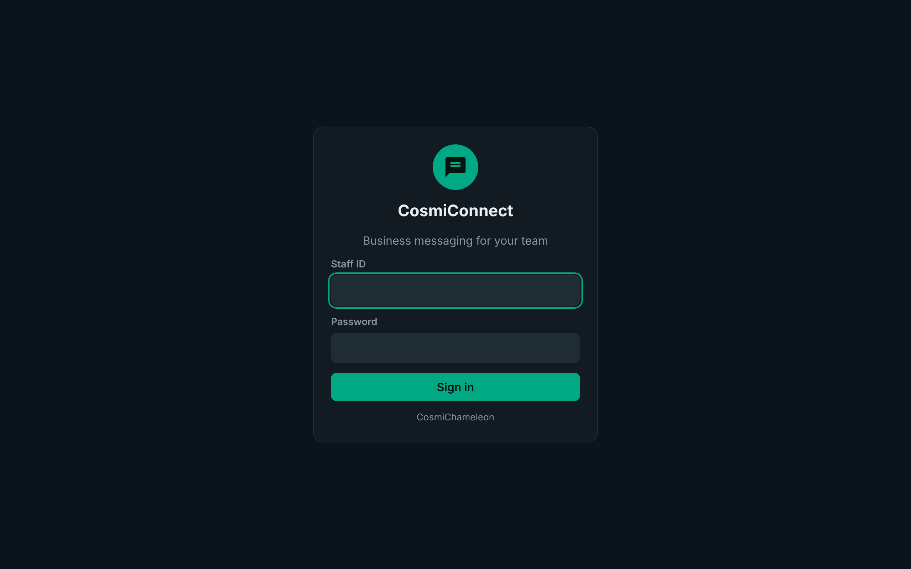
Brand name and company come from `web/src/brand.ts`. One message is shown for a wrong Staff ID and a wrong password, so the form cannot be used to discover which IDs exist (tested).

## 2. The Admin dashboard (Administration console)

### 2.1 Entering it
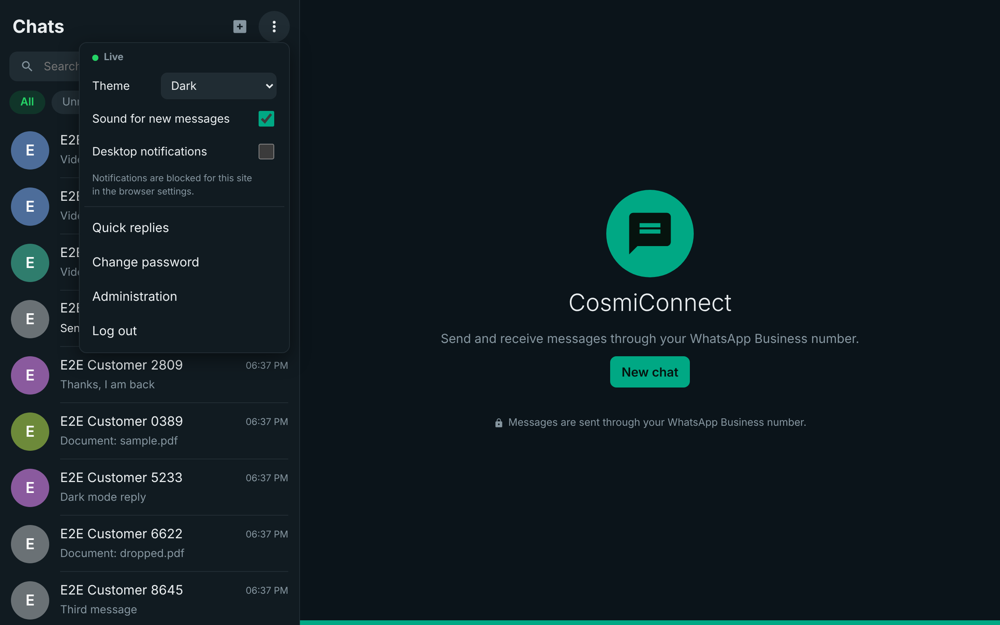
The admin sees the **Administration** item in the ⋮ menu. A client never sees it, and the server refuses the admin functions for anyone who is not an active platform admin (tested over the real API).

### 2.2 Overview
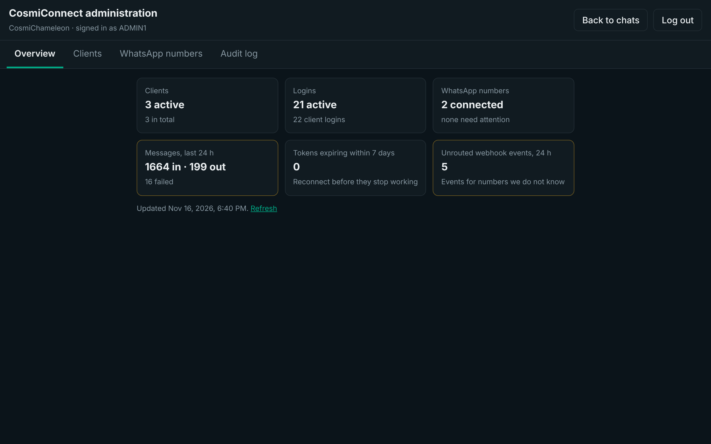
Counts only: clients, logins, connected numbers and those needing attention, messages in the last 24 hours (in, out, failed), tokens expiring within 7 days, and webhook events that arrived for numbers we do not know. The admin **cannot read message content** of other clients through any screen or API.

### 2.3 Clients
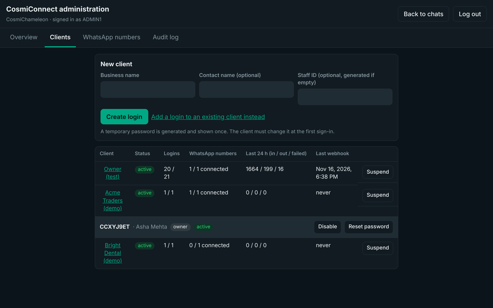
- **New client**: business name, optional contact name, optional Staff ID. A Staff ID such as `CCXYJ9ET` is generated when left empty.
- A client row expands to its logins: **Disable / Enable**, **Reset password**. **Suspend / Reactivate** locks a whole client out at once (reads, sends and webhooks).
- "Add a login to an existing client" supports several staff per client later.

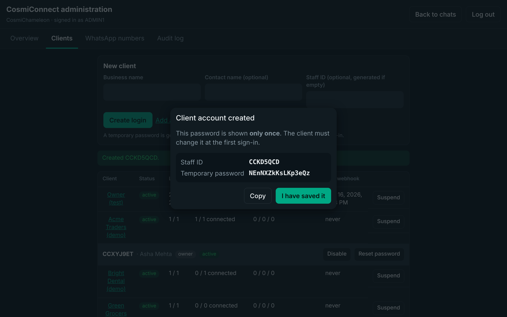
The temporary password is generated on the server (16 characters, no look-alike letters), shown **once**, never stored or logged, and must be replaced at the first sign-in.

### 2.4 WhatsApp numbers
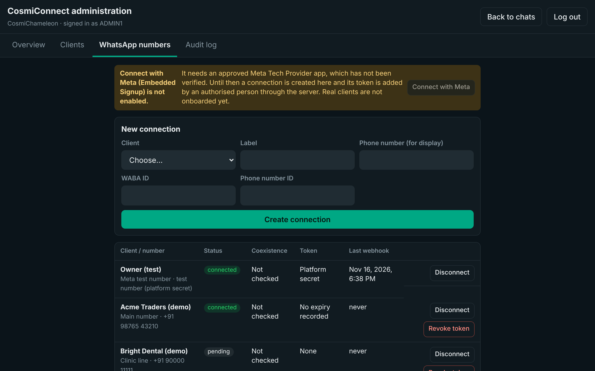
Create a connection for a client, see status, coexistence state (all "Not checked" until Phase 3), token expiry and last webhook, and **Disconnect / Reconnect / Revoke token**. The orange panel is the **Embedded Signup gate**: the "Connect with Meta" button is disabled and the server refuses the call until Meta Tech Provider approval is confirmed.

### 2.5 Audit log
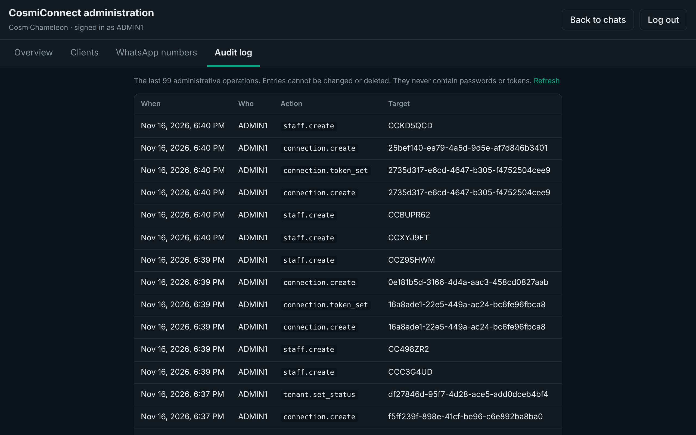
Insert-only record of every administrative action (who, what, which client or number). It never contains a password or token, and nobody, not even the service role, can change or delete rows (tested).

## 3. The Staff (client) dashboard

### 3.1 First sign-in with the temporary password
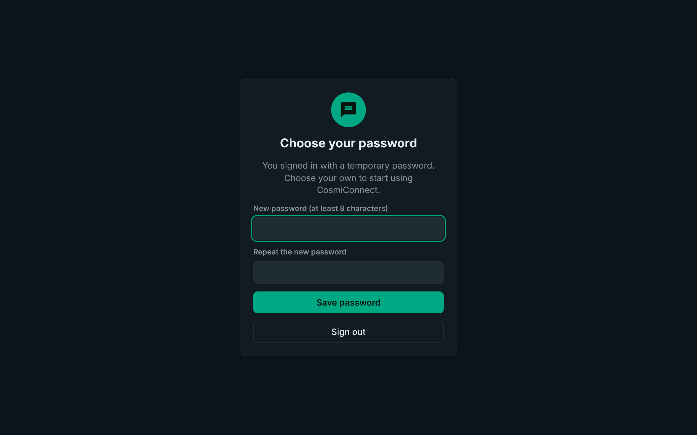

### 3.2 The client's inbox
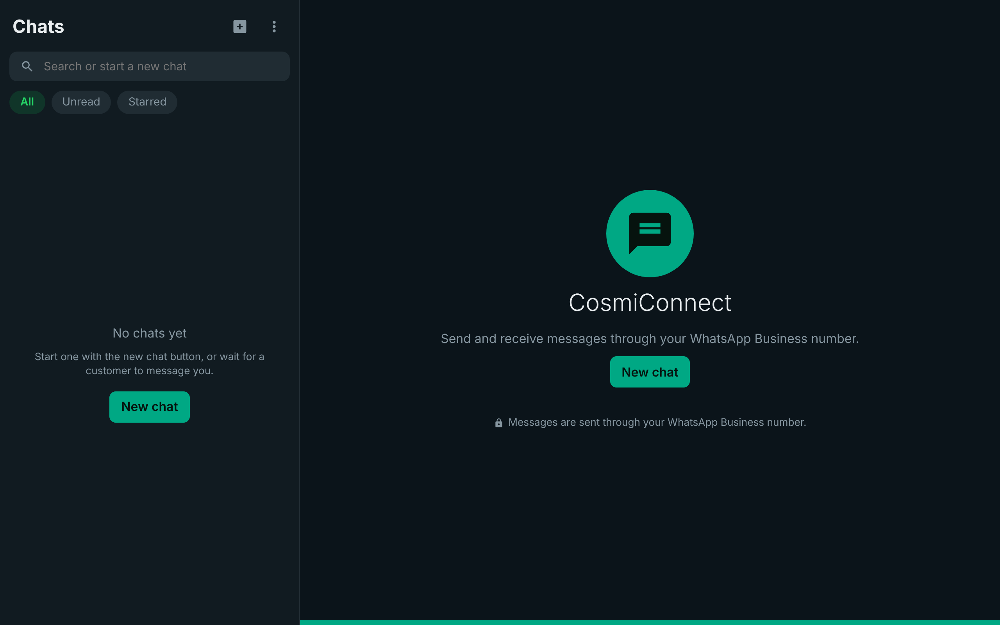
The familiar WhatsApp-style app, but scoped to the client. It starts empty: none of Owner (test)'s hundreds of chats are visible. When the client's number is not connected a small banner says so ("being set up" or "disconnected") without technical detail.

### 3.3 A message arrives for this client's number
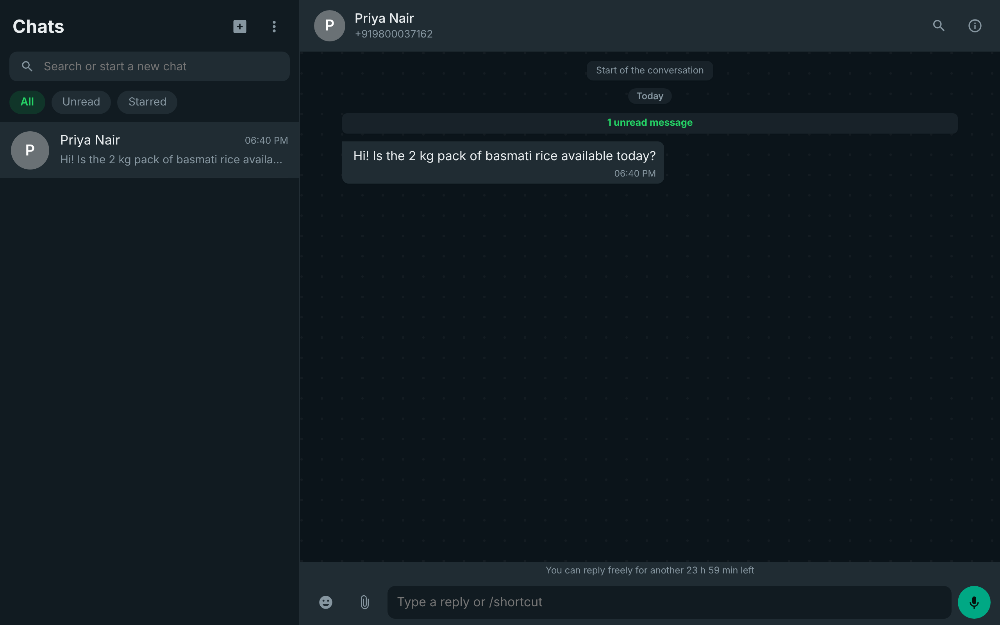
The webhook routed the message by Meta's Phone Number ID to this client's connection; Realtime delivered it only to this client's browser.

### 3.4 On a phone-sized screen
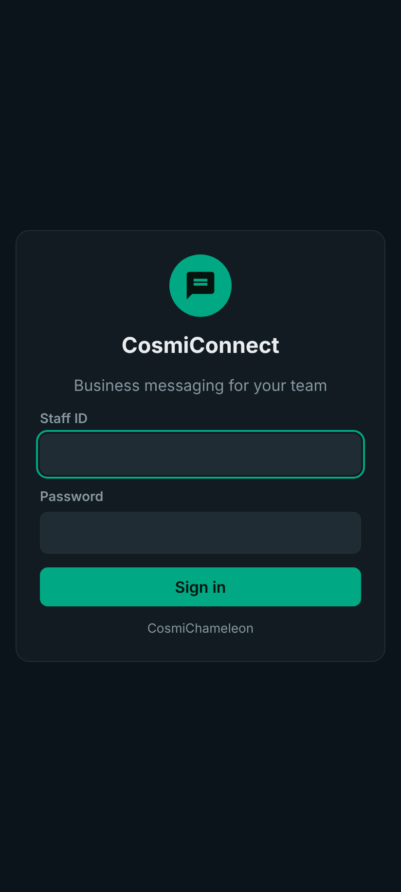 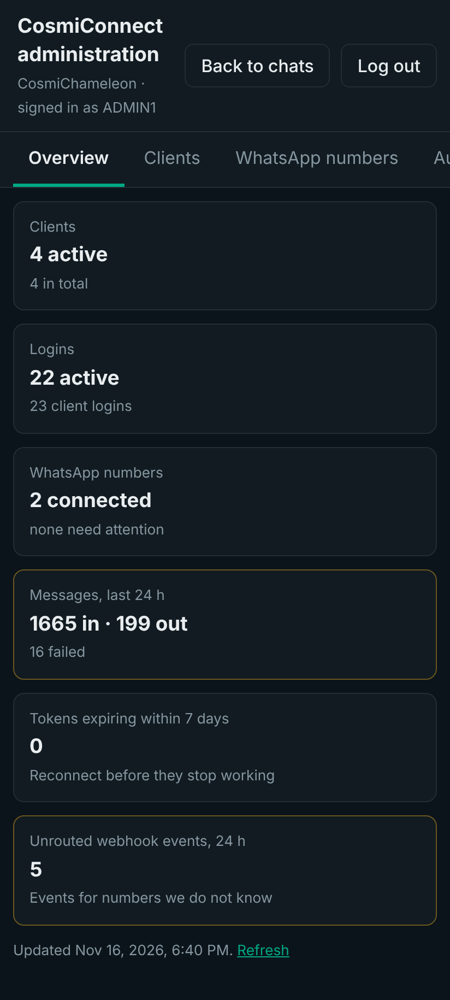 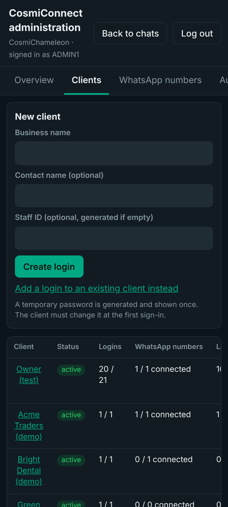

## 4. Client onboarding: the complete flow

### 4.1 What works today (no Meta involvement, test numbers only)

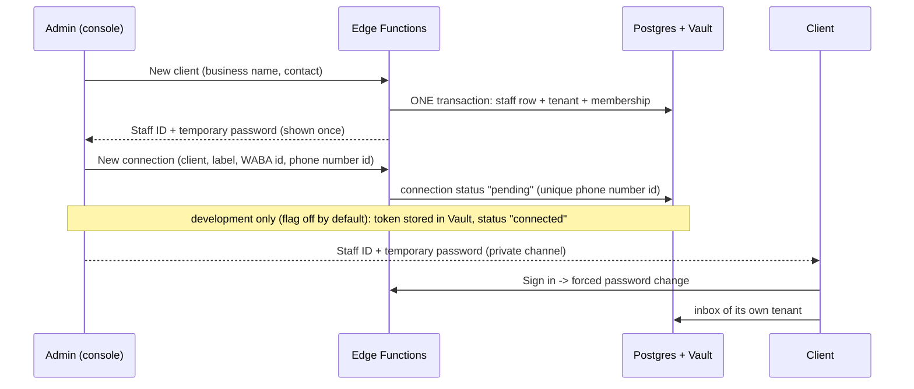

### 4.2 The intended production flow (Phase 3, NOT built, needs Meta approval)

```mermaid
sequenceDiagram
  autonumber
  participant Ad as Admin
  participant EF as Edge Functions
  participant C as Client (business owner)
  participant M as Meta
  participant DB as Postgres + Vault
  Ad->>EF: Create client + connection (pending)
  Ad->>C: Send the onboarding link (HTTPS page or Meta-hosted link)
  C->>M: Embedded Signup v5: log in, choose or verify the number, accept permissions
  Note over C,M: Business-app number -> Coexistence offered automatically: verification code, "Connect", choose to share chat history
  M-->>EF: session info (phone number id, Messaging account id, is_on_biz_app) and token code
  EF->>M: exchange code for the CLIENT's business token (server side, app secret)
  EF->>DB: token to Vault, ids to the connection
  EF->>M: subscribe the client's Messaging account to our app
  EF->>M: coexistence: request contacts sync, then history sync (24-hour window)
  M-->>EF: webhooks: account_update, smb_app_state_sync, history, smb_message_echoes
  EF->>DB: connection "connected"; contacts and history stored under that client only
  Ad-->>C: "You are connected" (the client signs in and starts messaging)
```
The client never sends us a Meta password, an App Secret or a token. A phone number alone can never produce a token: the client must authorise their own WhatsApp Business assets in Meta's flow. Real clients cannot be onboarded until [the blockers](REAL_CLIENT_ONBOARDING_READINESS.md) are cleared.

## 5. How WhatsApp connections are isolated between clients

### 5.1 The demonstration
Two demo clients were created, each with its **own connection** (different Phone Number ID and WABA ID, its own Vault token). The **same customer phone number** then wrote to both numbers:

| Client A (Acme Traders) | Client B (Bright Dental) |
| --- | --- |
|  | 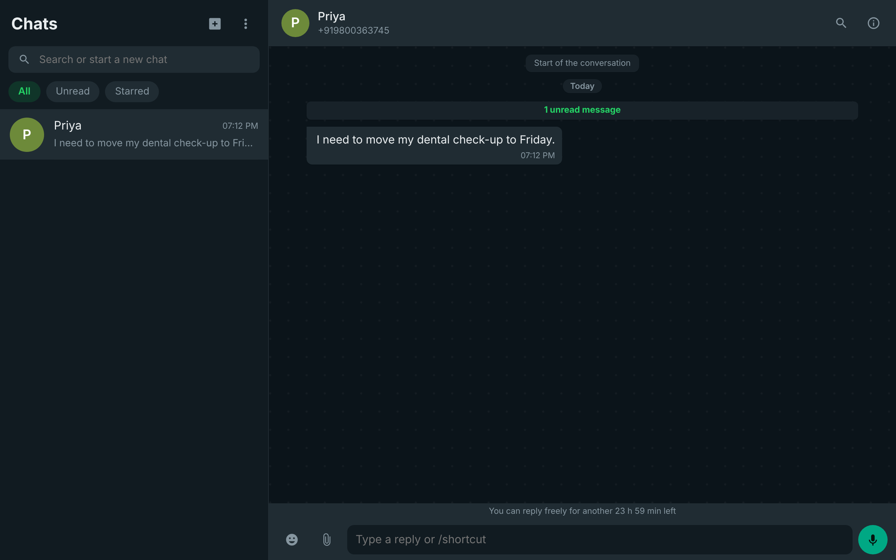 |
| Sees "Is the 2 kg basmati rice pack in stock today?" | Sees "I need to move my dental check-up to Friday." |

Client A then opened a link to **client B's conversation id**:

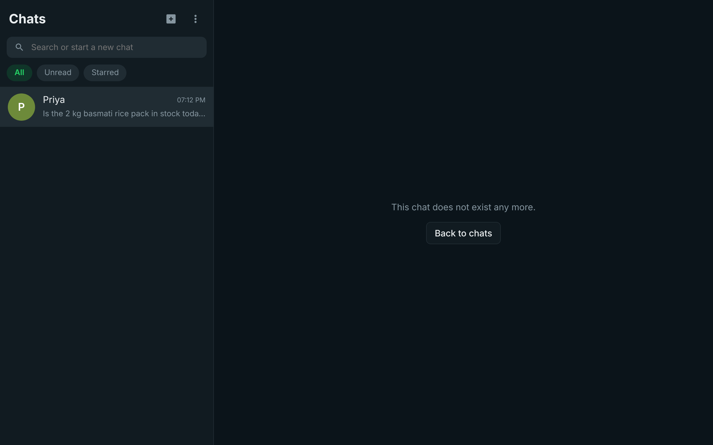

The app answers "This chat does not exist any more": another client's chat is indistinguishable from a missing one.

### 5.2 Why it holds: seven independent layers
1. **Routing:** the webhook trusts only the signed request, then maps `metadata.phone_number_id` (+ `entry.id` as the WABA id) to exactly one connection. The tenant comes from that connection, never from the message.
2. **Database constraints:** a chat's connection must belong to the chat's tenant, and a message's tenant must equal its chat's (composite foreign keys). A phone number id can exist only once on the platform.
3. **Row level security:** every read is filtered by `tenant_id in current_tenant_ids()`, where the tenant is derived from the signed-in user in the database.
4. **No trusted client input:** no function takes a tenant id from the app; other tenants' resources answer "not found".
5. **Tokens:** one Vault secret per connection; only the Edge Functions can decrypt it; sending uses the token of the *conversation's* connection.
6. **Storage and Realtime:** files are readable only through a message of your own tenant; live events are filtered by the same policies (tested: nothing, not even an empty event, reaches another client).
7. **Ownership checks on updates:** a delivery status or reaction is applied only if the message belongs to the connection that reported it; a message id replayed on another number is ignored.

### 5.3 Evidence (all run locally)
| Evidence | Result |
| --- | --- |
| SQL suite, two tenants plus disabled, suspended, tenant-less, anonymous and admin logins | 92 / 92 |
| Real-HTTP script (REST, RPC, Storage, Realtime, Edge Functions with real logins) | 100 / 100, including 24 named REST/RPC attack checks plus storage, send and Realtime attacks |
| Deno tests of the webhook routing and the send/mark-read tenant checks | 134 / 134 in total |
| Browser test: new client sees 0 conversations, 0 messages, 1 tenant, 0 audit rows; admin API refused | passes on desktop and phone |
Details and the list of attacks: [MULTI_TENANT_SECURITY.md](MULTI_TENANT_SECURITY.md). Weak spots found in the review: [MIGRATION_AND_POLICY_REVIEW.md](MIGRATION_AND_POLICY_REVIEW.md).
