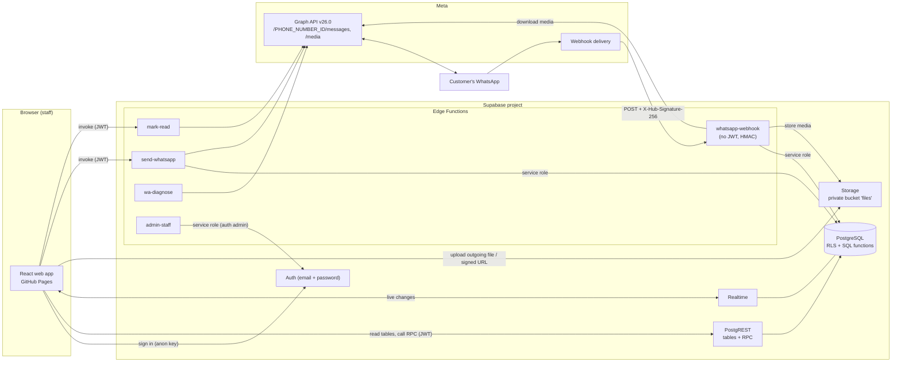
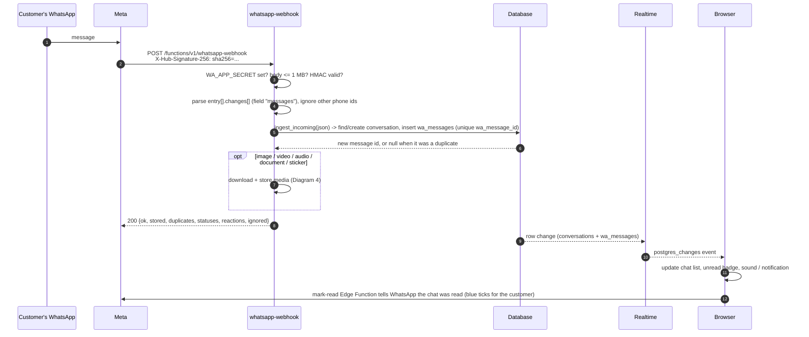

# System architecture

> **Phase 2 notice (2026-11-16):** this document describes single-tenant architecture. Since Phase 2 the system is multi-tenant; read MULTI_TENANT_ARCHITECTURE.md first.


> Status labels: see [README.md](README.md#status-labels-used-in-all-documents).
> Detailed documents: [Frontend](FRONTEND_DOCUMENTATION.md) · [Backend](BACKEND_DOCUMENTATION.md) ·
> [Database](DATABASE_DOCUMENTATION.md) · [WhatsApp API](WHATSAPP_API_INTEGRATION.md) · [Webhook](WEBHOOK_DOCUMENTATION.md)

## 1. The parts

| Part | Where it lives | Technology | Job |
| --- | --- | --- | --- |
| **Web app** | `web/` → built and served by GitHub Pages | React 19, TypeScript, Vite, plain CSS, `@supabase/supabase-js` | The WhatsApp-Web-style interface. Runs entirely in the browser. Uses only the *public* anon key. |
| **Supabase Auth** | Hosted Supabase project | GoTrue (email + password) | Logs the user in and issues a JWT. Public sign-up is off. |
| **Supabase Database** | Hosted Supabase project | PostgreSQL 17, Row Level Security | Stores chats, messages, per-user flags. Business rules live in SQL functions. |
| **Supabase Realtime** | Hosted Supabase project | `postgres_changes` over WebSocket | Pushes new/changed rows to the browser. |
| **Supabase Storage** | Hosted Supabase project | Private bucket `files` | Stores photos, videos, audio, documents. Served only through short-lived signed URLs. |
| **Edge Functions** | `supabase/functions/` | Deno / TypeScript | `whatsapp-webhook`, `send-whatsapp`, `mark-read`, `admin-staff`, `wa-diagnose`. The only code that holds the WhatsApp token. |
| **Meta Cloud API** | Meta (Graph API v26.0) | HTTPS + webhooks | Sends/receives the actual WhatsApp messages. |
| **GitHub Actions** | `.github/workflows/deploy-web.yml` | Node 22 | Builds `web/` and publishes it to GitHub Pages on every push to the branch. |

**Trust boundaries.** The browser is untrusted: it can only read tables through row level security and call named
SQL functions or Edge Functions. The Edge Functions use the Supabase *service role* and the WhatsApp secrets, which
exist only as Supabase secrets, never in the web code or in git ([SECURITY_DOCUMENTATION.md](SECURITY_DOCUMENTATION.md)).

## 2. Diagram 1 - Overall architecture



**Step by step.** (1) The browser loads the static site from GitHub Pages and signs in against Supabase Auth with the
public anon key. (2) With the returned JWT it reads tables (allowed by row level security) and calls SQL functions
through PostgREST, and subscribes to Realtime. (3) To send a message it calls the `send-whatsapp` Edge Function, which
validates everything, stores the message, and calls Meta's Graph API. (4) Customers' messages travel from WhatsApp to
Meta, which POSTs them to `whatsapp-webhook`; the function verifies the signature, writes to the database (and
downloads media from Meta into Storage). (5) The database change reaches the browser through Realtime.

## 3. Frontend architecture (summary)

No router library and no state library: hash routes (`#/c/<conversation id>`), React hooks, and Supabase Realtime.
Data hooks: `useInbox` (chat list, unread counts, per-user flags, previews) and `useMessages` (one chat's messages).
Both use `useLiveChannel`, which keeps a Realtime subscription alive and **reloads data after every reconnect**.
Details: [FRONTEND_DOCUMENTATION.md](FRONTEND_DOCUMENTATION.md).

## 4. Backend architecture (summary)

Each Edge Function has the same shape: `index.ts` wires real dependencies, `handler.ts` holds the logic as a function
of injected dependencies (store, fetch, clock), so the 90 Deno tests run without network or Supabase. Shared code is
in `supabase/functions/_shared/` (`http.ts`, `graph.ts`, `media.ts`, `wa_errors.ts`, `env.ts`, `supabase_store.ts`).
Details: [BACKEND_DOCUMENTATION.md](BACKEND_DOCUMENTATION.md).

## 5. Database and storage architecture (summary)

Six tables (`staff`, `conversations`, `wa_messages`, `conversation_reads`, `message_flags`, `quick_replies`), all with
row level security and **read-only** access for logged-in users; all writes go through `SECURITY DEFINER` SQL functions
or Edge Functions. One private bucket `files` with folders `incoming/<customer>/…` (written by the webhook) and
`outgoing/<user id>/…` (uploaded by the browser). Details: [DATABASE_DOCUMENTATION.md](DATABASE_DOCUMENTATION.md).

## 6. Authentication architecture (summary)

Supabase Auth email + password. The interface asks only for a password and signs in as one fixed address
(`OWNER_EMAIL` in `web/src/lib/api.ts`). A matching row in `staff` (not disabled) is required for any data access
(`is_active_staff()`). See Diagram 7.

## 7. Diagram 2 - Outgoing message flow

```mermaid
sequenceDiagram
  autonumber
  participant U as Browser (Composer)
  participant S as Storage (files)
  participant F as send-whatsapp
  participant D as Database
  participant M as Meta Graph API
  participant C as Customer's WhatsApp

  opt message has a file
    U->>S: upload raw bytes to outgoing/<user id>/<uuid>.<ext>
  end
  U->>F: invoke {conversation_id, text | media_path | template | reaction, reply_to?} + JWT
  F->>F: verify JWT (auth.getUser), staff row not disabled
  F->>F: validate input, 24-hour window, rate limit (20/min), file type/size
  F->>D: create_outgoing(...) -> row status "sending"
  alt WA_DRY_RUN = true
    F->>F: fake id "wamid.DRYRUN.<uuid>" (no call to Meta)
  else real
    F->>S: signed URL (10 min) or download for upload mode
    F->>M: POST /<PHONE_NUMBER_ID>/messages (retry 3x on 429/5xx)
    M-->>F: {messages:[{id: wamid...}]} or error
  end
  F->>D: update row -> "sent" + wa_message_id, or "failed" + mapped reason
  F-->>U: {message: row} (HTTP 200) or {error, code, message} (HTTP 502 when Meta refused)
  M->>C: deliver
  Note over D,U: later status webhooks update the row; Realtime pushes it to the UI
```

**Explanation.** The row is stored *before* the call to Meta so the UI can show "Sending…" and so a failure is
visible and permanent. Meta's answer only means "accepted"; delivery is reported later (Diagram 5). Error codes from
Meta are translated to readable sentences in `_shared/wa_errors.ts` ([WHATSAPP_API_INTEGRATION.md](WHATSAPP_API_INTEGRATION.md)).

## 8. Diagram 3 - Incoming message flow



**Explanation.** Meta must get a fast `200`. A *database* failure returns `500` so Meta retries (duplicates are
ignored by the unique `wa_message_id`); a *media* failure never fails the webhook - the message row is kept with a
readable error. Full details: [WEBHOOK_DOCUMENTATION.md](WEBHOOK_DOCUMENTATION.md).

## 9. Diagram 4 - Media upload and download flow

```mermaid
flowchart TB
  subgraph IN["Incoming media (customer to app)"]
    I1["Webhook receives message with media id + mime type"] --> I2["Check mime allowed for this message type"]
    I2 --> I3["GET graph/<media id> with WA_TOKEN -> {url, file_size}"]
    I3 --> I4["GET url with WA_TOKEN (valid ~5 min)"]
    I4 --> I5{"size <= 16 MB?"}
    I5 -- yes --> I6["Upload to Storage: incoming/<customer>/<message id>.<ext>"]
    I6 --> I7["wa_messages.media_path + media_size set"]
    I5 -- no --> I8["row kept, error 'File is larger than 16 MB'"]
  end
  subgraph OUT["Outgoing media (app to customer)"]
    O1["Browser validates type + size (photo 5 MB, others 10 MB)"] --> O2["Upload raw bytes to Storage: outgoing/<user id>/<uuid>.<ext>"]
    O2 --> O3["send-whatsapp re-checks path, type, size"]
    O3 --> O4{"WA_MEDIA_MODE"}
    O4 -- "link (default)" --> O5["10-minute signed URL given to Meta"]
    O4 -- upload --> O6["POST /<PHONE_NUMBER_ID>/media then send by media id"]
  end
  subgraph SHOW["Showing a file in the browser"]
    S1["MessageBubble asks Storage for a 1-hour signed URL"] --> S2["img / video / audio / link uses the URL"]
  end
```



**Explanation.** Files never become public: the bucket is private and every view uses a signed URL created for the
logged-in user (the Storage policy `files_staff_read` allows only active staff). Meta's media URLs need the bearer
token, so the webhook (server side) downloads them. Details: [MESSAGE_AND_MEDIA_DOCUMENTATION.md](MESSAGE_AND_MEDIA_DOCUMENTATION.md).

## 10. Diagram 5 - Message status update flow

```mermaid
sequenceDiagram
  autonumber
  participant M as Meta
  participant H as whatsapp-webhook
  participant D as Database
  participant R as Realtime
  participant U as Browser

  M->>H: POST {statuses:[{id: wamid, status: sent|delivered|read|played|failed, errors?}]}
  H->>H: signature check, status in the allowed set
  H->>D: apply_message_status(wamid, status, error)
  Note over D: only moves forward: sending -> sent -> delivered -> read -> played;<br/>failed only from sending or sent
  D-->>H: true if a row changed (false = ignored)
  D-->>R: UPDATE wa_messages
  R-->>U: event -> tick icon changes (clock, one tick, two ticks, blue ticks, red mark)
```

**Explanation.** Meta can deliver statuses out of order or twice; the SQL function makes the update safe to repeat
and prevents going backwards. Failures store a staff-readable reason (`staffMessage(code, detail)`). Statuses keep
working on messages a user deleted for themself (tested, [MESSAGE_DELETION_DOCUMENTATION.md](MESSAGE_DELETION_DOCUMENTATION.md)).

## 11. Diagram 6 - Message deletion flow ("Delete for me")

```mermaid
sequenceDiagram
  autonumber
  participant U as User
  participant UI as MessageBubble / ConversationPane
  participant I as useInbox
  participant P as PostgREST (RPC)
  participant D as Database (message_flags)

  U->>UI: three-dot menu -> "Delete for me"
  UI->>U: dialog "Delete message?" (Cancel / Delete for me)
  U->>UI: confirm
  UI->>I: deleteForMe(message id)
  I->>P: rpc delete_message_for_me(p_message_id) + JWT
  P->>D: checks is_active_staff() and that the message exists
  D->>D: upsert message_flags(user_id = auth.uid(), message_id, hidden = true, hidden_at = now())
  D-->>I: ok
  I->>I: set flags[message].hidden = true, reload visible_last_messages()
  I-->>UI: message disappears; notice "Message deleted." with Undo
  U->>UI: Undo -> rpc restore_message_for_me
  Note over D: wa_messages row, its status and its file in Storage are never touched.<br/>Nothing is sent to WhatsApp. Other users still see the message.
  opt "Delete for everyone"
    UI->>U: explains: not supported by the Cloud API (no call is made)
  end
```

Full explanation: [MESSAGE_DELETION_DOCUMENTATION.md](MESSAGE_DELETION_DOCUMENTATION.md).

## 12. Diagram 7 - Authentication flow

```mermaid
sequenceDiagram
  autonumber
  participant U as User
  participant W as Web app (LoginPage)
  participant A as Supabase Auth
  participant D as Database (RLS)
  participant F as Edge Function

  U->>W: types the password
  W->>A: signInWithPassword(email = OWNER_EMAIL, password)
  A-->>W: session {access JWT (1 h), refresh token}
  W->>W: supabase-js keeps the session (browser storage) and refreshes it
  W->>D: select * from staff where user_id = me
  D-->>W: staff row (not disabled) -> app opens; otherwise "Login not active"
  W->>D: table reads / RPC with the JWT -> RLS: is_active_staff()
  W->>F: functions.invoke(...) with the JWT
  F->>A: auth.getUser(jwt) using the service-role client
  F->>D: staff row exists and not disabled (and role = admin for admin-staff / wa-diagnose)
  Note over W,A: Public sign-up is disabled on the hosted project.
  U->>W: "Change password" -> auth.updateUser; "Log out" -> signOut
```

**Explanation.** There is no password list in the code: the one fixed email is a constant and the password lives
only in Supabase Auth. Disabling a staff row blocks data access immediately (RLS) and the `admin-staff` function also
bans the auth user so the token cannot be refreshed. Details: [SECURITY_DOCUMENTATION.md](SECURITY_DOCUMENTATION.md).

## 13. Where each concern lives (quick map)

| Concern | Files |
| --- | --- |
| Screens and interaction | `web/src/components/*.tsx`, `web/src/styles.css` |
| Data loading and realtime | `web/src/hooks/useInbox.ts`, `useMessages.ts`, `useLiveChannel.ts` |
| All backend calls from the browser | `web/src/lib/api.ts` (single place) |
| Sending | `supabase/functions/send-whatsapp/handler.ts` |
| Receiving | `supabase/functions/whatsapp-webhook/handler.ts` |
| Read receipts / typing | `supabase/functions/mark-read/handler.ts` |
| Health check | `supabase/functions/wa-diagnose/index.ts` |
| Schema and SQL functions | `supabase/migrations/*.sql` (mirrored in `whatsapp_setup.sql`) |
| Deployment of the site | `.github/workflows/deploy-web.yml` |
