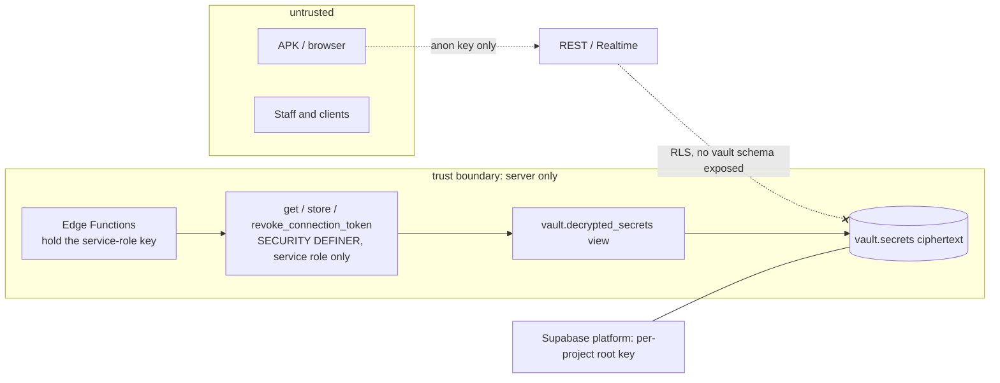

# Vault security boundary and token recovery strategy

> Replaces the "Unverified (U)" notes in [MULTI_TENANT_SECURITY.md](MULTI_TENANT_SECURITY.md) section 8 with statements **read from Supabase's documentation on 2026-11-16** (`supabase.com/docs/guides/database/vault`, `.../platform/backups`, `.../platform/migrating-within-supabase/*`). Where a point is still not from a source it is marked **Unverified**.
> Status labels: see [README.md](README.md#status-labels-used-in-all-documents). Related: [BACKUP_AND_ROLLBACK_PLAN.md](BACKUP_AND_ROLLBACK_PLAN.md) · [MULTI_TENANT_ARCHITECTURE.md](MULTI_TENANT_ARCHITECTURE.md)

## 1. What Vault is, per Supabase

| Statement (Supabase docs) | Consequence for us |
| --- | --- |
| Secrets are stored with **Authenticated Encryption with Associated Data** (libsodium). They are encrypted and signed, so a value copied between rows is rejected. | A stolen table dump shows only ciphertext. |
| Decrypted values exist only in the `vault.decrypted_secrets` **view**, computed at query time; "any backups or replication streams also preserve this encryption". | Database backups never contain plaintext tokens. |
| "The encryption key is **never stored in the database** alongside the encrypted data." | A database dump alone cannot be decrypted. |
| "Supabase creates and manages a **unique encryption key for each project**" in its secured backend. The Management API pgsodium endpoint **returns the project's 64-character hex root key**, so you can copy it to another project. It works only for **active** (not paused or removed) projects. | The key can be backed up by the owner, deliberately. |
| "You should ensure that you protect access to this view with the appropriate SQL privilege settings at all times, as anyone that has access to the view has access to decrypted secrets." | See the boundary below. |
| The extensions list marks **pgsodium "pending deprecation"**. | The mechanism underneath Vault may change; re-check at every Supabase upgrade. |

## 2. The boundary, exactly

| Who | Can read a token? | Why |
| --- | --- | --- |
| Browser, APK, any client login, **platform admin** | **No** | No grant on `vault`, no EXECUTE on the token functions (tested); the Vault reference column is not readable either; the REST API does not expose the `vault` schema (tested: HTTP 406) |
| Edge Functions with the service-role key | **Yes, deliberately**, in memory, for one request | Calls `get_connection_token` |
| Anyone holding the service-role key outside Edge Functions | **Yes** | **The limit**: the platform itself grants `service_role` SELECT on the Vault views, and only the platform role `supabase_admin` could revoke it (a migration cannot; verified: the revoke was a silent no-op) |
| Supabase platform staff / someone who obtains the root key and a dump | Yes | Inherent in managed encryption |

**Therefore:** the service-role key is the crown jewel. It exists only in Edge Functions and the platform, never in the browser, the APK, GitHub or a chat. If it is ever exposed: rotate it, then treat every stored token as exposed and rotate them (re-onboard or revoke in Meta).

## 3. Lifecycle controls (implemented, tested locally)
- **One secret per connection** (`wa_conn_<connection id>`); the connection row stores only the secret's id, and that column is invisible to every login.
- **Rotation:** `store_connection_token` updates the secret in place (old value gone at once).
- **Disconnect / revoke:** the secret is **deleted**; the connection survives without a token. Revocation of the token at Meta is a separate step the admin must also take if a leak is suspected.
- **Audit:** who stored, rotated, disconnected or revoked, never the token.
- **Expiry:** `token_expires_at` is shown; automatic polling is Phase 3. Meta's own configuration template is named "...With 60 Expiration Token", which suggests a token lifetime that must be handled; the actual lifetime of business tokens is set by the Facebook Login for Business configuration and was **not verified**: Phase 3 must read it from `debug_token` rather than assume.

## 4. Recovery strategy

The principle: **a client token is re-obtainable, so Vault is never the only copy of anything that cannot be recreated.**

| Scenario | What happens to tokens | What to do |
| --- | --- | --- |
| Normal operation, daily backup, same-project restore, **PITR**, pause/restore | Same project key: tokens decrypt automatically (Supabase docs) | Nothing |
| "Restore to a new project" (Dashboard) or **branching** | Supabase copies the key to the new project (docs) | Verify one `get_connection_token` through an Edge Function health check |
| **Manual `pg_dump` / `pg_restore` to a new project** (or `supabase db dump`) | New project has a **fresh key**: copied secrets **cannot be decrypted** (docs) | Copy the root key from the old project to the new one **before** relying on the data, using the Management API pgsodium endpoint (docs give the `GET` + `PUT` calls). Needs an access token for the old project while it is still active |
| Project **deleted or paused and lost** with no key backup | All stored tokens are unreadable | Mark every connection `error`, then re-onboard each client (they re-authorise through Embedded Signup; we get fresh business tokens). The connection list in the database (non-secret) says who to contact |
| A token is **stolen or leaked** | Attacker can message as that client until revoked | Revoke at Meta, then `revoke` in the console (secret deleted), then reconnect for a new token |
| `WA_TOKEN` (the owner's own legacy test number) | Not in Vault: a Supabase secret | Keep the permanent token in a password manager; replace the secret when it expires |

### 4.1 Should we back up the root key?
**Recommendation: yes, once the first real client token is stored, and not before.** It is as sensitive as every token together: keep it offline (password manager with access limited to the owner and one named deputy, or a sealed escrow), **never** in git, chat, a Supabase secret or the app. Record the date. Re-fetch it after any platform change that Supabase announces for pgsodium/Vault. Until then (no client tokens exist) there is nothing to protect.

### 4.2 Drills (do them once before real clients)
1. Create a scratch project, restore a backup into it with **Restore to a new project**, run `get_connection_token` through a test function, and confirm the token decrypts.
2. Repeat with a **manual dump/restore**, copy the root key as documented, and confirm decryption. Delete the scratch project afterwards.
3. Practise the "lost key" runbook on one test connection: revoke, reconnect, send a test message.

## 5. Open items
1. **Which Supabase plan the hosted project uses** (decides daily backups, PITR, and whether the Management API key calls are available): not verified.
2. Whether the hosted project has the Vault extension enabled: not verified.
3. Whether a new business token can be minted for an **already onboarded** client without re-running Embedded Signup: **not verified** (the pages read describe the code exchange only). Plan for re-authorisation.
4. Track the pgsodium deprecation notice; if Vault changes, `get/store/revoke_connection_token` are the only three functions to adapt, by design.
