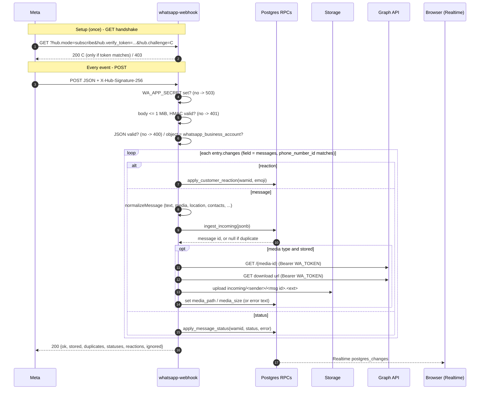

# Webhook documentation

> **Phase 2 notice (2026-11-16):** this document describes the single-number webhook. It now routes by phone_number_id to a tenant connection; see MULTI_TENANT_ARCHITECTURE.md section 5.

> Status labels: see [README.md](README.md#status-labels-used-in-all-documents). Source of truth:
> `supabase/functions/whatsapp-webhook/handler.ts` (read in full for this document).
> Related: [WHATSAPP_API_INTEGRATION.md](WHATSAPP_API_INTEGRATION.md) · [MESSAGE_AND_MEDIA_DOCUMENTATION.md](MESSAGE_AND_MEDIA_DOCUMENTATION.md) ·
> [SECURITY_DOCUMENTATION.md](SECURITY_DOCUMENTATION.md)

## 1. Endpoint

`https://<PROJECT_REF>.supabase.co/functions/v1/whatsapp-webhook`

The function is deployed with **JWT verification off** (Meta cannot send a Supabase login); authentication is the HMAC signature
instead. This is the only public write path into the system.

| Method | Purpose | Auth |
| --- | --- | --- |
| `GET` | One-time subscription handshake when the callback URL is saved in Meta | `hub.verify_token` compared in constant time with `WA_VERIFY_TOKEN` |
| `POST` | Events: incoming messages, reactions, delivery statuses | `X-Hub-Signature-256: sha256=<hex>` = HMAC-SHA256 of the **raw body** with `WA_APP_SECRET` |
| other | - | 405 |

## 2. Request handling, step by step

## 3. Responses

| Case | HTTP | Notes |
| --- | --- | --- |
| Handshake OK | 200 text = challenge | |
| Handshake wrong token / mode | 403 | |
| `WA_APP_SECRET` not configured | 503 | Fail closed; Meta retries |
| Missing/invalid signature | 401 | body is not parsed |
| Body over 1 MiB | rejected before parsing (`readBody`) | |
| Not JSON | 400 | |
| Not a `whatsapp_business_account` object, other fields, unreadable items | 200 with `ignored` counted | Never an error, so Meta does not retry useless events |
| A change set that **cannot be routed** (no Phone Number ID, unknown Phone Number ID, WABA mismatch, connection disconnected/revoked/suspended, legacy bind failed) | 200 with `quarantined` counted; the change set is **kept**, not dropped | Phase 2.1: see section 7 |
| The quarantine itself cannot be written (database down, 20000-event cap) | **500** | Meta retries; the event is not lost |
| Duplicate message | 200, `duplicates` counted | `wa_message_id` is unique |
| Unexpected exception (e.g. database down) | 500 | Makes Meta retry later (Meta's retry schedule is **not verified** here); duplicates are harmless |

Success body example: `{"ok":true,"stored":1,"duplicates":0,"statuses":0,"reactions":0,"ignored":0}`. Log lines contain counts only, never message
text or phone numbers; Meta-reported `errors[]` are logged as codes only.

## 4. Event types handled

| Meta event | Handling | Status |
| --- | --- | --- |
| `messages[]` type `text` | stored, body capped at 8000 chars | Tested locally; **Tested live** (real inbound messages arrived earlier in the project) |
| `image`, `video`, `document`, `audio` (incl. voice), `sticker` | stored, then file downloaded to Storage; failure leaves the message with an `error` note | Tested locally (simulated Meta payloads and a fake Graph); live media download needs a valid `WA_TOKEN` and was only partly exercised |
| `location` | stored with `{latitude, longitude, name, address, url}`; invalid coordinates stored as a text note | Tested locally |
| `contacts` | up to 20 contacts, 5 phones each | Tested locally |
| `interactive` (button/list reply), `button` (template quick reply) | stored as text of the chosen option | Tested locally |
| `reaction` | `apply_customer_reaction`; empty/missing emoji clears it | Tested locally |
| `system`, `unsupported`, orders and unknown types | stored as a bracketed note so staff see something arrived | Tested locally |
| `statuses[]` `sent` / `delivered` / `read` / `played` / `failed` | `apply_message_status` (monotonic; `failed` carries a mapped human-readable reason) | Tested locally; real delivered/read ticks seen live earlier for text |
| `context.id` / `forwarded` | stored as `reply_to_wa_message_id` / `forwarded` | Tested locally |
| `contacts[].profile.name` | customer profile name (never overwrites the saved contact name) | Tested locally |
| Business-scoped user ids (`from_user_id` / `user_id`) | accepted; the message may have no phone number | Tested locally |
| Revoke/edit events (coexistence only), typing, calls, template-status and account events | **not handled** (ignored); fields other than `messages` are dropped | Unsupported by this app |

## 5. Idempotency and ordering

- **Duplicates:** `wa_messages.wa_message_id` is `UNIQUE`; `ingest_incoming` does `ON CONFLICT DO NOTHING` and returns null, so redelivery
  never creates a second row or a second preview/unread bump.
- **Statuses arriving before the message row exists** (possible for outgoing messages whose send response is slow) return "not changed"
  and are counted as `ignored`; they are not queued (a limitation; see [KNOWN_ISSUES_AND_ROADMAP.md](KNOWN_ISSUES_AND_ROADMAP.md)).
- **Out-of-order statuses:** the state machine never moves backwards (`read` after `delivered` is fine; `delivered` after `read` is ignored).
- Events are processed sequentially in one request; a media failure never fails the request.

## 6. Verification checklist (no secrets needed)

| Check | How | Result in this audit |
| --- | --- | --- |
| Callback URL equals the deployed function | admin `wa-diagnose` | matched (Tested live) |
| `messages` field subscribed | `wa-diagnose` + Meta UI | subscribed (Tested live) |
| WABA subscribed to the app | `wa-diagnose` | yes (Tested live) |
| Bad signature rejected | `scripts/simulate-bad-signature.mjs`, Deno tests | 401 (Tested locally) |
| Duplicate ignored | `scripts/simulate-duplicate.mjs`, Deno tests | Tested locally |
| Signed simulated message stored | `scripts/simulate-incoming.mjs` (needs the app secret in the environment; it is never printed) | Tested locally |
| GET handshake | `scripts/verify-webhook.mjs` | Tested locally |

Not re-run in this documentation session (documentation only; no calls were made that could change data).

## 7. Routing, quarantine and replay (Phase 2.1; local only, not deployed)

Routing key: the **Phone Number ID** in `value.metadata.phone_number_id`, resolved to a connection (and so a tenant) by the database; the entry's WABA id must match the connection's. The legacy test number binds on its first webhook when it equals the `WA_PHONE_ID` secret.

| Reason (ledger and quarantine) | Meaning | What to do |
| --- | --- | --- |
| `no_phone_number_id` | the change set had no Phone Number ID | inspect with Meta; nothing to replay |
| `unknown_phone_number_id` | no connection owns that number | attach the number to the right client in the admin console, then **Replay** |
| `waba_mismatch` | the connection exists but belongs to another WABA | fix the connection's WABA, then Replay |
| `connection_inactive` | connection disconnected/revoked/pending | reconnect, then Replay |
| `tenant_suspended` | the client is suspended | reactivate within 7 days, then Replay |
| `legacy_bind_failed` | the event matches `WA_PHONE_ID` but binding the legacy connection failed | **ALERT** log line: check the database and the secret |

* Every change set gets an `event_id`; the ledger row (`webhook_events`) carries `outcome`, `reason`, `event_id`, `quarantine_id`. The structured log line has the same ids and reason and **never** message text, customer numbers, tokens or payloads (tested).
* `webhook_quarantine` is readable by the **service role only**; payloads expire after **7 days**, ledger rows after **30 days** (best-effort hourly purge); a payload is erased as soon as its replay succeeds. Pending cap 20000.
* **Admin Webhooks tab** (`admin_routing_diagnostics()`): counts, reasons, unknown Phone Number IDs and connection health, metadata only. **Replay** calls `webhook-replay` (active admin without a pending password change): events go through the same code path as live ones, so they land in the tenant that now owns the number, duplicates are harmless.
* Tests: Deno (routing for two Phone Number IDs, every reason, replay, log content, 500 on quarantine failure), SQL (`phase21_security.sql`), real HTTP (`verify-multi-tenant-local.mjs`).
